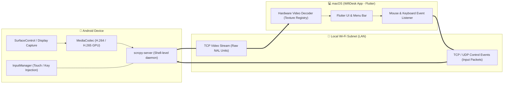

# ⚡️ WifiDesk

<p align="center">
  <b>Silky-smooth, zero-latency Android screen mirroring and remote control for macOS over local Wi-Fi.</b>
</p>

<p align="center">
  <a href="https://github.com/az-coder-123/wifi-desk/blob/main/LICENSE"></a>
  <a href="https://flutter.dev"></a>
  <a href="https://github.com/az-coder-123/wifi-desk/releases"></a>
  <a href="https://github.com/az-coder-123/wifi-desk/pulls"></a>
</p>

---

## 📖 Overview

**WifiDesk** is an open-source desktop application crafted with **Flutter Desktop** for **macOS**. 

It allows users to **wirelessly mirror an Android device screen onto a Mac and seamlessly interact with it using a mouse and keyboard over a local Wi-Fi network**—delivering glass-to-glass latency under 30ms and high refresh rates up to 60–120 FPS.

WifiDesk bridges two core principles:
1. **Unrivaled Performance:** Powered by the robust, hardware-accelerated `scrcpy-server` engine (H.264/H.265 GPU encoding).
2. **Native macOS Polish:** Packaged inside a modern, refined Apple-native interface crafted with Flutter.

---

## ✨ Key Highlights

- 🚀 **Sub-30ms Glass-to-Glass Latency:** Hardware-accelerated GPU capture and encoding directly on the Android device; streaming raw NAL units over a local TCP socket.
- 📶 **Zero-Config Wi-Fi Pairing:** Automated mDNS device discovery on your local network, with one-click pairing for Android 11+ Wireless Debugging (QR code / pairing PIN).
- 🖱️ **Fluid Remote Input:** Precise mouse gestures, natural trackpad inertial scrolling, and direct international keyboard input (including full Unicode and IME support).
- 🍎 **Mac-First Productivity:**
  - **Bidirectional Clipboard Sharing:** Instant synchronization between macOS pasteboard (`Cmd + C`) and the Android system clipboard.
  - **Drag & Drop Transfers:** Drag images, videos, and documents directly from Finder to push files or sideload `.apk` packages.
  - **Screen-Off Streaming:** Automatically powers off the physical phone screen during mirroring sessions to preserve battery life and prevent thermal throttling.
  - **Menu Bar Companion:** Quick-access status bar icon for toggling device windows and monitoring battery/Wi-Fi health.
- 🔒 **100% Private & P2P:** Audio, video, and control streams are routed strictly across your local Wi-Fi subnet without external servers, tracking, or cloud proxies.
- 💸 **Truly Free & Open Source:** Zero advertising, zero analytics trackers, and no recurring subscriptions.

👉 *For detailed technical specifications, visit [docs/features.md](docs/features.md).*

---

## 🏗️ Architecture



👉 *For the full modular blueprint and design patterns, see [docs/architecture.md](docs/architecture.md).*

---

## 🛠️ Technology Stack

- **User Interface (Frontend):** [Flutter Desktop](https://flutter.dev) (Dart) for macOS.
- **State Management:** [flutter_bloc](https://pub.dev/packages/flutter_bloc) (Cubit & BLoC).
- **Dependency Injection:** [get_it](https://pub.dev/packages/get_it) Service Locator.
- **Streaming & Control Core:** `scrcpy-server` (Java / C++ running under ADB Shell).
- **Networking:** Native TCP/UDP Sockets, mDNS / Bonjour for service discovery.
- **Video Decoding:** Hardware-accelerated video decoding via macOS VideoToolbox and Flutter Texture Registry.

---

## 🚀 Getting Started

### Prerequisites

- **macOS:** macOS 12 Monterey or later.
- **Flutter SDK:** Flutter 3.x+ with desktop support enabled.
- **Android Device:** Android 5.0+ (Android 11+ recommended for wireless pairing without initial USB tethering).
- **Android Platform Tools (ADB):** Install via Homebrew:
  ```bash
  brew install android-platform-tools
  ```

### Build & Run

```bash
# 1. Clone the repository
git clone https://github.com/az-coder-123/wifi-desk.git
cd wifi-desk

# 2. Fetch dependencies
flutter pub get

# 3. Launch on macOS
flutter run -d macos
```

---

## 🗺️ Roadmap

- [x] Initialized Flutter macOS Desktop project foundation
- [x] Implemented modular Clean Architecture (Core, Discovery, Streaming, Control, Settings)
- [x] Integrated Cubit state management with `flutter_bloc`
- [x] Established Apple-native design tokens & theme system
- [x] Built comprehensive automated test suite (Unit, BLoC, Widget tests)
- [x] Implement mDNS device discovery daemon and pairing assistant
- [x] Integrate low-latency H.264 video pipeline via `scrcpy-server` and Flutter Texture
- [ ] Build mouse and keyboard input translation layer
- [ ] Implement bidirectional clipboard synchronization and drag-and-drop transfers
- [ ] Implement macOS Menu Bar companion and audio forwarding

---

## 🤝 Contributing

Contributions are welcome! Please follow these guidelines:

1. Fork this repository.
2. Create a feature branch: `git checkout -b feature/AmazingFeature`.
3. Commit your changes: `git commit -m 'feat: add AmazingFeature'`.
4. Push to your branch: `git push origin feature/AmazingFeature`.
5. Open a **Pull Request**.

---

## 📄 License

Distributed under the **MIT License**. See [LICENSE](LICENSE) for more information.

<p align="center">
  Maintained with ❤️ by <b><a href="https://github.com/az-coder-123">az-coder-123</a></b>
</p>
