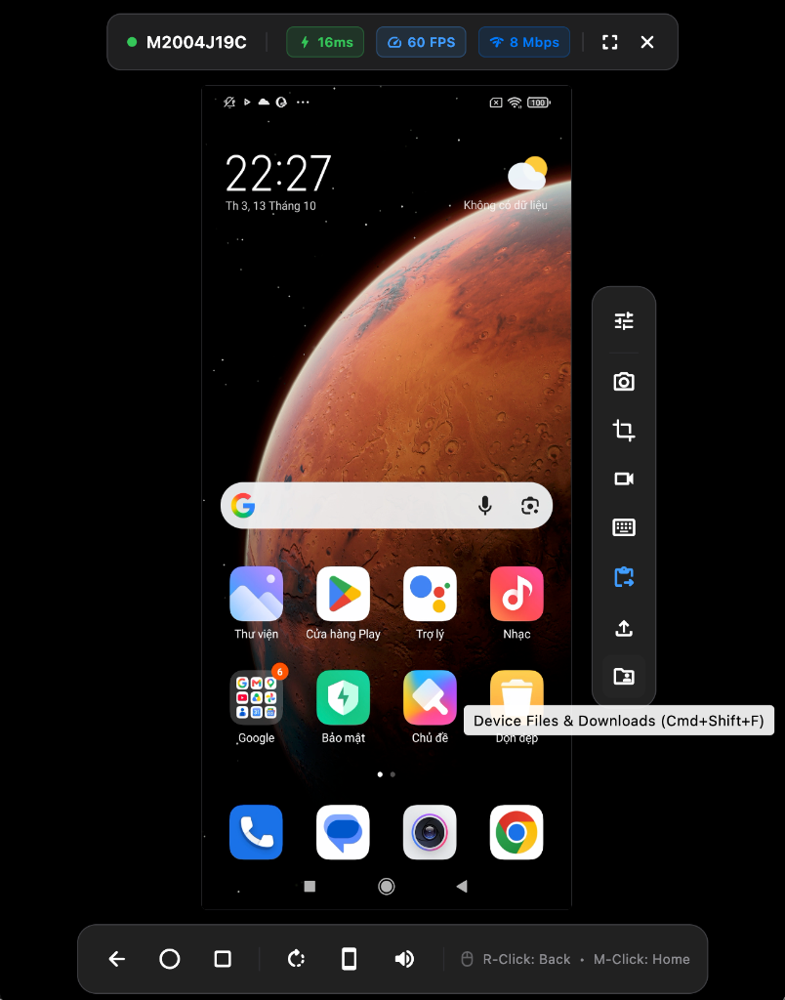

# ⚡️ WifiDesk

<p align="center">
  <b>Silky-smooth, low-latency Android screen mirroring and remote control for macOS over Wi-Fi & USB.</b>
</p>

<p align="center">
  <a href="https://github.com/az-coder-123/wifi-desk/blob/main/LICENSE"></a>
  <a href="https://flutter.dev"></a>
  <a href="https://github.com/az-coder-123/wifi-desk/releases"></a>
  <a href="https://github.com/az-coder-123/wifi-desk/pulls"></a>
</p>

<p align="center">
  
</p>

---

## 📖 Overview

**WifiDesk** is an open-source desktop application crafted with **Flutter Desktop** for **macOS**. 

It enables users to **mirror an Android device screen onto a Mac and seamlessly interact with it using a mouse and keyboard over local Wi-Fi or USB cable**—delivering glass-to-glass latency under 20ms and fluid refresh rates up to 60–120 FPS.

WifiDesk bridges two core principles:
1. **Unrivaled Performance:** Powered by the robust, hardware-accelerated `scrcpy-server` engine (H.264/H.265 GPU encoding).
2. **Native macOS Polish:** Packaged inside a modern, refined Apple-native interface crafted with Flutter.

---

## ✨ Key Highlights

- 🚀 **Sub-20ms Glass-to-Glass Latency:** Hardware-accelerated GPU capture and encoding directly on Android; streaming raw NAL units over a local TCP socket.
- 📶 **Dual-Mode Connectivity (Wi-Fi & USB):** Seamless plug-and-play USB cable connection with 1-click wireless switching, plus automated mDNS discovery and pairing for Android 11+ Wireless Debugging.
- 🖱️ **Fluid Remote Input:** Precise mouse gestures, natural trackpad inertial scrolling, and direct international keyboard input (full Unicode and IME support).
- 🍎 **Mac-First Productivity:**
  - **Bidirectional File Transfers & Explorer:** Send files/APKs via Finder sheet (<kbd>Cmd</kbd> + <kbd>U</kbd>) or drag-and-drop; browse phone storage and download files to Mac (<kbd>Cmd</kbd> + <kbd>Shift</kbd> + <kbd>F</kbd>) with quick folders.
  - **Professional APK Sideload & Manager:** Inspect APK metadata (App name, icon, package name, version, SDK target, file size), configure install flags (`-r`, `-g`, `-t`, `-d`), monitor live progress, get intelligent failure diagnosis (signature mismatches, OEM/MIUI USB restrictions), and 1-click launch or clean uninstall (<kbd>Cmd</kbd> + <kbd>Shift</kbd> + <kbd>I</kbd>).
  - **Real-Time Device Logcat Console:** Live logcat inspection with multi-tier filtering (Level `V/D/I/W/E/F`, Search, Regex, Tag, PID), bounded ring buffer, pause/freeze inspection, live disk recording, and snapshot export via sidebar or device card (<kbd>Cmd</kbd> + <kbd>Shift</kbd> + <kbd>L</kbd>).
  - **Lossless Screenshots (Full & Area Crop):** Capture full-screen (<kbd>Cmd</kbd> + <kbd>S</kbd>) or draggable area crop (<kbd>Cmd</kbd> + <kbd>Shift</kbd> + <kbd>S</kbd>), auto-saved to `~/Downloads` and copied to macOS clipboard (`⌘V`).
  - **Hardware Screen Recording:** Capture lossless MP4 video with countdown HUD & live timer (`REC 00:15`) via sidebar or <kbd>Cmd</kbd> + <kbd>Shift</kbd> + <kbd>R</kbd>, auto-saved to `~/Downloads`.
  - **Bidirectional Clipboard Sharing:** Instant synchronization between macOS pasteboard (`Cmd + C`) and Android system clipboard.
  - **Screen-Off Streaming:** Automatically powers off the physical phone screen during mirroring to save battery and prevent heat buildup.
  - **Menu Bar Companion:** Quick-access status bar icon for toggling device windows and monitoring latency, battery, and Wi-Fi health.
- 🔒 **100% Private & P2P:** Audio, video, and control streams are routed strictly across your local Wi-Fi subnet or direct USB link without external servers or cloud proxies.
- 💸 **Truly Free & Open Source:** Zero advertising, zero analytics trackers, and no subscriptions.

---

## ⌨️ Essential Shortcuts

| Shortcut | Action | Description |
| :--- | :--- | :--- |
| <kbd>Cmd</kbd> + <kbd>S</kbd> | Full Screenshot | Captures phone screen to `~/Downloads` & macOS clipboard |
| <kbd>Cmd</kbd> + <kbd>Shift</kbd> + <kbd>S</kbd> | Area Screenshot | Drag marquee to crop region on phone screen |
| <kbd>Cmd</kbd> + <kbd>Shift</kbd> + <kbd>R</kbd> | Screen Recording | Lossless hardware MP4 video recording with countdown HUD |
| <kbd>Cmd</kbd> + <kbd>Shift</kbd> + <kbd>I</kbd> | Install APK | Inspect, configure options & sideload Android APK packages |
| <kbd>Cmd</kbd> + <kbd>U</kbd> | Send Files | Opens macOS Finder dialog to push files or install APKs |
| <kbd>Cmd</kbd> + <kbd>Shift</kbd> + <kbd>F</kbd> | Device Files | Opens Android File Explorer to browse and pull files to Mac |
| <kbd>Cmd</kbd> + <kbd>Shift</kbd> + <kbd>L</kbd> | Device Logcat | Opens real-time logcat inspection, filtering & recording console |
| <kbd>Cmd</kbd> + <kbd>K</kbd> | Text Injection | Opens Unicode / Vietnamese input modal |
| <kbd>Cmd</kbd> + <kbd>H</kbd> / <kbd>Backspace</kbd> | Home / Back | Android system navigation |

---

## 📚 Documentation Hub

| Guide | Description |
| :--- | :--- |
| [📖 User Guide](docs/user-guide.md) | Getting started, first-time setup, and device permissions |
| [📶 Pairing Guide](docs/pairing-guide.md) | Wireless pairing instructions for Android 11+ and USB fallback |
| [⌨️ Shortcuts & Gestures](docs/shortcuts.md) | Complete mouse gestures and macOS keyboard shortcuts cheat sheet |
| [⚡️ Features & Specs](docs/features.md) | Detailed technical specifications of the video pipeline and tools |
| [🏛️ Architecture](docs/architecture.md) | Clean Architecture blueprint, BLoC state model, and socket protocols |
| [🛠️ Troubleshooting](docs/troubleshooting.md) | Solutions for Xiaomi/MIUI input permissions, firewalls, and ADB errors |
| [💡 Lessons Learned](docs/lessons-learned/README.md) | Engineering post-mortems, root cause analyses, and reusable edge-case solutions |

---

## 🏗️ Architecture


---

## 🛠️ Technology Stack

- **User Interface (Frontend):** [Flutter Desktop](https://flutter.dev) (Dart) for macOS.
- **State Management:** [flutter_bloc](https://pub.dev/packages/flutter_bloc) (Cubit & BLoC).
- **Dependency Injection:** [get_it](https://pub.dev/packages/get_it) Service Locator.
- **Streaming & Control Core:** `scrcpy-server` (Java / C++ running under ADB Shell).
- **Networking:** Native TCP/UDP Sockets, mDNS / Bonjour for service discovery.
- **Video Decoding:** Hardware-accelerated video decoding via macOS VideoToolbox and Flutter Texture Registry.

---

## 🚀 Getting Started

### Prerequisites

#### 1. macOS Host (Mac)
- **Operating System:** macOS 12 Monterey or later.
- **Android Debug Bridge (ADB):** The only external tool required on macOS. Install via Homebrew:
  ```bash
  brew install android-platform-tools
  ```
  > [!NOTE]
  > If Android Studio is already installed, ADB is detected automatically. You do **not** need to install `scrcpy` or `ffmpeg`—all server components are bundled inside WifiDesk, and video is decoded via native Apple VideoToolbox.

#### 2. Android Device (Phone / Tablet)
- **OS Version:** Android 5.0+ (Android 11+ recommended for cable-free wireless pairing).
- **Developer Options:** Go to **Settings ➔ About Phone** and tap **Build Number** 7 times.
- **Debugging Flags:** Enable **USB Debugging** (and **Wireless Debugging** for Android 11+).
- **Xiaomi / Redmi / POCO:** Also enable **USB debugging (Security settings)** to permit mouse clicks and keyboard typing.

### Build & Run


```bash
# 1. Clone the repository
git clone https://github.com/az-coder-123/wifi-desk.git
cd wifi-desk

# 2. Fetch dependencies
flutter pub get

# 3. Launch on macOS
flutter run -d macos
```

---

## 🗺️ Roadmap

- [x] Initialized Flutter macOS Desktop project foundation
- [x] Implemented modular Clean Architecture (Core, Discovery, Streaming, Control, Settings)
- [x] Integrated Cubit/BLoC state management with `flutter_bloc`
- [x] Established Apple-native design tokens & theme system
- [x] Built comprehensive automated test suite (Unit, BLoC, Widget tests with 100% pass rate)
- [x] Automated mDNS device discovery and wireless pairing assistant
- [x] Low-latency H.264 video pipeline via `scrcpy-server` and macOS hardware texture
- [x] Mouse, trackpad, and keyboard input translation layer with Unicode injector
- [x] Lossless PNG full & draggable area crop screenshots with clipboard auto-copy
- [x] Hardware MP4 screen recording with live HUD and 3-second countdown toggle
- [x] Bidirectional file transfer: Finder push (<kbd>Cmd</kbd> + <kbd>U</kbd>) and Device File Explorer (<kbd>Cmd</kbd> + <kbd>Shift</kbd> + <kbd>F</kbd>)
- [x] Dual-mode USB and Wi-Fi device merging with seamless wireless switching
- [x] macOS Menu Bar companion and audio forwarding support
- [ ] Virtual touch gestures mapping for mobile gaming
- [ ] Multi-device simultaneous streaming dashboard

---

## 🤝 Contributing

Contributions are welcome! Please follow these guidelines:

1. Fork this repository.
2. Create a feature branch: `git checkout -b feature/AmazingFeature`.
3. Commit your changes: `git commit -m 'feat: add AmazingFeature'`.
4. Push to your branch: `git push origin feature/AmazingFeature`.
5. Open a **Pull Request**.

---

## 📄 License

Distributed under the **MIT License**. See [LICENSE](LICENSE) for more information.

<p align="center">
  Maintained with ❤️ by <b><a href="https://github.com/az-coder-123">az-coder-123</a></b>
</p>
