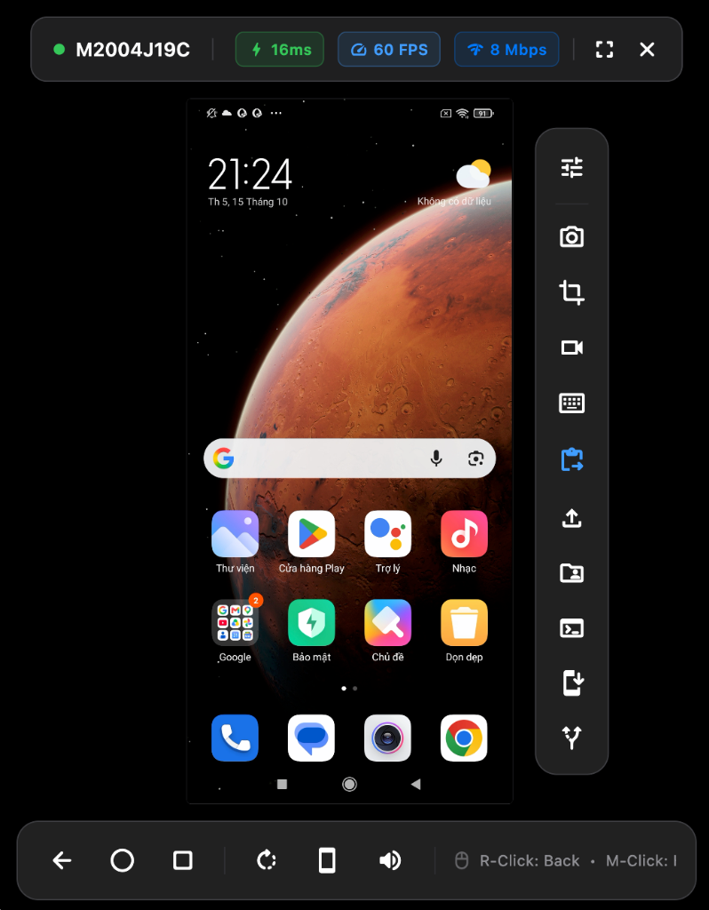
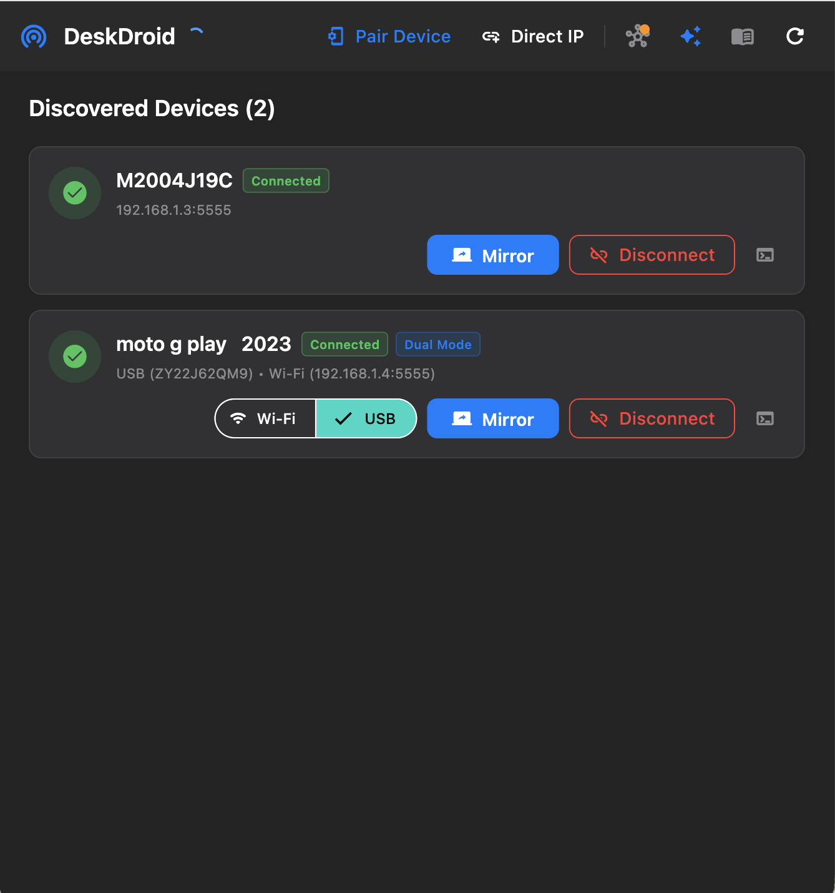
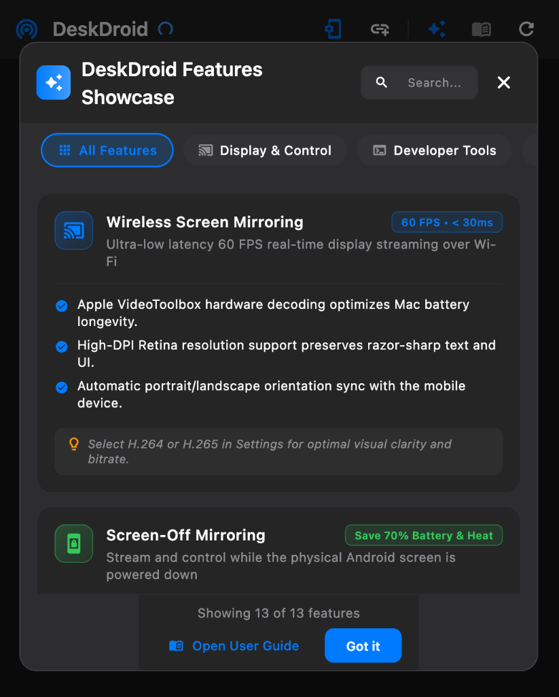
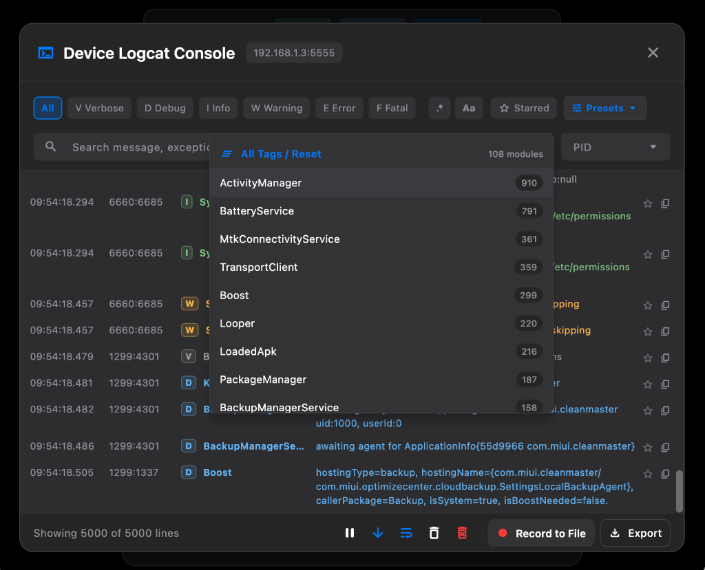
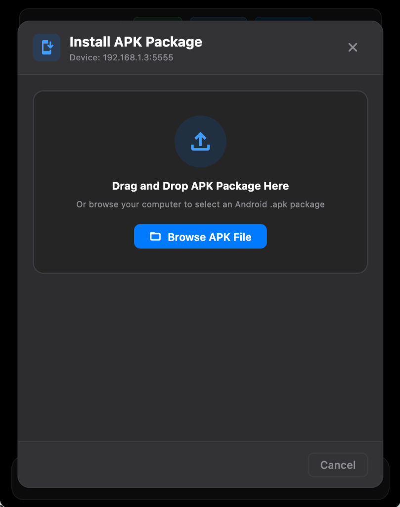
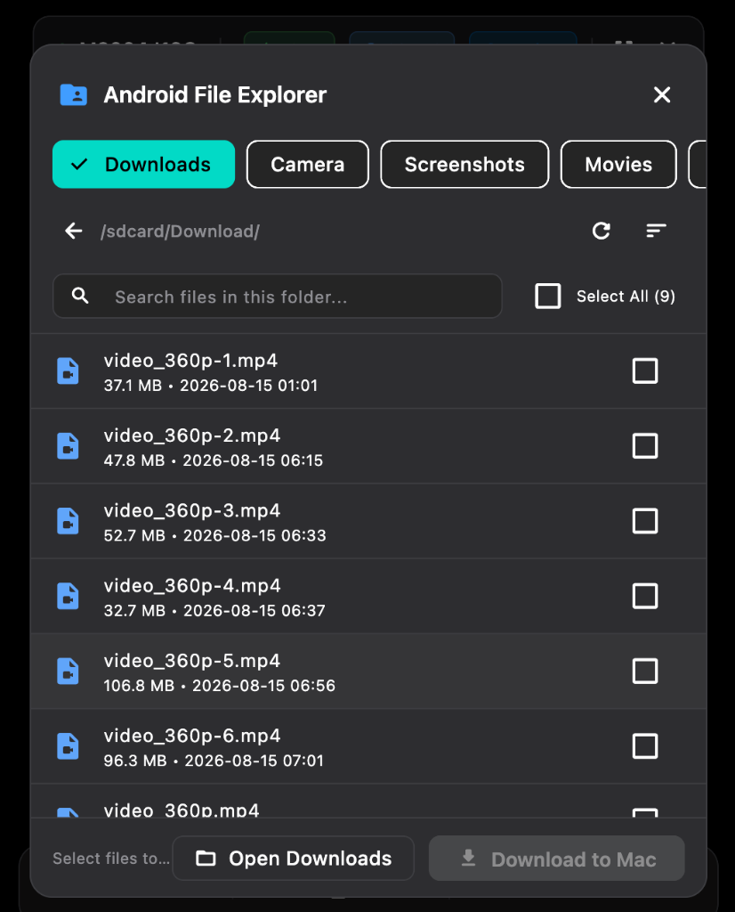
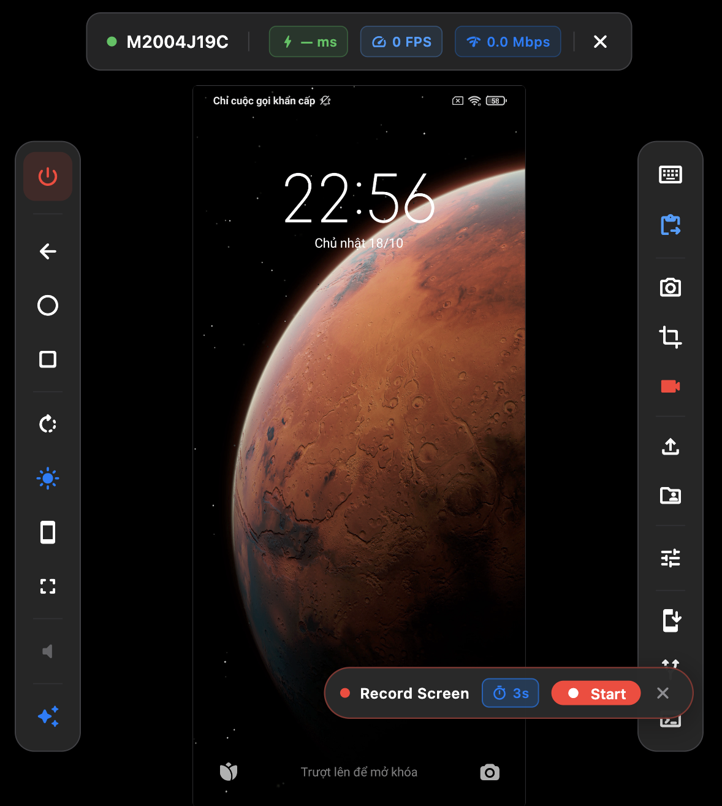
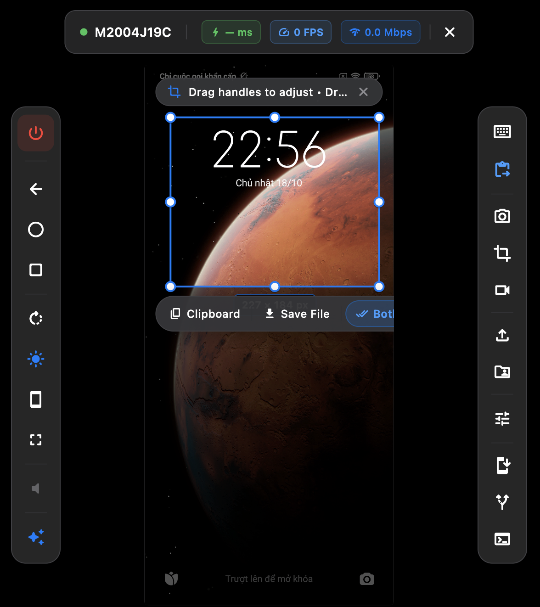
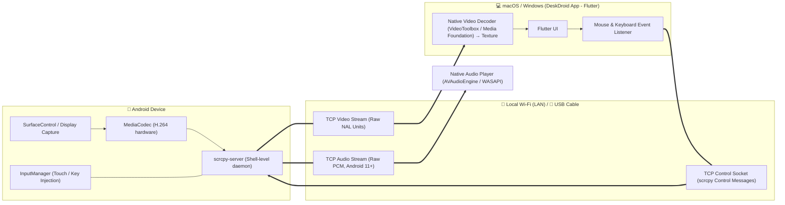

# ⚡️ DeskDroid — High-Performance Android Screen Mirroring & Workstation for macOS & Windows

<p align="center">
  <b>Silky-smooth, low-latency Android screen mirroring, remote control, and developer powerhouse for macOS and Windows over Wi-Fi & USB. Built with Flutter Desktop and scrcpy-server.</b>
</p>

<p align="center">
  <a href="https://github.com/az-coder-123/desk-droid/blob/main/LICENSE"></a>
  <a href="https://flutter.dev"></a>
  <a href="https://github.com/az-coder-123/desk-droid/releases"></a>
  <a href="docs/platform-support.md"></a>
  <a href="https://github.com/Genymobile/scrcpy/releases/tag/v5.0.1"></a>
  <a href="https://github.com/az-coder-123/desk-droid/pulls"></a>
</p>

<p align="center">
  <a href="https://github.com/az-coder-123/desk-droid/releases/latest/download/DeskDroid-v1.0.1-macOS.zip"></a>
  &nbsp;
  <a href="https://github.com/az-coder-123/desk-droid/releases/latest/download/DeskDroid-v1.0.1-Windows-x64.zip"></a>
  &nbsp;
  <a href="https://github.com/az-coder-123/desk-droid/releases/latest"></a>
  <br>
  <sub>macOS: Universal Binary (18 MB) • Apple Silicon (M1/M2/M3/M4) & Intel Core • macOS 12.0+</sub>
  <br>
  <sub>Windows (Preview): portable ZIP (13 MB) • Windows 10/11 x64 • <a href="docs/platform-support.md">what works on each platform</a></sub>
</p>

<p align="center">
  
</p>

---

## 🚀 Why DeskDroid?

DeskDroid turns your Mac or Windows PC into the ultimate Android command center. Whether you are an Android developer debugging apps, a content creator recording mobile gameplay, or a power user seeking desktop control over your phone, DeskDroid delivers:

- ⚡️ **Low-Latency Native Decoding:** Hardware H.264 encoding on the phone, decoded natively on the desktop (Apple VideoToolbox on macOS, Media Foundation on Windows) at up to 60 FPS, at the phone's own resolution.
- 📶 **Dual Connection (Wi-Fi & USB):** Subnet ARP auto-discovery, mDNS wireless debugging, 1-click USB-to-Wi-Fi switch, or instant plug-and-play USB cable mode.
- 🔋 **Screen-Off Streaming:** Keep the physical phone screen dark while you keep mirroring and controlling it, for privacy and less battery drain from the display.
- 🔒 **100% Private & P2P:** Zero cloud servers, zero analytics, and zero telemetry. All video, audio, and inputs remain strictly inside your local network.

---

## 📸 Visual Showcase

### 1. Subnet Discovery & Built-in Feature Catalog
<table>
  <tr>
    <td width="50%" align="center" valign="top">
      
      <br><b>Multi-Device Discovery</b>
      <br><sub>Subnet auto-scan, connection badges & 1-click wireless mirroring.</sub>
    </td>
    <td width="50%" align="center" valign="top">
      
      <br><b>Interactive Feature Showcase</b>
      <br><sub>Categorized catalog with performance badges, highlights & pro tips.</sub>
    </td>
  </tr>
</table>

### 2. Developer Inspection: Logcat & Intent Dispatcher
<table>
  <tr>
    <td width="50%" align="center" valign="top">
      
      <br><b>Device Logcat Console (<kbd>Cmd</kbd>+<kbd>Shift</kbd>+<kbd>L</kbd>)</b>
      <br><sub>Live stream (batched every 100 ms), 5k ring buffer, regex/PID/tag filters, star bookmarks & recording to a file.</sub>
    </td>
    <td width="50%" align="center" valign="top">
      
      <br><b>Deep Link & Intent Dispatcher (<kbd>Cmd</kbd>+<kbd>Shift</kbd>+<kbd>D</kbd>)</b>
      <br><sub>Fire custom URI schemes, system actions, targeted packages & typed extras.</sub>
    </td>
  </tr>
</table>

### 3. App Deployment & Two-Way File Management
<table>
  <tr>
    <td width="50%" align="center" valign="top">
      
      <br><b>1-Click APK Manager (<kbd>Cmd</kbd>+<kbd>Shift</kbd>+<kbd>I</kbd>)</b>
      <br><sub>AAPT2 metadata inspection, permission grant flags, 1-click launch & clean uninstall.</sub>
    </td>
    <td width="50%" align="center" valign="top">
      
      <br><b>Device File Explorer (<kbd>Cmd</kbd>+<kbd>Shift</kbd>+<kbd>F</kbd>)</b>
      <br><sub>Two-way file browser with quick folder shortcuts & batch download.</sub>
    </td>
  </tr>
</table>

### 4. Lossless Media Capture & Screen Recording
<table>
  <tr>
    <td width="50%" align="center" valign="top">
      
      <br><b>Hardware Screen Recording (<kbd>Cmd</kbd>+<kbd>Shift</kbd>+<kbd>R</kbd>)</b>
      <br><sub>H.264 MP4 encoded by the phone's hardware encoder (up to 3 minutes), with a 3 s countdown HUD.</sub>
    </td>
    <td width="50%" align="center" valign="top">
      
      <br><b>Interactive Area Crop (<kbd>Cmd</kbd>+<kbd>Shift</kbd>+<kbd>S</kbd>)</b>
      <br><sub>PNG marquee crop with live pixel badge; copy, save, or both.</sub>
    </td>
  </tr>
</table>

---

## ⚡️ Complete Feature Catalog

DeskDroid includes **14 built-in modules** (plus a planned menu bar companion):

| # | Feature | Highlights & Capabilities | Shortcut | Docs |
| :-: | :--- | :--- | :--- | :-: |
| **01** | **Wireless Display & Low-Latency Streaming** | Up to 60 FPS at native resolution, H.264 hardware decoding (VideoToolbox on macOS, Media Foundation on Windows), live FPS / bitrate / latency badges | Auto | [Guide](docs/features/wireless-display-streaming.md) |
| **02** | **Device Discovery & Wireless Pairing** | Subnet ARP scan, 1-click USB-to-Wi-Fi, mDNS discovery for Android 11+ pairing | Auto / Toolbar | [Guide](docs/features/device-discovery-pairing.md) |
| **03** | **Remote Input & Gesture Control** | Trackpad scrolling, two-finger pinch and rotate (trackpad or Alt + drag), right-click back, over the scrcpy control socket | Mouse / Trackpad | [Guide](docs/features/remote-input-control.md) |
| **04** | **Keyboard & Text Injection** | Desktop keyboard shortcuts and a text input modal; Vietnamese, CJK, and emoji are pasted intact | <kbd>Cmd</kbd>+<kbd>K</kbd> | [Guide](docs/features/remote-input-control.md) |
| **05** | **Screen-Off Streaming** | Turns the phone's display panel off while mirroring and control continue | <kbd>Cmd</kbd>+<kbd>O</kbd> | [Guide](docs/features/screen-off-streaming.md) |
| **06** | **Device Logcat Console & Debugger** | Live stream (batched every 100 ms), 5k ring buffer, regex/PID/tag filters, star bookmarks, recording to a file | <kbd>Cmd</kbd>+<kbd>Shift</kbd>+<kbd>L</kbd> | [Guide](docs/features/device-logcat-console.md) |
| **07** | **Deep Link & Intent Dispatcher** | Test URI schemes, system actions (`VIEW`, `SEND`), packages & typed extras | <kbd>Cmd</kbd>+<kbd>Shift</kbd>+<kbd>D</kbd> | [Guide](docs/features/deep-link-intent-dispatcher.md) |
| **08** | **APK Sideload & Package Manager** | AAPT2 package inspection, install flags (`-r`, `-g`, `-t`), launch & uninstall | <kbd>Cmd</kbd>+<kbd>Shift</kbd>+<kbd>I</kbd> | [Guide](docs/features/apk-sideload-manager.md) |
| **09** | **Two-Way File Explorer** | Two-way file manager, quick folders (Downloads, DCIM, Docs) & download to the computer | <kbd>Cmd</kbd>+<kbd>Shift</kbd>+<kbd>F</kbd> | [Guide](docs/features/file-transfer-explorer.md) |
| **10** | **Viewport Drag & Drop Push** | Drag any file or APK onto the mirroring window for instant push or sideload | Drag-and-drop | [Guide](docs/features/file-transfer-explorer.md) |
| **11** | **Bidirectional Clipboard Sync** | Desktop clipboard ⇄ Android clipboard every 2 s, with loop prevention | Auto, or <kbd>Cmd</kbd>+<kbd>Shift</kbd>+<kbd>C</kbd> / <kbd>V</kbd> | [Guide](docs/features/clipboard-sync.md) |
| **12** | **Hardware MP4 Screen Recording** | H.264 MP4 (8 Mbps, up to 3 minutes) encoded on the phone, 3 s countdown HUD, live timer | <kbd>Cmd</kbd>+<kbd>Shift</kbd>+<kbd>R</kbd> | [Guide](docs/features/hardware-screen-recording.md) |
| **13** | **Lossless Screenshots & Area Crop** | Full PNG capture or interactive 8-handle marquee crop, to the clipboard, your Downloads folder, or both | <kbd>Cmd</kbd>+<kbd>S</kbd> / <kbd>Shift</kbd>+<kbd>S</kbd> | [Guide](docs/features/screenshots-area-crop.md) |
| **14** | **Model Context Protocol (MCP) AI Agent Server** | Headless stdio MCP server exposing 58 tools for Claude Desktop, Cursor & Antigravity | Stdio CLI | [Guide](docs/mcp-setup-guide.md) |
| **+** | **Menu Bar Companion** *(not yet available)* | Status bar popover for quick window toggle and live telemetry (FPS & latency); designed, not yet wired into the app | Menu Bar | [Guide](docs/features/menu-bar-companion.md) |

> Shortcuts are shown with <kbd>Cmd</kbd> (macOS); use <kbd>Ctrl</kbd> on Windows. Most features are verified on macOS; the Windows preview has verified mirroring, logcat, bitrate presets, and the MCP server. Audio forwarding (Android 11+) is new and not yet verified in the app on either platform. Full matrix: [Platform Support](docs/platform-support.md).

---

## ⌨️ Essential Keyboard Shortcuts

Use <kbd>Cmd</kbd> on macOS and <kbd>Ctrl</kbd> on Windows (for example <kbd>Ctrl</kbd> + <kbd>Shift</kbd> + <kbd>S</kbd>). Tooltips in the app always show the keys of the running platform.

| Shortcut (macOS / Windows) | Action | Description |
| :--- | :--- | :--- |
| <kbd>Cmd</kbd> / <kbd>Ctrl</kbd> + <kbd>S</kbd> | Full Screenshot | Captures full phone screen to your Downloads folder & clipboard |
| <kbd>Cmd</kbd> + <kbd>Shift</kbd> + <kbd>S</kbd> | Area Screenshot | Drag interactive marquee to crop custom screen region |
| <kbd>Cmd</kbd> + <kbd>Shift</kbd> + <kbd>R</kbd> | Screen Recording | Hardware H.264 MP4 recording (up to 3 minutes) with countdown HUD & timer |
| <kbd>Cmd</kbd> + <kbd>Shift</kbd> + <kbd>I</kbd> | APK Manager | Inspect package metadata, configure install flags & sideload |
| <kbd>Cmd</kbd> + <kbd>Shift</kbd> + <kbd>D</kbd> | Intent Dispatcher | Fire deep link URLs, system intents & typed extras |
| <kbd>Cmd</kbd> + <kbd>Shift</kbd> + <kbd>F</kbd> | Device Files | Browse phone directories & download files to the computer |
| <kbd>Cmd</kbd> + <kbd>Shift</kbd> + <kbd>L</kbd> | Device Logcat | Real-time log stream with level/tag/PID filtering & export |
| <kbd>Cmd</kbd> + <kbd>O</kbd> | Screen-Off Toggle | Turn the phone's screen off or on; mirroring continues |
| <kbd>Cmd</kbd> + <kbd>K</kbd> | Text Injection | Open the text input modal (any language, emoji included) |
| <kbd>Cmd</kbd> + <kbd>H</kbd> / <kbd>Backspace</kbd> | Home / Back | Standard Android navigation controls |

---

## 🏗️ Architecture



---

## 🛠️ Quick Start & Installation

### Prerequisites

| | macOS | Windows (Preview) |
| :--- | :--- | :--- |
| Host | macOS 12.0+ (Apple Silicon or Intel) | Windows 10/11 x64 |
| ADB | **Bundled** in release builds (optional: `brew install android-platform-tools`) | **Bundled** in release builds (optional: `winget install Google.PlatformTools`) |
| Android | 5.0+ with **USB Debugging** enabled | Same |

### Install a release

- **macOS:** unzip `DeskDroid-v1.0.1-macOS.zip`, move **DeskDroid.app** to `/Applications`. Unsigned build: run `xattr -cr /Applications/DeskDroid.app` once if Gatekeeper blocks it.
- **Windows:** unzip `DeskDroid-v1.0.1-Windows-x64.zip` and run `DeskDroid\desk_droid.exe` (no installer). Unsigned build: on the SmartScreen prompt choose **More info → Run anyway**.

### Run from source

```bash
# 1. Clone repository
git clone https://github.com/az-coder-123/desk-droid.git
cd desk-droid

# 2. Install dependencies & launch
flutter pub get
flutter run -d macos     # macOS
flutter run -d windows   # Windows (needs Visual Studio 2022 with "Desktop development with C++")
```

### Build a release package

```bash
./scripts/build_release.sh                                            # macOS → RELEASE/DeskDroid-v<version>-macOS.zip
powershell -ExecutionPolicy Bypass -File scripts\build_release.ps1     # Windows → RELEASE\DeskDroid-v<version>-Windows-x64.zip
```

Full setup, ADB drivers, and packaging options: [Installation & Building](docs/installation.md).

---

## 📚 Documentation Hub

| Guide | Scope |
| :--- | :--- |
| [💿 Installation & Building](docs/installation.md) | Install on macOS or Windows, set up ADB, run from source, and package a release |
| [🖥️ Platform Support](docs/platform-support.md) | What works on macOS and Windows, and where the platforms differ |
| [📖 User Guide](docs/user-guide.md) | Getting started, first-time setup, and device permissions |
| [📶 Pairing Guide](docs/pairing-guide.md) | Wireless pairing instructions for Android 11+ and USB fallback |
| [⌨️ Shortcuts & Gestures](docs/shortcuts.md) | Complete mouse gestures and keyboard shortcuts (<kbd>Cmd</kbd> on macOS, <kbd>Ctrl</kbd> on Windows) |
| [⚡️ Features Catalog](docs/features/README.md) | Modular in-depth documentation across all 14 built-in features |
| [🏛️ Architecture](docs/architecture.md) | Clean Architecture blueprint, BLoC state model, and socket protocols |
| [🧭 Dependency Boundaries](docs/dependency-boundaries.md) | Allowed imports between features, shared kernel, and composition root |
| [🧩 Platform Abstraction](docs/platform-abstraction.md) | Where macOS/Windows differences live, and how to add a new one |
| [🎞️ Native Video Contract](docs/native-video-contract.md) | MethodChannel, scrcpy wire format, and rules shared by the Swift and C++ plugins |
| [📦 Bundled Platform-Tools](docs/bundled-platform-tools.md) | How adb ships inside the app, how it is found, and how to upgrade it |
| [🧮 scrcpy Upgrade Assessment](docs/scrcpy-upgrade-assessment.md) | Why v2.1 must be upgraded, protocol compatibility by version, and the recommended path |
| [🪟 Windows Port Plan](docs/windows-port-plan.md) | Phases, status, and risks of the Windows port |
| [🛠️ Troubleshooting](docs/troubleshooting.md) | Solutions for Xiaomi/MIUI input permissions, firewalls, and ADB errors |
| [💡 Lessons Learned](docs/lessons-learned/README.md) | Engineering post-mortems, root cause analyses, and edge-case solutions |
| [🤖 AI Agent & MCP Guide](docs/mcp-setup-guide.md) | Connect Claude Desktop, Cursor, and Antigravity to automate Android devices (58 tools) |

---

## 🏷️ Search Keywords & Tags

`android-screen-mirroring` · `scrcpy-macos-gui` · `scrcpy-windows-gui` · `wireless-adb` · `screen-mirror-mac` · `screen-mirror-windows` · `flutter-desktop` · `apple-silicon` · `android-logcat-gui` · `apk-installer-mac` · `deep-link-tester` · `android-file-transfer-mac` · `low-latency-streaming` · `open-source`

---

## 🤝 Community, Contributing & License

<table>
  <tr>
    <td width="50%" valign="top">
      <h3>🤝 Contributing</h3>
      <p>Contributions, feature requests, and bug reports are warmly welcome! DeskDroid thrives on community feedback.</p>
      <p>
        <a href="https://github.com/az-coder-123/desk-droid/issues"></a>
        <a href="https://github.com/az-coder-123/desk-droid/pulls"></a>
        <a href="https://github.com/az-coder-123/desk-droid/stargazers"></a>
      </p>
      <ul>
        <li>Found a bug? Submit a detailed <a href="https://github.com/az-coder-123/desk-droid/issues/new">GitHub Issue</a>.</li>
        <li>Have a feature idea? Share it in <a href="https://github.com/az-coder-123/desk-droid/issues">Feature Requests</a>.</li>
        <li>Want to contribute code? Fork, branch, and open a Pull Request.</li>
      </ul>
    </td>
    <td width="50%" valign="top">
      <h3>📄 License & Freedom</h3>
      <p>DeskDroid is 100% free, open-source, and privacy-respecting software released under the <b>MIT License</b>.</p>
      <p>
        <a href="LICENSE"></a>
        
        
      </p>
      <p>You are free to use, modify, distribute, and integrate this software into personal or commercial workflows. See <a href="LICENSE">LICENSE</a> for full legal terms.</p>
    </td>
  </tr>
</table>

<p align="center">
  Developed and maintained by <b><a href="https://github.com/az-coder-123">az-coder-123</a></b>
</p>
