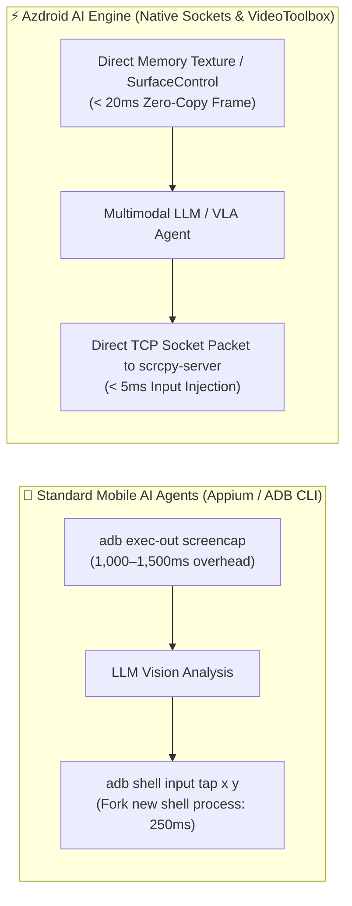

# 🤖 Feasibility Study: Transforming Azdroid into an Autonomous AI Agent

> **Architectural RFC & Roadmap:** Evaluating the feasibility, design patterns, and engineering roadmap to turn Azdroid into an AI Agent and an MCP (Model Context Protocol) Server for Android automation.

---

## 🎯 1. Executive Summary & Feasibility Rating

| Dimension | Rating | Analysis |
| :--- | :---: | :--- |
| **Technical Feasibility** | **9.5 / 10** | **Extremely High.** 90% of the low-level infrastructure (sub-20ms frame capture, sub-5ms socket input injection, intent dispatcher, logcat streaming, APK sideloading) is already implemented and stable in Azdroid. |
| **Market Impact** | **10 / 10** | Existing AI mobile agents (AppAgent, Mobile-Agent, OSWorld) suffer from slow `adb screencap` (1.5s/frame) and process-spawning input taps (300ms). Azdroid offers **30x faster feedback loops**. |
| **Architectural Fit** | **9.5 / 10** | Clean Architecture with decoupled Cubit/BLoC state and repository contracts makes exposing headless APIs or an MCP server straightforward. |
| **Portfolio Synergy** | **10 / 10** | Perfectly complements the `@az-coder-123` ecosystem (`sql-server-mcp`, `postgres-mcp`, `mongodb-mcp`) by introducing the **first high-performance macOS-to-Android MCP Server**. |

---

## ⚡️ 2. The Azdroid Advantage over Traditional Mobile AI Tooling



---

## 🏛️ 3. Proposed Dual-Architecture Paradigms

### Paradigm A: Azdroid as an MCP Server (`azdroid-mcp`) — *Highest Priority*
Azdroid acts as a **Model Context Protocol (MCP)** server over `stdio` or Server-Sent Events (SSE). 
- Allows external AI assistants (e.g. **Antigravity**, **Claude Desktop**, **Cursor**) to observe and drive real Android devices natively.
- Developers can say: *"Run my checkout flow, inspect Logcat if any errors occur, and take a screenshot of the confirmation page."*

### Paradigm B: Embedded In-App AI Operator
An integrated multimodal agent (powered by Gemini 1.5/2.0 Flash or local Ollama) operating inside the Azdroid macOS window:
- Natural language command prompt bar at the bottom of the mirroring viewport.
- Real-time visual overlay drawing bounding boxes and planned action paths.
- Emergency manual override (<kbd>Esc</kbd> / touch interrupt).

---

## 🛠️ 4. Core Tool Contracts for AI Agents

```typescript
// 1. Vision & Observation
take_screenshot(): { image_base64: string, width: number, height: number, orientation: number }
get_ui_hierarchy(): { xml_tree: string, clickable_elements: Array<{ id: string, bounds: Rect, text: string }> }

// 2. Precise Control & Navigation
tap_coordinate(x: number, y: number): { success: boolean }
swipe_gesture(x1: number, y1: number, x2: number, y2: number, duration_ms: number): { success: boolean }
inject_text(text: string): { success: boolean }
press_key(key_code: "BACK" | "HOME" | "ENTER" | "TAB"): { success: boolean }

// 3. Developer & Diagnostic Inspections
dispatch_intent(action: string, data_uri?: string, package?: string, extras?: Record<string, any>): { success: boolean, output: string }
get_logcat_errors(tag_filter?: string, limit?: number): { logs: Array<LogEntry> }
install_and_launch_apk(apk_path: string, launch_package: string): { installed: boolean, launched: boolean }
```

---

## 🧩 5. Key Engineering Challenges & Solutions

1. **Resolution & Coordinate Normalization:**
   - *Challenge:* LLM vision models scale images down (e.g., to 1024x1024 or 768x768), while Android screens have varying native resolutions (e.g., 1080x2400).
   - *Solution:* Azdroid already handles viewport-to-device coordinate translation matrices in `ControlRepository`. Expose normalized coordinates `[0.0, 1.0]` across all tools.
2. **Semantic UI Understanding (Accessibility Tree):**
   - *Challenge:* Vision-only agents can hallucinate click targets.
   - *Solution:* Combine vision with a background daemon querying `AccessibilityNodeInfo` to provide element IDs and bounding boxes.
3. **Safety & Guardrails:**
   - *Challenge:* Autonomous agents might trigger unwanted destructive actions (e.g. factory reset, unauthorized purchases).
   - *Solution:* Confirmation prompts for high-risk intents, sandbox permissions, and 1-key emergency stop.

---

## 🗺️ 6. Phased Implementation Roadmap

- [ ] **Phase 1: Headless CLI & MCP Protocol Bridge (1–2 weeks)**
  - Implement Dart `shelf` or `stdio` MCP server exposing core tools (`screenshot`, `tap`, `swipe`, `text`, `intent`, `logcat`).
  - Publish `azdroid-mcp` package and configuration snippet for Claude/Cursor.
- [ ] **Phase 2: Semantic UI Element Grounding (2 weeks)**
  - Integrate fast accessibility node inspection alongside raw screenshot capture.
  - Return combined `{ image, elements: [...] }` payload for multimodal LLMs.
- [ ] **Phase 3: Native Azdroid In-App AI Copilot (2–3 weeks)**
  - Add native Flutter prompt bar and visual action overlay directly in the macOS mirroring window.
  - Support Gemini API keys and local Ollama endpoints for autonomous task execution.
