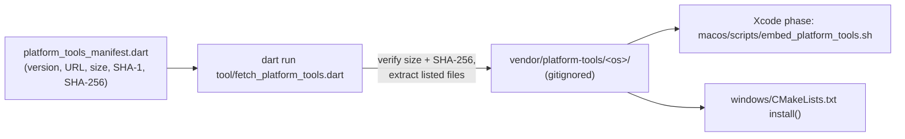

# Bundled Android Platform-Tools (adb)

> Release builds of DeskDroid ship their own `adb`, so users do not have to install anything. This document covers what is bundled, how the app chooses an adb, and how to upgrade it.

---

## 1. What Is Bundled

Pinned version: **37.0.1** (`tool/platform_tools/platform_tools_manifest.dart`).

| Platform | Files | Location in the build |
|:---|:---|:---|
| macOS | `adb` (universal x86_64 + arm64, ~18.8 MB) | `DeskDroid.app/Contents/MacOS/adb` |
| macOS | `platform-tools-NOTICE.txt`, `platform-tools-source.properties` | `DeskDroid.app/Contents/Resources/platform-tools/` |
| Windows | `adb.exe`, `AdbWinApi.dll`, `AdbWinUsbApi.dll` (~8.5 MB) | Next to `desk_droid.exe` |
| Windows | `platform-tools-NOTICE.txt`, `platform-tools-source.properties` | Next to `desk_droid.exe` |

Only adb and what it needs are extracted. `fastboot`, `sqlite3`, and the other platform-tools are not shipped.

---

## 2. Build Pipeline

| Step | macOS | Windows |
|:---|:---|:---|
| Fetch | `dart run tool/fetch_platform_tools.dart` | `dart run tool/fetch_platform_tools.dart --os=windows` |
| Embed | Run Script phase **Embed Platform Tools (adb)** | `install(DIRECTORY …)` into the bundle folder |
| Missing tools, Debug | Warning; app uses an installed adb | Warning; app uses an installed adb |
| Missing tools, Release | **Build error** | **Install error** |
| Release script | `scripts/build_release.sh` fetches first, then checks `Contents/MacOS/adb` and `codesign --verify --deep --strict` | Phase 4 |

The binaries are **not committed**. `vendor/` is gitignored; the fetch tool is idempotent (a `.version` stamp skips repeat downloads) and re-downloads after a version bump.

---

## 3. Which adb Is Used

`AdbBinaryLocator` (shared by the app and the MCP server) tries, in order:

1. `which adb` / `where adb.exe` on `PATH`
2. Android SDK roots: `ANDROID_HOME`, `ANDROID_SDK_ROOT`, then the default SDK folder
3. System installs (Homebrew on macOS)
4. **The bundled copy** (`HostToolchain.bundledAdbPath`)

An installed adb always wins. All adb clients on one computer share one adb server, and two different adb versions keep restarting it (*"adb server version doesn't match this client; killing..."*). Preferring the installed copy means DeskDroid only falls back to its own adb when no other adb exists.

The app log records the choice: `Using installed ADB at …` or `Using bundled ADB at …`.

The MCP launcher (`scripts/start_mcp_server.sh`) appends `vendor/platform-tools/macos` to `PATH` last, so source checkouts follow the same order.

---

## 4. Integrity, Signing, and Licensing

- **Provenance:** Google publishes size and SHA-1 for each archive in `https://dl.google.com/android/repository/repository2-3.xml`. The pinned SHA-1 values come from that file.
- **Integrity:** the fetch tool verifies size and **SHA-256** before extracting anything.
- **macOS signing:** `adb` is already signed by Google (Team ID `EQHXZ8M8AV`, hardened runtime). The embed script verifies that signature and never re-signs it; Xcode then seals the app around it.
- **License:** adb is Apache License 2.0. `platform-tools-NOTICE.txt` from the same archive is shipped with every build.

---

## 5. Upgrading adb

1. Open `repository2-3.xml` and find `remotePackage path="platform-tools"`. Note the version, and for each OS the archive name, size, and SHA-1.
2. Download each archive and confirm `shasum -a 1` matches Google's value.
3. Record `shasum -a 256` in `platform_tools_manifest.dart`, together with the new version, archive names, and sizes.
4. Check that the file list still matches what adb imports (`otool -L adb`; `adb.exe` imports `AdbWinApi.dll`).
5. Run `dart run tool/fetch_platform_tools.dart --os=all`, `flutter test test/tool`, and a release build.
