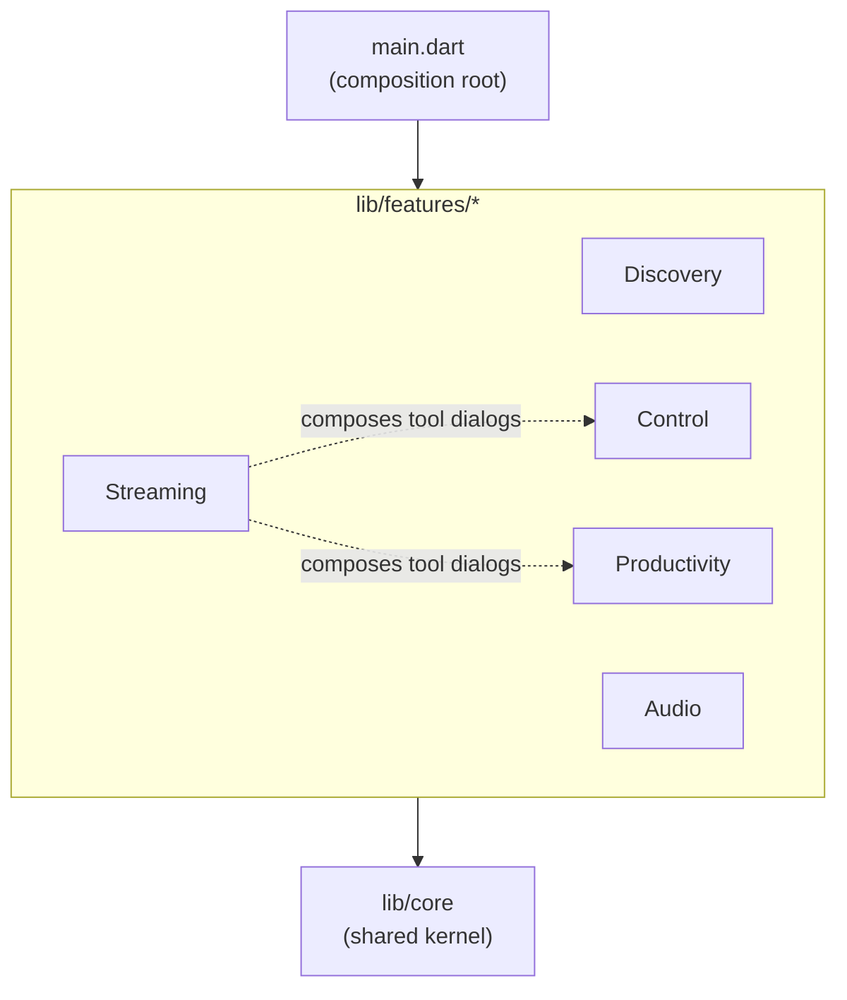

# Dependency Boundaries Between Features

> Rules that keep Azdroid features independent. Read this before importing one feature from another.

---

## 1. Allowed Dependency Directions



| From | May import | Must not import |
|:---|:---|:---|
| `lib/core/**` | Dart SDK, Flutter, third-party packages | Any `lib/features/**` file |
| `features/<a>/domain` | `core/models`, `core/constants`, own domain | Flutter UI types, other features |
| `features/<a>/data` | `core/**`, own domain | Other features' `data` or `presentation` |
| `features/<a>/presentation` | `core/**`, own domain, other features' **widgets/cubits** for composition only | Other features' `data` layer, `sl<Service>()` calls in widgets |
| `lib/main.dart` | Everything | — |

There must be **no import cycle** between two features.

---

## 2. Shared Kernel (`lib/core`)

Put a type in `core` when two or more features need it.

| Type | Location | Used by |
|:---|:---|:---|
| `DeviceEntity`, `DeviceConnectionType` | `core/models/device_entity.dart` | discovery, streaming |
| `IAudioStreamNativeService` (native audio player) | `core/services/audio_stream_native_service.dart` | streaming (opens and closes it), audio (volume, mute, state) |
| `ScrcpyControlChannel` (one socket per session), `ScrcpyControlMessage` (wire format) | `core/services/scrcpy_control_channel.dart`, `core/services/scrcpy_control_message.dart` | streaming (opens and closes it, display power), control (sends input) |
| `AdbBinaryLocator` (pure Dart) | `core/services/adb_binary_locator.dart` | app `AdbPathResolver`, MCP server |
| `HostPaths`, `HostToolchain`, `HostFilePicker`, `HostFileLauncher`, `ImageClipboard`, `ShortcutScheme` | `core/platform/` (see [platform-abstraction.md](platform-abstraction.md)) | all features |
| `LocalFileSystemGateway`, `splitLines()` | `core/services/`, `core/extensions/` | productivity, MCP, parsers |
| `tryRead<T>()` | `core/extensions/optional_read_extension.dart` | widgets with optional providers |

`AdbBinaryLocator`, `ProcessExecutor`, `HostOs`, `HostPaths`, `HostToolchain`, and `core/constants` must stay free of Flutter imports because the MCP server runs on the plain `dart` VM.

---

## 3. Composition Root

Feature-to-feature navigation is wired in `lib/main.dart`, not inside features.

```dart
// main.dart
home: const DiscoveryPage(mirroringRouteBuilder: _mirroringRoute),
```

`DiscoveryPage` only knows the `MirroringRouteBuilder` typedef, so discovery does not import streaming. Toolbar status buttons from other features come the same way: `main.dart` passes `McpStatusIndicator` in `DiscoveryPage.statusActions`.

App-wide cubits (`DiscoveryCubit`, `HostContextCubit`, `MenuBarCubit`) and the `ShortcutScheme` are provided above `MaterialApp`, so dialogs pushed on the root navigator can read them.

---

## 4. Rules for Widgets

1. Widgets read state from Cubits. They never call `sl<SomeService>()` or run `Process`/`File` I/O.
2. `BlocProvider(create: (_) => sl<XCubit>())` is allowed only at the root of a page or dialog.
3. Cubits scoped to a parameter use `registerFactoryParam` (for example `sl<ApkInstallerCubit>(param1: serial)`).
4. When a provider is genuinely optional, use `context.tryRead<T>()`. Never wrap `context.read` in `try/catch`.

---

## 5. Checking Boundaries

List every cross-feature import:

```bash
for f in lib/features/*/; do
  n=$(basename "$f")
  grep -rhoE "features/[a-z_]+/" "$f" | grep -v "features/$n/" | sort -u | sed "s|^|$n -> |"
done
```

Each line must follow the table in section 1. Any pair that appears in both directions is a cycle and must be removed.
