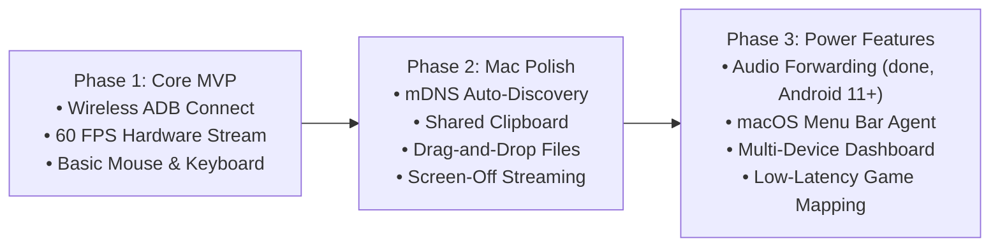

# DeskDroid — Technical Specifications & Feature Documentation

> Comprehensive specification and architectural breakdown of the **DeskDroid** open-source project: Ultra-low latency Android screen mirroring and remote control for macOS and Windows (preview) over local Wi-Fi.
>
> 🖥️ **Platform status:** Not every feature below is available or verified on both platforms (audio forwarding is new and not yet verified in the app; the menu bar companion is not functional yet). See [platform-support.md](platform-support.md).
>
> 💡 **Dedicated Specifications:** Each feature is thoroughly documented in its own dedicated file adhering to the Single Responsibility Principle. Browse the [Features Directory](features/README.md) for individual specifications.

---

## 📑 Table of Contents
1. [Wireless Connectivity & Device Discovery](#1-wireless-connectivity--device-discovery)
2. [Ultra-Low Latency Display Engine](#2-ultra-low-latency-display-engine)
3. [Comprehensive Remote Control & Input Injection](#3-comprehensive-remote-control--input-injection)
4. [Mac-First Productivity Features](#4-mac-first-productivity-features)
5. [Security & Privacy Architecture](#5-security--privacy-architecture)
6. [Feature Roadmap](#6-feature-roadmap)

---

## 1. Wireless Connectivity & Device Discovery

### 1.1 Zero-Configuration Discovery (mDNS / Bonjour)
- **Local Service Broadcasting:** Automatically discovers Android devices on the same Wi-Fi subnet with active Wireless Debugging enabled via multicast DNS (`_adb-tls-connect._tcp` / `_adb._tcp`).
- **Elimination of Manual Configuration:** Eliminates the need for users to manually inspect phone settings or enter IP addresses and ports (e.g., `192.168.1.100:5555`).

### 1.2 Interactive Pairing Assistant (Android 11+)
- **Wi-Fi Pairing Protocol:** Native integration with Android's secure pairing workflow (`adb pair <ip>:<port> <pairing-code>`).
- **Authentic 6-Digit PIN Pairing:** Provides a clean graphical guide for one-time 6-digit PIN verification and pairing port entry without relying on fake or non-functional QR pairing mechanisms.
- **Recent Device Persistence:** Persists previously connected devices locally in `history.json` for instant 1-click reconnecting from the dashboard.

### 1.3 Session Loss Handling
- **Clear Stop:** When the video stream fails or the device closes it, mirroring stops with an explanation and a **Retry Connection** button.
- **No Automatic Reconnect Yet:** DeskDroid does not reconnect by itself when a device drops off the network; reconnect from the device list or press Retry.

### 1.4 1-Click USB-to-Wi-Fi Mode Switch (`adb tcpip 5555`)
- **Automated Network Query:** Reads the phone's Wi-Fi address with `adb shell ip addr show wlan0`, falling back to `ip route`.
- **Zero-Terminal Activation:** Runs `adb tcpip 5555` and establishes wireless connection in 1 click, allowing users to unplug the USB cable immediately.

---

## 2. Ultra-Low Latency Display Engine

### 2.1 Hardware-Accelerated Video Pipeline
- **Direct Frame Capture:** Interacts directly with Android's internal `SurfaceControl` API to bypass UI toolkit overhead.
- **On-Device Hardware Encoding:** scrcpy-server encodes the screen with the device's hardware H.264 encoder (`MediaCodec`).
- **Low Latency:** NAL units travel over the local `adb forward` socket straight into the native hardware decoder (VideoToolbox on macOS, Media Foundation on Windows). The header shows the measured host processing time per frame; end-to-end latency is not measured.

### 2.2 Frame Rate & Bitrate
- **Up to 60 FPS:** The server is asked for at most 60 frames per second; a still screen sends fewer. The header shows the measured rate.
- **Bitrate Presets:** 4, 8, or 16 Mbps, chosen in the side dock (8 Mbps by default). The bitrate does not change by itself.

### 2.3 Apple Retina & HiDPI Optimization
- **Pixel-Perfect Scaling:** Adapts to Apple Retina displays with automatic pixel density compensation (HiDPI integer/fractional scaling), eliminating blurriness and visual artifacts.
- **Native Resolution:** The stream uses the phone's own resolution (for example 1080 × 2336); no downscaling option exists yet.

---

## 3. Comprehensive Remote Control & Input Injection

### 3.1 Mouse Emulation (Single Pointer)
- **Pointer Event Normalization:** Normalizes cursor coordinates ($0.0 \to 1.0$) to guarantee precision across differing display aspect ratios and resolutions.
- **Primary Actions:**
  - **Left Click:** Touch down, drag, and touch up.
  - **Right Click:** Android system **Back** action (`KEYCODE_BACK`).
  - **Middle Click / Command + H:** Android system **Home** action (`KEYCODE_HOME`).
  - **App Switcher button / Ctrl + Tab (Windows):** Android **Recent Apps** (`KEYCODE_APP_SWITCH`). On macOS, Cmd + Tab belongs to the system app switcher, so use the toolbar button.
  - **Command + S:** Device **Screenshot Capture** (Lossless PNG to `~/Downloads` & macOS clipboard).
- **Scrolling:** Converts trackpad and mouse wheel scrolling into short touch swipes, so Android lists scroll with their own inertia.

### 3.2 Keyboard & International Text Input
- **Direct Keystroke Forwarding:** Maps macOS hardware keys to Android standard Linux/Android keycodes.
- **Text Injection (<kbd>Cmd</kbd> + <kbd>K</kbd>):** Sends text with `adb shell input text`, which types ASCII characters. Accented and CJK characters (Vietnamese, Japanese, Chinese) are not typed yet; copy them on the computer and paste on the phone through clipboard sync instead.

---

## 4. Mac-First Productivity Features

### 4.1 Bidirectional Clipboard Synchronization
- **Automatic Clipboard Sync:** Every 2 seconds, text copied on either side is copied to the other, with loop prevention. Force a push with <kbd>Cmd</kbd> + <kbd>Shift</kbd> + <kbd>C</kbd> or a pull with <kbd>Cmd</kbd> + <kbd>Shift</kbd> + <kbd>V</kbd>.

### 4.2 Drag & Drop File Sharing
- **File Transfer:** Drag images, documents, and videos from macOS Finder directly onto the device viewport to store them in the Android `Downloads` directory.
- **APK Sideloading:** Drag `.apk` packages onto the window to trigger automatic background installation.

### 4.3 Screen-Off Mirroring (Energy & Privacy Optimization)
- **Host Display Power Management:** Turns the phone's screen off on demand (<kbd>Cmd</kbd> + <kbd>O</kbd>) while mirroring continues, through scrcpy's `SET_DISPLAY_POWER` control message ([details](features/screen-off-streaming.md)).
- **Privacy & Power:** The phone's screen stays dark in public places, and the display panel draws no power while off.

### 4.4 macOS Menu Bar Companion (Planned)
- **Not Available Yet:** A menu bar popover is designed but not wired into the app ([status](features/menu-bar-companion.md)).

### 4.5 Audio Forwarding
- **Device Audio on the Computer:** Raw PCM from Android 11+ plays on the computer's default output with a 50 ms jitter buffer; the phone goes quiet while mirroring ([details](features/audio-forwarding.md)).

### 4.6 Lossless Device Screenshot & Regional Area Crop
- **Full & Custom Area Capture:** Supports both full-screen lossless capture and interactive region selection.
- **Interactive Drag Marquee HUD:** Allows users to freely drag on the phone display to select position and size with live dimension indicators (`W × H px`), darkened cutout mask, and macOS corner reticles. Cancelable with <kbd>Esc</kbd> or right-click.
- **Professional 8-Point Resize & Translation:** After drawing the initial selection, users can flexibly fine-tune the region:
  - **8 Handle Knobs:** Circular Apple-style knobs on all 4 corners and 4 edge midpoints with responsive directional cursors (`resizeUpDown`, `resizeLeftRight`, `resizeUpLeftDownRight`, `resizeUpRightDownLeft`).
  - **Whole-Box Pan/Move:** Dragging inside the selection body translates the entire frame smoothly with `move` cursor.
  - **Outside Re-Selection:** Dragging outside immediately starts drawing a fresh marquee.
- **Crop on the Computer:** Captures the full screen with `screencap` (PNG), then crops it on the computer to the selection, mapped from normalized coordinates ($0.0 \to 1.0$) to device pixels.
- **Interactive Floating Action Bar:** Upon completing area selection, an exquisite floating glassmorphism capsule appears anchored to the crop marquee offering instant destination choices:
  - **Clipboard:** Copies cropped PNG directly to macOS clipboard (`⌘V`) without saving temporary files to disk.
  - **Save File:** Persists lossless PNG to `~/Downloads` with Finder and Open actions.
  - **Both:** Highlighted primary option that simultaneously saves to disk and copies to clipboard.
  - Keyboard shortcuts: <kbd>C</kbd> (Clipboard), <kbd>S</kbd> (Save File), <kbd>Enter</kbd> (Both), <kbd>Esc</kbd> (Cancel).
- **Interactive Floating Toast HUD:** Provides immediate preview with file size, 1-click **Finder** reveal (`open -R`), and **Open** viewer actions with auto-dismissal. Triggerable via vertical dock buttons or shortcuts: <kbd>Cmd</kbd> + <kbd>S</kbd> (Full) and <kbd>Cmd</kbd> + <kbd>Shift</kbd> + <kbd>S</kbd> (Area).

### 4.7 Right-Side Vertical Action Dock
- **Unobstructed Viewport Ergonomics:** Productivity tools (Streaming Bitrate, Screenshot, Screen Recording, Text Injector, Clipboard Sync) are isolated from the bottom navigation dock and placed in an elegant vertical floating dock along the right edge of the real-time phone display.
- **Dynamic Proximity & Gap Preservation:** Positioned outside the phone frame with a consistent 16px ergonomic gap, scaling responsively with window size and device aspect ratio while maintaining symmetrical window centering.

### 4.8 Hardware Screen Recording (H.264 MP4)
- **On-Device Hardware Video Recording:** Runs Android's `screenrecord` to record up to 180 seconds (Android's own limit) of H.264 MP4 at 8 Mbps, encoded on the phone.
- **Intentional Recording Preparation HUD:** Clicking the camera tool button or pressing <kbd>Cmd</kbd> + <kbd>Shift</kbd> + <kbd>R</kbd> enters a preparation state with an Apple-style floating HUD rather than recording abruptly, featuring a 3-second countdown toggle, Start button, and quick cancel.
- **Animated 3-2-1 Countdown Overlay:** Displays an animated pulsating circular dial over the phone display during the 3-second buffer, allowing users to prepare phone context or skip directly with "Start Now" or abort with <kbd>Esc</kbd>.
- **Live Elapsed Duration & Dual Actions:** Live status pill displaying recording state (`REC 00:15`) with a pulsing recording dot, 1-click **STOP** (finalize & pull MP4), and **DISCARD** (purge temporary file without host disk clutter).
- **Auto-Pull to macOS & Quick Actions:** Seamlessly interrupts the recording to finalize the MP4 container, pulls to `~/Downloads/DeskDroid_Recording_YYYYMMDD_HHMMSS.mp4`, and displays preview card with 1-click **Finder** and **Play** actions. Triggerable via vertical toolbar button or <kbd>Cmd</kbd> + <kbd>Shift</kbd> + <kbd>R</kbd>.

### 4.9 Bidirectional File Transfer & Device File Explorer
- **macOS to Android Push:** Send arbitrary files, photos, videos, documents, or APKs to the Android device via native Apple Finder file selection dialog or drag-and-drop. APKs are automatically installed; media files trigger an Android MediaScanner broadcast to appear instantly in the Gallery. Triggerable via vertical dock button or <kbd>Cmd</kbd> + <kbd>U</kbd>.
- **Real-Time Transfer Progress & Size HUD:** Floating dynamic banner displays file names, human-readable file sizes (e.g., `14.5 MB`), multi-item counters (`Item 1 of 3`), and dismissible completion badges.
- **Android Device File Explorer & Pull to Mac:** Interactive modal file manager to navigate directories on the device with quick shortcuts (`Downloads`, `Camera`, `Screenshots`, `Movies`, and auto-detected `💳 SD Card`), full MicroSD card / external storage volume detection (`/storage/<UUID>/`), storage root navigation (`/storage/`), breadcrumb path display with <kbd>← Back</kbd> navigation, instant search filtering, multi-criteria sorting (Date, Size, Name), "Select All" bulk controls, vibrant file-type badges, formatted total selection sizes, and batch download to `~/Downloads/DeskDroid` with 1-click Finder reveal. Triggerable via vertical dock button or <kbd>Cmd</kbd> + <kbd>Shift</kbd> + <kbd>F</kbd>.

### 4.10 Professional APK Sideload & Package Manager
- **Comprehensive Metadata Inspection:** Inspect APK package details prior to installation, including App Name, Package ID (`applicationId`), App Icon, Version Name, Version Code, Minimum & Target Android SDK levels, and precise file size.
- **Granular Installation Flags:** Configure standard Android installation switches with 1-click toggles: `-r` (reinstall/keep data), `-g` (grant all runtime permissions), `-t` (allow test packages), and `-d` (allow version downgrade).
- **Intelligent Failure Diagnosis:** Automatically diagnoses common sideload errors and provides actionable resolution steps (e.g., signature mismatches `INSTALL_FAILED_UPDATE_INCOMPATIBLE`, storage constraints `INSTALL_FAILED_INSUFFICIENT_STORAGE`, or Xiaomi MIUI USB security restrictions).
- **Post-Install Actions:** Quick 1-click **Launch App** (`monkey` / `am start`) and **Clean Uninstall** (`pm uninstall`) without manual device interaction. Triggerable via vertical dock button or <kbd>Cmd</kbd> + <kbd>Shift</kbd> + <kbd>I</kbd>.

### 4.11 Real-Time Device Logcat Console & Advanced Debugging
- **High-Throughput Streaming Engine:** Real-time logcat streaming with bounded ring buffer (5,000 in-memory entries) and malformed UTF-8 byte resilience (`Utf8Decoder(allowMalformed: true)`). Triggerable via device card or <kbd>Cmd</kbd> + <kbd>Shift</kbd> + <kbd>L</kbd>.
- **Multi-Tier Filtering Pipeline:**
  - **Log Levels:** Color-coded priority badges (`V`, `D`, `I`, `W`, `E`, `F`).
  - **Search & Regex:** Live case-insensitive substring search or full regular expression pattern matching.
  - **Dynamic Tag & PID Autocomplete:** Dropdown menus dynamically populated from live logs and active Android processes.
  - **Negation & Exclude Tags:** Multi-tag exclusion (`-tag` chips) to filter out noisy subsystems with 1-click deletion and "Clear all" control.
- **Filter Presets:** Instant 1-click filter profiles for common debugging scenarios:
  - `All`: Full unfiltered stream.
  - `Crashes & ANRs`: High-priority errors and crash dumps (`Level >= Error`).
  - `Network & HTTP`: Network traffic logs (`OkHttp`, `Retrofit`, `Volley`, `cronet`).
  - `Audio & Media`: Audio/video pipelines (`AudioTrack`, `ExoPlayer`, `MediaCodec`).
  - `Android System`: OS core subsystems (`ActivityManager`, `WindowManager`).
  - `Starred Only`: Isolate developer-flagged lines.
- **Bookmarking & Star Logs:** 1-click star toggle on console rows and the inspector drawer to bookmark critical logs, filterable with the dedicated **Starred** chip.
- **Side Detail Drawer & Stack Trace Viewer:** Slide-out inspector with the entry's metadata, Java/Kotlin stack trace highlighting, and a **JSON: Raw / Formatted** toggle for JSON payloads.
- **Adaptive Soft-Wrap vs. Fixed Row Height:** Toggle between fixed 26 px rows (fastest virtualized scrolling) and soft-wrap multi-line rendering for long log lines.
- **Pause & Continuous Disk Recording:** Freeze log stream for manual inspection or stream directly to a timestamped file in the Downloads folder (`deskdroid_logs/logcat_<serial>_<yyyyMMdd_HHmmss>.log`).

---

## 5. Security & Privacy Architecture

### 5.1 Local Peer-to-Peer Protocol
- **Strictly LAN-Bound:** Audio, video, and input streams travel strictly across the local wireless network. No external relay servers, STUN/TURN traversal, or cloud proxies are utilized.
- **Offline Reliability:** Fully operational in air-gapped environments without an active Internet uplink.

### 5.2 Zero Telemetry & Open Source
- **No Account Required:** Completely functional without user registration, subscriptions, or telemetry gathering.
- **Auditable Security:** Built entirely from transparent, verifiable open-source code under the MIT license.

---

## 6. Feature Roadmap

