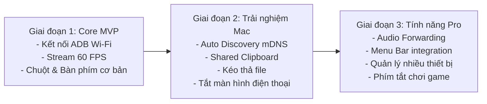

# WifiDesk Features & Technical Specifications

> Chi tiết các tính năng và thông số kỹ thuật của dự án mã nguồn mở **WifiDesk** — giải pháp trình chiếu và điều khiển thiết bị Android qua mạng Wi-Fi cục bộ trên macOS.

---

## 📑 Mục lục
1. [Kết nối không dây & Tự động nhận diện thiết bị (Wireless Discovery)](#1-kết-nối-không-dây--tự-động-nhận-diện-thiết-bị)
2. [Hiển thị & Giải mã thời gian thực (Ultra-Low Latency Display)](#2-hiển-thị--giải-mã-thời-gian-thực)
3. [Điều khiển từ xa toàn diện (Full Remote Control)](#3-điều-khiển-từ-xa-toàn-diện)
4. [Tính năng nâng cao Mac-First (Mac Productivity)](#4-tính-năng-nâng-cao-mac-first)
5. [Bảo mật & Quyền riêng tư (Privacy & Security)](#5-bảo-mật--quyền-riêng-tư)
6. [Lộ trình phát triển tính năng (Roadmap)](#6-lộ-trình-phát-triển-tính-năng)

---

## 1. Kết nối không dây & Tự động nhận diện thiết bị

- **Zero-Config Discovery (mDNS / Bonjour):**
  - Tự động dò tìm các thiết bị Android đã bật *Wireless Debugging* trong cùng mạng Wi-Fi nội bộ.
  - Người dùng không cần phải gõ thủ công địa chỉ IP (ví dụ `192.168.1.xxx:5555`).
- **Ghép nối 1 chạm qua mã QR / PIN (Pairing Assistant):**
  - Hỗ trợ chuẩn ghép nối bảo mật từ Android 11+ (`adb pair`).
  - Giao diện hướng dẫn từng bước trực quan cho người dùng mới.
- **Tự động kết nối lại (Auto Reconnect):**
  - Tự phát hiện và khôi phục kết nối ngay khi thiết bị quay trở lại cùng vùng phủ sóng Wi-Fi.
- **Hỗ trợ cắm cáp USB dự phòng:**
  - Tự động chuyển đổi mượt mà giữa USB và Wi-Fi mà không làm gián đoạn phiên làm việc.

---

## 2. Hiển thị & Giải mã thời gian thực

- **Độ trễ siêu thấp (Zero-Latency Stream < 30ms):**
  - Tận dụng `scrcpy-server` tầng thấp để thu thập khung hình trực tiếp từ `SurfaceControl` của Android.
  - Truyền tải luồng H.264/H.265 NAL units thô qua Socket TCP nội mạng.
- **Tốc độ khung hình mượt mà (Up to 60/120 FPS):**
  - Hỗ trợ màn hình tần số quét cao (90Hz / 120Hz) trên các dòng máy Android đời mới.
- **Tối ưu hiển thị cho màn hình Apple Retina:**
  - Tự động xử lý tỉ lệ hiển thị (HiDPI / Scaling) để hình ảnh sắc nét, không bị răng cưa hay vỡ hạt.
- **Tùy chỉnh linh hoạt Bitrate & Độ phân giải:**
  - Cho phép người dùng tùy chọn độ phân giải từ 720p, 1080p đến 2K/4K.
  - Tự điều chỉnh bitrate (2 Mbps - 16 Mbps) theo chất lượng sóng Wi-Fi.

---

## 3. Điều khiển từ xa toàn diện

- **Mô phỏng chuột & Cảm ứng đa điểm (Touch & Mouse Simulation):**
  - Chuột trái: Chạm (Tap) / Nhấn giữ (Long press) / Kéo (Drag).
  - Chuột phải: Phím **Back** của Android.
  - Cuộn chuột: Cuộn danh sách mượt mà (Smooth scrolling).
  - Phím chuột giữa / Cmd + H: Phím **Home** của Android.
  - Cmd + S: Mở màn hình đa nhiệm (App Switcher).
- **Gõ bàn phím tiếng Việt & Ký tự đặc biệt:**
  - Nhập liệu trực tiếp từ bàn phím macOS sang Android thông qua inject text hoặc IME đồng bộ.
  - Hỗ trợ đầy đủ bộ gõ tiếng Việt (Telex/VNI) từ Mac.
- **Ánh xạ phím tùy biến (Key Mapping):**
  - Cho phép gán các phím cứng trên Mac để kích hoạt các hành động cụ thể trên Android.

---

## 4. Tính năng nâng cao Mac-First

- **Đồng bộ hóa Clipboard hai chiều (Shared Clipboard):**
  - Copy một đoạn văn bản hoặc link trên macOS (`Cmd + C`), lập tức dán được trên Android (`Paste`) và ngược lại.
- **Kéo & Thả tập tin (Drag & Drop File Transfer):**
  - Kéo file ảnh, video, tài liệu từ Finder trên macOS thả thẳng vào cửa sổ WifiDesk để chuyển file sang Android.
  - Kéo file `.apk` vào để tự động cài đặt ứng dụng lên điện thoại.
- **Tắt màn hình điện thoại khi stream (Screen-off Streaming):**
  - Màn hình điện thoại vật lý tự động tắt đen trong khi vẫn hiển thị và điều khiển bình thường trên Mac.
  - Giúp điện thoại không bị nóng, không chai pin và bảo vệ sự riêng tư ở nơi công cộng.
- **Tích hợp Menu Bar macOS (Status Bar Companion):**
  - Ứng dụng có thể thu nhỏ thành một biểu tượng tinh tế trên thanh Menu Bar của Mac.
  - Bấm vào biểu tượng để bật/tắt nhanh cửa sổ điện thoại hoặc kiểm tra pin, trạng thái kết nối.
- **Chuyển tiếp âm thanh (Audio Forwarding):**
  - Hỗ trợ truyền âm thanh từ Android sang loa của Mac (hỗ trợ Android 10+ với SNDCPY hoặc Android 12+ native audio forwarding).

---

## 5. Bảo mật & Quyền riêng tư

- **100% P2P trong mạng LAN:**
  - Không truyền bất kỳ luồng video hay dữ liệu nào qua máy chủ trung gian trên Internet.
  - Hoạt động ngay cả khi ngắt kết nối Internet (chỉ cần router Wi-Fi nội bộ).
- **Không yêu cầu tài khoản đám mây:**
  - Người dùng không cần đăng ký tài khoản, không lo bị rò rỉ dữ liệu cá nhân.
- **Mã nguồn mở (Open Source):**
  - Toàn bộ mã nguồn minh bạch, cho phép cộng đồng kiểm tra và đóng góp.

---

## 6. Lộ trình phát triển tính năng

