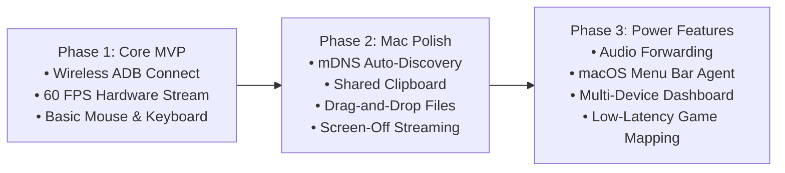

# WifiDesk — Technical Specifications & Feature Documentation

> Comprehensive specification and architectural breakdown of the **WifiDesk** open-source project: Ultra-low latency Android screen mirroring and remote control for macOS over local Wi-Fi.

---

## 📑 Table of Contents
1. [Wireless Connectivity & Device Discovery](#1-wireless-connectivity--device-discovery)
2. [Ultra-Low Latency Display Engine](#2-ultra-low-latency-display-engine)
3. [Comprehensive Remote Control & Input Injection](#3-comprehensive-remote-control--input-injection)
4. [Mac-First Productivity Features](#4-mac-first-productivity-features)
5. [Security & Privacy Architecture](#5-security--privacy-architecture)
6. [Feature Roadmap](#6-feature-roadmap)

---

## 1. Wireless Connectivity & Device Discovery

### 1.1 Zero-Configuration Discovery (mDNS / Bonjour)
- **Local Service Broadcasting:** Automatically discovers Android devices on the same Wi-Fi subnet with active Wireless Debugging enabled via multicast DNS (`_adb-tls-connect._tcp` / `_adb._tcp`).
- **Elimination of Manual Configuration:** Eliminates the need for users to manually inspect phone settings or enter IP addresses and ports (e.g., `192.168.1.100:5555`).

### 1.2 Interactive Pairing Assistant (Android 11+)
- **Wi-Fi Pairing Protocol:** Native integration with Android's secure pairing workflow (`adb pair <ip>:<port> <pairing-code>`).
- **Authentic 6-Digit PIN Pairing:** Provides a clean graphical guide for one-time 6-digit PIN verification and pairing port entry without relying on fake or non-functional QR pairing mechanisms.
- **Recent Device Persistence:** Persists previously connected devices locally in `history.json` for instant 1-click reconnecting from the dashboard.

### 1.3 Automatic Session Recovery
- **Heartbeat & Keep-Alive:** Monitors TCP socket connectivity in real time.
- **Instant Reconnection:** Seamlessly detects when a device drops from the Wi-Fi network and automatically re-establishes the streaming session upon rejoining.

### 1.4 1-Click USB-to-Wi-Fi Mode Switch (`adb tcpip 5555`)
- **Automated Network Query:** Automatically interrogates the connected device via `adb shell ip` to extract internal Wi-Fi IP address.
- **Zero-Terminal Activation:** Runs `adb tcpip 5555` and establishes wireless connection in 1 click, allowing users to unplug the USB cable immediately.

---

## 2. Ultra-Low Latency Display Engine

### 2.1 Hardware-Accelerated Video Pipeline
- **Direct Frame Capture:** Interacts directly with Android's internal `SurfaceControl` API to bypass UI toolkit overhead.
- **On-Device Hardware Encoding:** Encodes raw video frames directly via the device's GPU/VPU using `MediaCodec` (H.264 Baseline/High Profile and optional H.265/HEVC).
- **Sub-30ms Glass-to-Glass Latency:** Streams raw NAL units over raw TCP sockets directly into native hardware decoders on macOS (Apple VideoToolbox / Metal).

### 2.2 High Refresh Rate & Fluid Rendering
- **High Frame Rates (60 / 90 / 120 FPS):** Fully supports modern Android high-refresh-rate displays for butter-smooth animations and responsiveness.
- **Dynamic Bitrate Scaling:** Automatically throttles bitrate (ranging from 2 Mbps to 20 Mbps) based on Wi-Fi packet jitter, dropped frames, and network congestion.

### 2.3 Apple Retina & HiDPI Optimization
- **Pixel-Perfect Scaling:** Adapts to Apple Retina displays with automatic pixel density compensation (HiDPI integer/fractional scaling), eliminating blurriness and visual artifacts.
- **Configurable Resolutions:** Presets available for 720p, 1080p, 2K, and native device resolution.

---

## 3. Comprehensive Remote Control & Input Injection

### 3.1 Advanced Mouse & Multi-Touch Emulation
- **Pointer Event Normalization:** Normalizes cursor coordinates ($0.0 \to 1.0$) to guarantee precision across differing display aspect ratios and resolutions.
- **Primary Actions:**
  - **Left Click:** Touch down, drag, and touch up.
  - **Right Click:** Android system **Back** action (`KEYCODE_BACK`).
  - **Middle Click / Command + H:** Android system **Home** action (`KEYCODE_HOME`).
  - **Command + Tab:** Android **Recent Apps / App Switcher** (`KEYCODE_APP_SWITCH`).
  - **Command + S:** Device **Screenshot Capture** (Lossless PNG to `~/Downloads` & macOS clipboard).
- **Smooth Inertial Scrolling:** Converts macOS trackpad and mouse wheel scroll events into natural Android gesture scroll velocity.

### 3.2 Keyboard & International Text Input
- **Direct Keystroke Forwarding:** Maps macOS hardware keys to Android standard Linux/Android keycodes.
- **IME & Unicode Text Synchronization:** Injects complex international characters and multi-byte input (e.g., Vietnamese Telex/VNI, Japanese, Chinese) directly into the active Android text field without character loss.

---

## 4. Mac-First Productivity Features

### 4.1 Bidirectional Clipboard Synchronization
- **Real-Time Clipboard Sync:** Automatically synchronizes text copies between the macOS Pasteboard and the Android System Clipboard (`Cmd + C` on Mac $\to$ `Paste` on Android, and vice versa).

### 4.2 Drag & Drop File Sharing
- **File Transfer:** Drag images, documents, and videos from macOS Finder directly onto the device viewport to store them in the Android `Downloads` directory.
- **APK Sideloading:** Drag `.apk` packages onto the window to trigger automatic background installation.

### 4.3 Screen-Off Mirroring (Energy & Privacy Optimization)
- **Host Display Power Management:** Automatically blanks the physical Android display during an active mirroring session (`--turn-screen-off` flag).
- **Thermal & Battery Protection:** Dramatically reduces device heat dissipation and battery consumption while safeguarding user privacy in public settings.

### 4.4 macOS Menu Bar Companion
- **System Tray Integration:** Runs discretely in the macOS Menu Bar. Users can quickly toggle device windows, check Wi-Fi connection quality, and monitor device battery levels with a single click.

### 4.5 Audio Forwarding
- **Synchronized Audio Stream:** Low-latency PCM/AAC audio streaming directly to macOS audio output devices (via Android 10+ internal audio capture API).

### 4.6 Lossless Device Screenshot & System Clipboard Integration
- **Direct SurfaceFlinger Capture:** Captures native full-resolution PNG frames directly via `adb exec-out screencap -p` without client-side video scaling distortion or letterbox artifacts.
- **Auto-Save & Instant Paste:** Automatically saves files to `~/Downloads/WifiDesk_Screenshot_YYYYMMDD_HHMMSS.png` and copies the raw PNG data directly to the macOS system clipboard (`⌘V`).
- **Interactive Floating Toast HUD:** Provides immediate preview with file size, 1-click **Finder** reveal (`open -R`), and **Open** viewer actions with auto-dismissal. Triggerable via floating bottom toolbar camera button or <kbd>Cmd</kbd> + <kbd>S</kbd>.

### 4.7 Right-Side Vertical Action Dock
- **Unobstructed Viewport Ergonomics:** Productivity tools (Streaming Bitrate, Screenshot, Text Injector, Clipboard Sync) are isolated from the bottom navigation dock and placed in an elegant vertical floating dock along the right edge of the real-time phone display.
- **Dynamic Proximity & Gap Preservation:** Positioned outside the phone frame with a consistent 16px ergonomic gap, scaling responsively with window size and device aspect ratio while maintaining symmetrical window centering.

---

## 5. Security & Privacy Architecture

### 5.1 Local Peer-to-Peer Protocol
- **Strictly LAN-Bound:** Audio, video, and input streams travel strictly across the local wireless network. No external relay servers, STUN/TURN traversal, or cloud proxies are utilized.
- **Offline Reliability:** Fully operational in air-gapped environments without an active Internet uplink.

### 5.2 Zero Telemetry & Open Source
- **No Account Required:** Completely functional without user registration, subscriptions, or telemetry gathering.
- **Auditable Security:** Built entirely from transparent, verifiable open-source code under the MIT license.

---

## 6. Feature Roadmap

