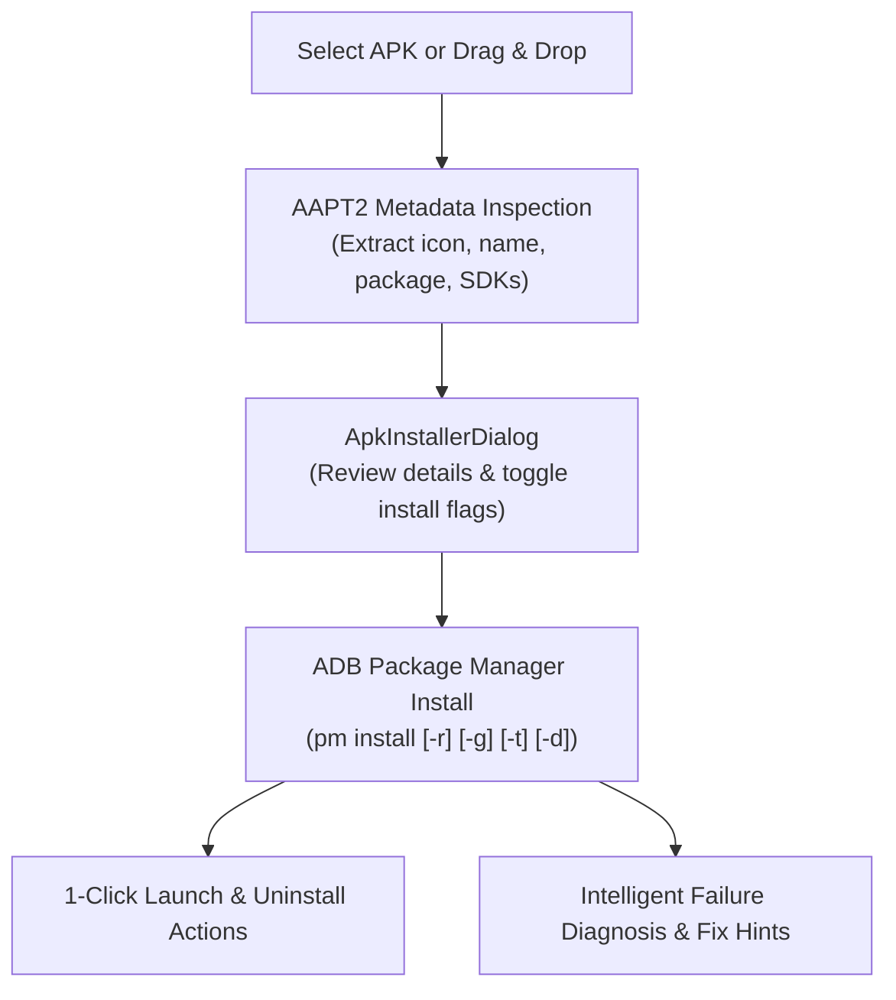

# Feature: Professional APK Sideload & Package Manager

> **Subsystem:** `lib/features/apk_installer/`  
> **Key Interfaces:** `ApkInstallerRepository`, `Aapt2MetadataDatasource`  
> **Presentation:** `ApkInstallerCubit`, `ApkInstallerDialog`  
> **Shortcut:** <kbd>Cmd</kbd> + <kbd>Shift</kbd> + <kbd>I</kbd>  
> **Platforms:** macOS ✅ · Windows 🧪 not yet verified ([status](../platform-support.md))

---

## 📌 Overview

The **APK Sideload & Package Manager** provides an end-to-end workflow for inspecting, configuring, installing, and managing Android application packages (`.apk`) directly from macOS.

  

---

## ⚡️ Key Capabilities

### 1. Pre-Install Metadata Inspection (AAPT2 Engine)
- **Host-Side Extraction:** Uses `aapt2` from the Android SDK `build-tools` (or on `PATH`) to read the manifest before the APK is pushed. It is not bundled with Azdroid; without it, the APK still installs, and the card shows only the file name and size.
- **Detailed Inspection Card:**
  - **App Identity:** Display Name, Package ID (`applicationId`), and high-resolution App Icon.
  - **Versioning:** Version Name (e.g. `1.4.2`) and Version Code (`142`).
  - **SDK Requirements:** Minimum Android SDK (`minSdkVersion`) and Target SDK (`targetSdkVersion`).
  - **File Footprint:** Exact byte size formatted in human-readable units (`MB`).

### 2. Granular Installation Flags
Customize Android package manager behavior with 1-click toggles:
- **`-r` (Reinstall):** Replaces existing application while preserving app internal data and caches.
- **`-g` (Grant Permissions):** Automatically grants all runtime permissions requested in the manifest upon installation.
- **`-t` (Allow Test Packages):** Permits installation of packages marked with `android:testOnly="true"`.
- **`-d` (Allow Downgrade):** Allows installing an APK with a lower version code than the currently installed version.

### 3. Intelligent Failure Diagnosis
When an installation fails, Azdroid automatically analyzes the raw ADB error string and presents actionable solutions:
- **`INSTALL_FAILED_UPDATE_INCOMPATIBLE`:** Explains that the signing certificate does not match the installed version; offers 1-click clean uninstall of the older package.
- **`INSTALL_FAILED_INSUFFICIENT_STORAGE`:** Identifies storage constraints on the target device.
- **`INSTALL_FAILED_USER_RESTRICTED`:** Specifically diagnoses Xiaomi MIUI / HyperOS USB installation blocks and directs the user to enable **"Install via USB"** in Developer Options.

### 4. Post-Installation Ergonomics
- **1-Click Launch:** Starts the default launcher activity immediately via Android `monkey` tool without needing to touch the phone.
- **Clean Uninstall:** Completely removes the package from the device via `pm uninstall` if testing is complete.
