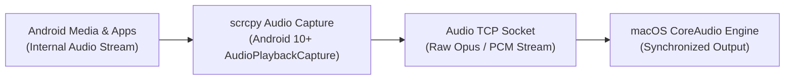

# Feature: Low-Latency Audio Forwarding

> **Subsystem:** `lib/features/audio/`  
> **Key Interfaces:** `AudioRepository`, `AudioSocketDatasource`  
> **Presentation:** `AudioCubit`, `AudioControlsWidget`  
> **Platforms:** ❌ Not functional yet on macOS or Windows: the scrcpy server is started with `audio=false` ([status](../platform-support.md))

---

## 📌 Overview

DeskDroid routes system audio from Android directly to macOS speakers or connected headphones with low latency. Audio is captured natively on the device and forwarded alongside the video stream over an independent high-throughput socket.

---

## ⚡️ Key Capabilities

### 1. Internal Audio Capture (Android 10+)
- **System-Level Capture:** Employs Android 10+'s `AudioPlaybackCaptureConfiguration` API to capture clean, digital audio streams directly from applications and media players.
- **Microphone Independence:** Captures audio internally without relying on the physical phone microphone, avoiding ambient room noise and acoustic echo.

### 2. High-Fidelity Audio Compression & Sockets
- **Opus & Raw PCM Codecs:** Utilizes low-latency Opus audio compression (48 kHz sample rate, stereo channels) to minimize Wi-Fi packet bandwidth while preserving acoustic fidelity.
- **Dedicated Socket Stream:** Audio travels across a dedicated TCP socket independent of video packets, preventing audio stuttering during sudden video bitrate spikes.

### 3. A/V Synchronization & Buffer Governance
- **Lip-Sync Alignment:** Dynamically balances audio packet jitter buffers against video frame PTS timestamps to maintain synchronization during video playback and gaming.
- **Low-Latency Mode:** Configured for minimum buffering (~40ms) to ensure interactive sounds (clicks, typing, UI effects) feel responsive.

### 4. Desktop Audio Controls
- **Volume Slider & Mute Toggle:** Integrated volume control in the audio control toolbar allowing users to adjust Android playback volume independently of macOS master volume.
- **Audio Output Selection:** Automatically conforms to current macOS default audio output devices (built-in speakers, AirPods, USB DACs).
