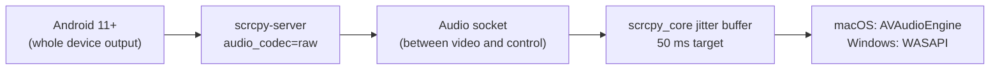

# Feature: Audio Forwarding

> **Subsystem:** `lib/features/audio/` (controls and state), `lib/core/services/audio_stream_native_service.dart` (native player)  
> **Key Interfaces:** `AudioRepository`, `IAudioStreamNativeService`  
> **Presentation:** `AudioCubit`, `AudioControlsWidget`  
> **Platforms:** macOS 🧪 player verified on an Android 16 emulator, not yet in the app with an Android 11+ phone · Windows 🧪 written, not yet built ([status](../platform-support.md))

---

## 📌 Overview

While you mirror a phone, its sound plays on your computer. The phone itself goes quiet, like when headphones are connected, and its normal output comes back when mirroring stops.

---

## ⚡️ How It Works

| Topic | Behavior |
|:---|:---|
| Requirements | Android 11 or newer. On Android 11, unlock the phone before mirroring starts. Android 10 and older cannot share audio: mirroring works without sound, and the audio button explains why. |
| Format | Uncompressed PCM, 48 kHz stereo, about 1.5 Mbps on top of the video. No decoder is needed on the computer. |
| Latency | A 50 ms jitter buffer smooths network timing. If the buffer keeps more than 70 ms for a whole second, the extra is dropped, so latency stays close to 50 ms. Above 200 ms, it is cut back at once. |
| Gaps | When audio arrives late, a short gap of silence plays while 50 ms is collected again. |
| Volume and mute | The speaker button in the bottom toolbar (volume slider and mute). They change only what the computer plays, not the phone's own volume, and are kept for the rest of the app session. |
| Output device | The computer's default output. On macOS, switching the output (for example to AirPods) restarts playback on the new device. |

The audio socket is part of the mirroring session: it opens after the video socket and before the control socket, and closes with the session. Details: [native-audio-contract.md](../native-audio-contract.md).

---

## 🔈 Audio Button States

| Icon | Tooltip | Meaning |
|:---|:---|:---|
| 🔊 (volume level) | Audio Volume (n%) | Playing; click for volume and mute. |
| 🔇 grey | Audio Starting… | Waiting for the first audio data. |
| 🔇 grey | No Audio: the phone needs Android 11 or newer | The phone cannot share audio. |
| 🔇 grey | No Audio: not supported on this computer yet | This build has no native player. |
| ⚠️ | Audio Failed (see the app log) | Configuration error, unsupported stream, or no output device. |
| 🔇 grey | Audio Stopped by the Phone | The phone closed the audio stream; video continues. |

---

## ✅ Verification

- `scripts/check_macos_native.sh <serial> audio` compiles the app's own Swift classes with `scrcpy_core`, opens audio after the video session reports `connected` (as the app does), and plays the phone's audio on the Mac. Android 16 emulator: `playing`, played frames keep up with real time, latency 0–95 ms after start-up. Redmi 9 (Android 10): `disabled`.
- `dart run tool/verify_scrcpy_server.dart --serial=<serial>` checks the raw audio header and data with the app's exact server arguments.
