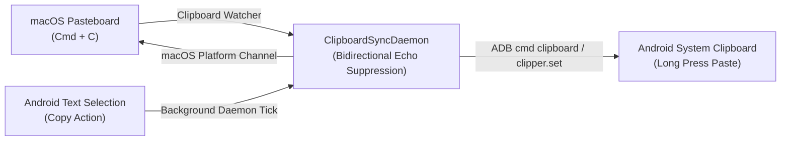

# Feature: Bidirectional Clipboard Synchronization

> **Subsystem:** `lib/features/productivity/`  
> **Key Interfaces:** `ClipboardRepository`, `ClipboardDatasource`, `ClipboardSyncDaemon`  
> **Presentation:** `ClipboardCubit`, `ClipboardSyncMenuButton`, `ClipboardFeedbackBanner`  
> **Shortcuts:** <kbd>Cmd</kbd> + <kbd>Shift</kbd> + <kbd>C</kbd> (Push to Android) / <kbd>Cmd</kbd> + <kbd>Shift</kbd> + <kbd>V</kbd> (Pull to computer)  
> **Platforms:** macOS ✅ · Windows 🧪 not yet verified ([status](../platform-support.md))

---

## 📌 Overview

DeskDroid provides seamless bidirectional clipboard synchronization between macOS and Android. Text copied on your computer can be pasted on Android, and text copied on Android can be pasted on the computer, within about 2 seconds.

---

## ⚡️ Key Capabilities

### 1. Two-Way Background Daemon (Every 2 Seconds)
- **Background Daemon:** `ClipboardSyncDaemon` runs a non-intrusive 2-second background loop monitoring both macOS pasteboard and Android clipboard without user interaction.
- **Mac to Android:** When you copy text, URLs, API keys, or verification codes on the computer, the next tick forwards the string to the Android clipboard.
- **Android to Mac:** When you select and copy text on the phone, the daemon detects the clipboard change and pushes the text to the macOS clipboard, ready for <kbd>Cmd</kbd> + <kbd>V</kbd>.

### 2. Dual Strategy & Broad Android Compatibility
- **Primary Method:** Native Android `cmd clipboard set / get` for modern AOSP devices.
- **Broadcast Fallback:** Automatic fallback to `am broadcast -a clipper.set / clipper.get` when `cmd clipboard` is unavailable on custom ROMs.

### 3. Bidirectional Echo Loop Suppression
- **Last-Synced Text:** Remembers the last text seen on each side.
- **Loop Prevention:** Text received from Mac is marked before pushing to Android, ensuring subsequent Android polling does not reflect it back to Mac, completely preventing infinite ping-pong loops.

### 4. Desktop Shortcuts & HUD Feedback
- **Fast Shortcuts:** <kbd>Cmd</kbd> + <kbd>Shift</kbd> + <kbd>C</kbd> to manually force push to Android; <kbd>Cmd</kbd> + <kbd>Shift</kbd> + <kbd>V</kbd> to manually force pull to Mac.
- **HUD Feedback Toast:** `ClipboardFeedbackBanner` pops up a subtle toast badge with direction and text snippet, automatically dismissing after 4 seconds.
- **Dock Menu Button:** `ClipboardSyncMenuButton` provides one-click manual sync triggers and auto-sync toggle.
