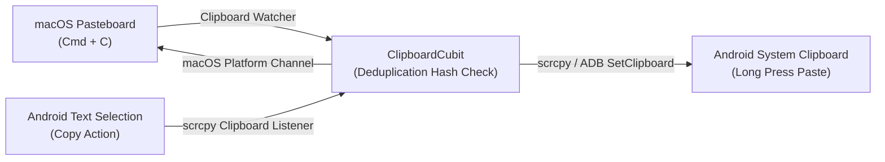

# Feature: Bidirectional Clipboard Synchronization

> **Subsystem:** `lib/features/productivity/`  
> **Key Interfaces:** `ClipboardRepository`, `ClipboardDatasource`  
> **Presentation:** `ClipboardCubit`, `ClipboardSyncMenuButton`  
> **Shortcuts:** <kbd>Cmd</kbd> + <kbd>C</kbd> (Mac Copy) / <kbd>Cmd</kbd> + <kbd>V</kbd> (Mac Paste)

---

## 📌 Overview

WifiDesk provides seamless bidirectional clipboard synchronization between macOS and Android. Any text copied on your Mac is instantly pasteable on Android, and text selected and copied on Android is immediately available in the macOS pasteboard.

---

## ⚡️ Key Capabilities

### 1. Two-Way Instant Synchronization
- **Mac to Android:** When you copy text, URLs, API keys, or verification codes on macOS (<kbd>Cmd</kbd> + <kbd>C</kbd>), WifiDesk immediately forwards the string to Android's `ClipboardManager`.
- **Android to Mac:** When you select and copy text on the phone, the daemon detects the clipboard change and pushes the text to the macOS clipboard, ready for <kbd>Cmd</kbd> + <kbd>V</kbd>.

### 2. Echo Loop Prevention & Deduplication
- **Content Hash Verification:** Maintains a history of the last synchronized string hash. If incoming clipboard content matches the previous synchronization hash, the event is safely dropped to prevent infinite ping-pong echo loops between the two operating systems.
- **Trim & Null Safety:** Robustly handles empty strings, whitespace, and non-printable control characters.

### 3. Full Unicode & Multi-Line Integrity
- **Complex Script Support:** Seamlessly synchronizes international scripts including Vietnamese diacritics, Chinese characters, Japanese kanji/kana, Korean hangul, and multi-byte emojis.
- **Formatted Strings:** Preserves line breaks (`\n`), code indentation, and formatted JSON or YAML documents.

### 4. Privacy & Manual Sync Controls
- **Sync Status Pill:** Displays an unobtrusive indicator in the control dock confirming successful clipboard dispatch.
- **Toggleable Sync:** Easily pause or disable automatic clipboard sharing from settings when working with sensitive credentials or password managers.
