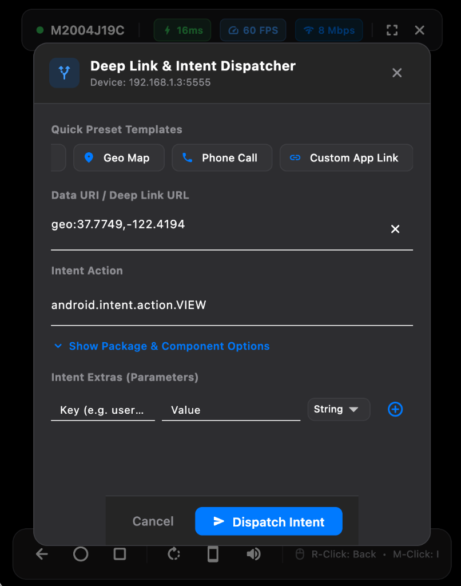
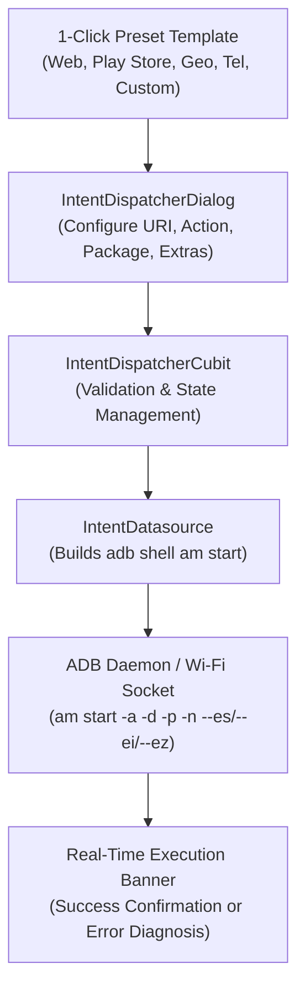

# Feature: Deep Link & Intent Dispatcher

> **Subsystem:** `lib/features/intent_dispatcher/`  
> **Key Interfaces:** `IntentRepository`, `IntentDatasource`  
> **Presentation:** `IntentDispatcherCubit`, `IntentDispatcherDialog`  
> **Shortcut:** <kbd>Cmd</kbd> + <kbd>Shift</kbd> + <kbd>D</kbd>  
> **Platforms:** macOS ✅ · Windows 🧪 not yet verified ([status](../platform-support.md))

---

## 📌 Overview

The **Deep Link & Intent Dispatcher** empowers mobile developers, QA engineers, and power users to fire Android Intents, deep link URLs, and app URI schemes directly into any running Android device over Wi-Fi without leaving macOS.

  

---

## ⚡️ Key Capabilities

### 1. One-Click Preset Templates
Quickly populate common URI schemes and standard Android intent actions:
- **🌐 HTTPS Web:** Open public or staging URLs in the default browser (`https://flutter.dev`).
- **🛍️ Play Store:** Navigate directly to app product pages (`market://details?id=...`).
- **🗺️ Geo Map:** Pin coordinates or addresses in mapping apps (`geo:37.7749,-122.4194?q=San+Francisco`).
- **📞 Phone Dialer:** Populate the dialer keypad (`tel:+15550199`).
- **🔗 Custom Scheme:** Test app-specific deep links (`myapp://checkout?id=99`).

### 2. Full Intent Specification
- **Data URI (`-d`):** The primary target URL or deep link scheme.
- **Intent Action (`-a`):** Defaults to `android.intent.action.VIEW`, but supports any system or custom action (e.g. `android.intent.action.SEND`, `android.intent.action.MAIN`).
- **Target Package (`-p`) & Component (`-n`):** Explicitly route intents to specific applications or unexported/exported activity classes, bypassing intent choosers.

### 3. Interactive Typed Intent Extras Editor
Add key-value arguments dynamically passed to the target Android Activity:
- **String (`--es`):** Text parameters, authentication tokens, or redirect paths.
- **Integer (`--ei`):** Numeric IDs, status flags, and counts.
- **Boolean (`--ez`):** Feature toggles (`true` or `false`).

### 4. Real-Time Feedback & Diagnosis
- **Instant Error Detection:** Captures and translates shell errors (such as `Activity not found`, `SecurityException`, or syntax errors) into clear visual banners.
- **Output Inspection:** Displays the raw output returned by Android's Activity Manager for fast debugging.

---

## ⌨️ Access Points & Shortcuts

| Access Method | Location / Shortcut | Description |
| :--- | :--- | :--- |
| **Side Controls Toolbar** | Toolbar icon `Icons.alt_route_rounded` | Located on the right-side dock next to the mirroring viewport |
| **Keyboard Shortcut** | <kbd>Cmd</kbd> + <kbd>Shift</kbd> + <kbd>D</kbd> | Opens the modal dialog instantly while viewing the device stream |
| **Feature Showcase** | Help / Feature Guide Dialog | Interactive overview card in the built-in catalog |
