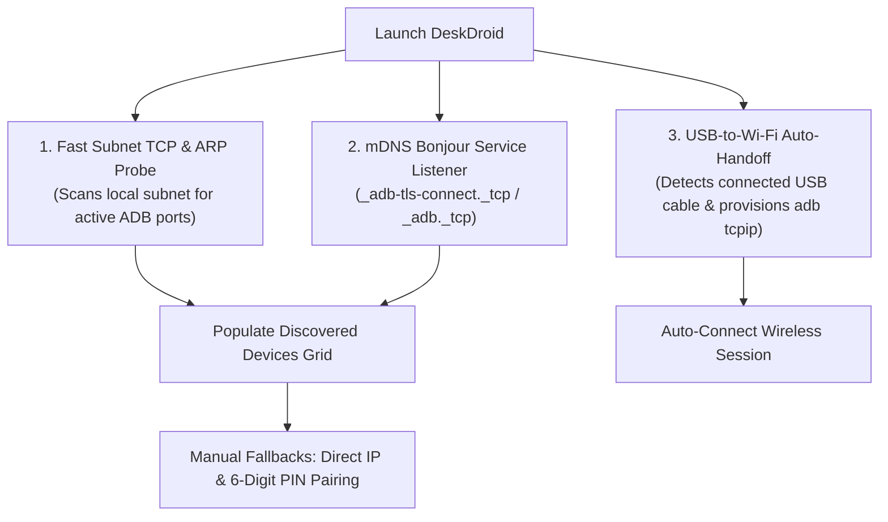

# Feature: Device Discovery & Wireless Pairing

> **Subsystem:** `lib/features/discovery/`  
> **Key Interfaces:** `DeviceDiscoveryRepository`, `AdbTcpipService`, `UsbWifiAutoHandoffService`  
> **Presentation:** `DiscoveryCubit`, `PairingCubit`, `DiscoveryPage`, `PairingDialog`, `ManualConnectDialog`  
> **Platforms:** macOS ✅ · Windows ✅ Wi-Fi verified, 🧪 USB not yet verified ([status](../platform-support.md))

---

## 📌 Overview

DeskDroid provides frictionless, zero-configuration device discovery and multi-path connection capabilities. Users do not need to manually discover their phone's IP address or type complex terminal commands.

---

## ⚡️ Key Capabilities

### 1. Zero-Config Subnet Probing (ARP + Fast TCP Scan)
- **Local Network Interrogation:** Automatically queries the macOS local ARP cache (`arp -an`) to identify active IPv4 hosts on the current Wi-Fi subnet.
- **Fast Non-Blocking Probing:** Dispatches asynchronous, concurrent TCP socket probes (150ms timeout) across standard ADB daemon ports (default `5555` and dynamic ranges `37000–44000`).
- **Instant Device Resolution:** Active Android endpoints are resolved to manufacturer model names (e.g. `Samsung Galaxy S23`, `Xiaomi Redmi 9`, `Google Pixel 8`) and displayed on the discovery grid with connection latency badges.

### 2. Automated USB-to-Wi-Fi Auto-Handoff
- **Plug-and-Play Provisioning:** When an authorized Android device is plugged into the Mac via USB, `UsbWifiAutoHandoffService` automatically extracts the device's internal Wi-Fi IP address via `adb shell ip route`.
- **Zero-Terminal Switch:** Dispatches `adb tcpip 5555` in the background, provisions the device for network debugging, and connects wirelessly.
- **Deduplication Safeguard:** Remembers previously provisioned hardware serials during the session to avoid redundant TCP/IP restarts.

### 3. Interactive 6-Digit PIN Pairing (Android 11+)
- **Standard Protocol Integration:** Implements native Android Wireless Debugging pairing (`adb pair <ip>:<port> <pin>`).
- **Ergonomic Modal Dialog:** Provides visual guidance for entering the pairing port and 6-digit PIN displayed under **Developer Options ➔ Wireless Debugging ➔ Pair device with pairing code**.
- **Instant Post-Pair Connection:** Automatically invokes `adb connect` immediately upon successful pairing handshake verification.

### 4. Direct IP & History Fallback
- **Direct IP Entry:** Allows users to manually connect to custom IP addresses and non-standard ports with persistent recent memory.
- **Session History:** Persists previously connected devices locally for 1-click reconnecting from the dashboard without rescanning.

---

## 🏛️ Technical Design & Data Flow

1. `DiscoveryCubit.startDiscovery()` launches concurrent discovery tasks via `DeviceDiscoveryRepository`.
2. `DeviceDiscoveryDatasourceImpl` aggregates attached ADB devices, ARP cache entries, and active TCP socket probes.
3. State transitions from `DiscoveryInitial` $\to$ `DiscoveryLoading` $\to$ `DiscoveryLoaded(devices)` or `DiscoveryError`.
4. Connected devices trigger `StreamingCubit.startStream(device)` to initialize mirroring.
