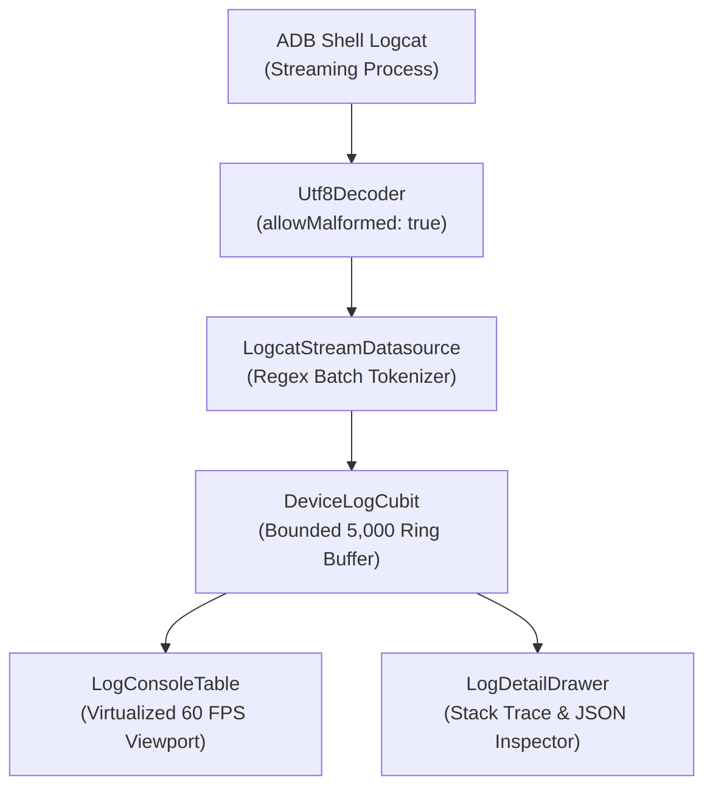

# Feature: Real-Time Device Logcat Console & Debugging

> **Subsystem:** `lib/features/logging/`  
> **Key Interfaces:** `DeviceLogRepository`, `LogcatStreamDatasource`  
> **Presentation:** `DeviceLogCubit`, `DeviceLogDialog`, `LogDetailDrawer`, `LogConsoleTable`, `LogFilterBar`  
> **Shortcut:** <kbd>Cmd</kbd> + <kbd>Shift</kbd> + <kbd>L</kbd>

---

## 📌 Overview

The **Device Logcat Console** is a developer inspection and diagnostic cockpit built directly into WifiDesk. It captures real-time Android logcat streams over wireless ADB with advanced filtering, stack trace colorization, line bookmarking, and continuous recording.

---

## ⚡️ Key Capabilities

### 1. High-Throughput Streaming & Resilient Engine
- **Bounded Ring Buffer:** Retains up to 5,000 active entries in memory to preserve host system RAM while preventing UI stalls.
- **Malformed UTF-8 Resilience:** Leverages `Utf8Decoder(allowMalformed: true)` to ensure non-standard driver binary dumps do not crash the stream.
- **Instant Controls:** Pause/freeze live output to investigate transients without losing buffer state; 1-click clear console or clear device buffer (`adb logcat -c`).

### 2. Multi-Tier Filtering Pipeline
- **Log Levels:** Color-coded priority badges (`Verbose`, `Debug`, `Info`, `Warning`, `Error`, `Fatal`).
- **Full-Text & Regex Search:** Instant substring search with optional regular expression syntax support.
- **Dynamic Tag & PID Autocomplete:** Dropdown menus dynamically populated from currently incoming tags and active Android process IDs.
- **Negation & Exclude Tags:** Exclude noisy subsystems (e.g. `OpenGLRenderer`, `ViewRootImpl`) using `-tag` chips with 1-click deletion and "Clear all" control.

### 3. Filter Presets
Switch instantly between common developer workflows using the Preset dropdown:
- **All Logs:** Unfiltered full device output.
- **Crashes & ANRs:** Filters for `Level >= Error` focusing on crashes, exceptions, and fatal signals.
- **Network & HTTP:** Isolates HTTP/REST clients (`OkHttp`, `Retrofit`, `Volley`, `cronet`).
- **Audio & Media:** Monitors media playback pipelines (`AudioTrack`, `ExoPlayer`, `MediaCodec`).
- **Android System:** Filters core OS daemons (`ActivityManager`, `WindowManager`).
- **Starred Only:** Focuses exclusively on lines flagged by the developer.

### 4. Bookmarking (Star Logs) & Side Detail Drawer
- **Line Bookmarking:** Click the star icon on any row or inside the drawer to flag entries for later review.
- **Inspector Drawer:** 420px slide-out drawer displaying comprehensive entry metadata (Timestamp, PID, TID, Level, Tag).
- **Stack Trace Color Coding:** Automatically identifies and syntax-highlights Java/Kotlin exception stack traces (`at package.Class.method(File.java:123)`).
- **Format JSON / Raw:** Automatically detects JSON strings embedded in log bodies and formats them with 2-space indentation.

### 5. Adaptive Soft-Wrap & Continuous Disk Recording
- **Performance Toggle:** Switch between fixed `itemExtent: 26.0` (ultra-fast virtualized 60 FPS scrolling) and soft-wrap multi-line rendering.
- **Live File Recording:** Stream logs directly to a timestamped file on macOS disk (`~/Downloads/WifiDesk_Logcat_*.txt`).

### 6. macOS Native Keyboard Shortcuts & Navigation
Ergonomic keyboard bindings orchestrated via `LogcatShortcutHandler`:
- <kbd>Cmd</kbd> + <kbd>F</kbd> / <kbd>Ctrl</kbd> + <kbd>F</kbd>: Instantly focus the search input field.
- <kbd>Cmd</kbd> + <kbd>K</kbd> / <kbd>Ctrl</kbd> + <kbd>K</kbd>: Clear the in-memory console buffer (`cubit.clearConsole()`).
- <kbd>Space</kbd>: Pause / resume the live stream (safely inhibited while actively typing in any text input).
- <kbd>Cmd</kbd> + <kbd>Down</kbd> / <kbd>Ctrl</kbd> + <kbd>Down</kbd>: Instantly jump to the latest log entries and re-engage auto-scroll.
- <kbd>Esc</kbd>: Context-sensitive back navigation: Unfocus search field if focused $\rightarrow$ Close Detail Drawer if open $\rightarrow$ Dismiss the Console Dialog.

### 7. Search Query In-Line Match Highlighting
- **Multi-Column Highlight:** Visual match highlighting across both `Tag` and `Message` columns via `LogSearchHighlighter`.
- **Contrast & Styling:** Amber highlight badge (`AppColors.statusWarning.withValues(alpha: 0.38)`), bold weight, and crisp high-contrast white text.
- **Search Modes:** Fully honors active Case-Sensitive (`Aa`) and Regex (`.*`) toggles with safe error boundaries for invalid patterns.

