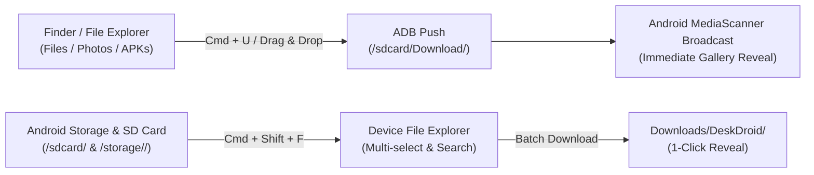

# Feature: Bidirectional File Transfer & Device File Explorer

> **Subsystem:** `lib/features/productivity/`  
> **Key Interfaces:** `FileTransferRepository`, `FileTransferDatasource`  
> **Presentation:** `FileTransferCubit`, `DeviceFileManagerCubit`, `DeviceFileManagerDialog`, `FileDropTargetOverlay`  
> **Shortcuts:** <kbd>Cmd</kbd> + <kbd>U</kbd> (Push) / <kbd>Cmd</kbd> + <kbd>Shift</kbd> + <kbd>F</kbd> (Explorer)  
> **Platforms:** macOS ✅ · Windows 🧪 not yet verified ([status](../platform-support.md))

---

## 📌 Overview

DeskDroid provides full two-way file sharing between macOS and Android. Users can push arbitrary files to the phone via drag-and-drop or explore and pull files from internal storage and MicroSD cards back to macOS.

---

## ⚡️ Key Capabilities

### 1. macOS to Android Push (<kbd>Cmd</kbd> + <kbd>U</kbd> & Direct Drag-and-Drop)
- **Full-Window Viewport Drag & Drop:** Drag files or folders directly from Finder (macOS) or File Explorer (Windows) and drop anywhere onto the mirroring canvas (in both Standard and Zen fullscreen modes) with frosted-glass drag highlight.
- **Zero-Click APK Auto-Sideloading:** Dropping an `.apk` package bypasses modal dialogs and initiates non-blocking background installation with real-time HUD progress badges.
- **Recursive Folder Expansion:** Dropping a directory recursively parses and transfers all nested files automatically.
- **Automated Media Indexing:** Media files (JPEG, PNG, MP4, MP3) automatically trigger an Android `MediaScannerConnection` broadcast upon transfer so they appear immediately in Google Photos / Gallery.
- **Transfer Status Banner:** A floating dynamic HUD banner displays live transfer and install progress (`Installing APK: app.apk`, `Item 2 of 5`), file sizes, and automatically dismisses after 4 seconds upon successful completion.

### 2. Android Device File Explorer (<kbd>Cmd</kbd> + <kbd>Shift</kbd> + <kbd>F</kbd>)
- **Storage Navigation:** Interactive modal file manager to browse phone directories with breadcrumb navigation.
- **Quick Access Folders:** Quick shortcuts for common storage paths:
  - `Downloads` (`/sdcard/Download`)
  - `Camera` (`/sdcard/DCIM/Camera`)
  - `Screenshots` (`/sdcard/Pictures/Screenshots`)
  - `Movies` (`/sdcard/Movies`)
- **MicroSD & External Storage Detection:** Automatically scans `/storage/` for external UUID mount points (e.g. `/storage/0000-0000/`) and renders an ergonomic **💳 SD Card** quick shortcut.

### 3. File Search, Sorting & Batch Download
- **Instant Search:** Real-time client-side name filtering across current directory contents.
- **Multi-Criteria Sorting:** Sort files by Date Modified, File Size, or Name in ascending/descending order.
- **Bulk Selection:** "Select All" toggle with checkbox multi-selection and cumulative size display.
- **Batch Pull to Computer:** Downloads selected files to the `DeskDroid` folder inside Downloads, with 1-click reveal (`open -R` in Finder on macOS, `explorer.exe /select` on Windows).
