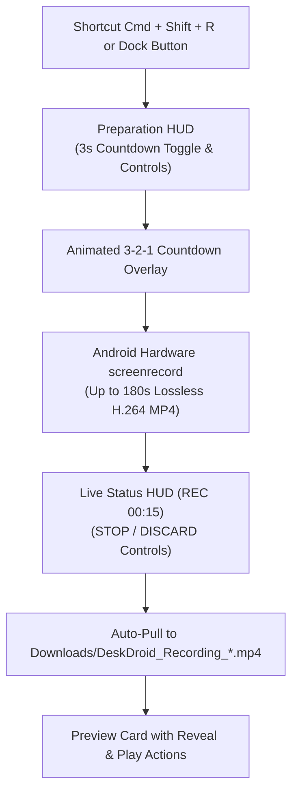

# Feature: Hardware Screen Recording (Lossless MP4)

> **Subsystem:** `lib/features/streaming/`  
> **Key Interfaces:** `ScreenRecordingRepository`, `ScreenRecordingDatasource`  
> **Presentation:** `ScreenRecordingCubit`, `ScreenRecordingHud`, `ScreenRecordingCountdownOverlay`  
> **Shortcut:** <kbd>Cmd</kbd> + <kbd>Shift</kbd> + <kbd>R</kbd>  
> **Platforms:** macOS ✅ · Windows 🧪 not yet verified ([status](../platform-support.md))

---

## 📌 Overview

DeskDroid provides lossless on-device video recording without placing computational capture burden on your Mac. It coordinates Android's native hardware `screenrecord` engine with an Apple-style preparation HUD, animated countdown, and automatic pulling to macOS.

  

---

## ⚡️ Key Capabilities

### 1. On-Device Hardware Video Recording
- **Native Encoder Pipeline:** Executes Android's internal `/system/bin/screenrecord` utility directly on the target device, recording display frames in hardware H.264 MP4 format.
- **Zero Host Overhead:** Eliminates desktop frame grabbing and re-encoding overhead on macOS, preserving 100% of host CPU and GPU resources for development.

### 2. Intentional Recording Preparation HUD
- **Ergonomic Initiation:** Clicking the recording icon or pressing <kbd>Cmd</kbd> + <kbd>Shift</kbd> + <kbd>R</kbd> summons a floating glassmorphic preparation HUD rather than recording abruptly.
- **Countdown Toggle:** Provides an optional 3-second buffer switch, an instant **"Start Now"** action, and quick abort via <kbd>Esc</kbd>.

### 3. Animated 3-2-1 Countdown Overlay
- **Visual Buffer:** Displays an animated pulsating circular dial over the phone display during the 3-second preparation phase.
- **Context Preparation:** Gives developers and presenters time to open the target app screen or position the mouse before recording starts.

### 4. Live Elapsed Duration & Dual Actions
- **Live Status Pill:** Renders a floating indicator displaying the active recording duration (e.g. `REC 00:15`) with a pulsing red recording dot.
- **Stop vs. Discard:**
  - **STOP:** Interrupts the recording cleanly to finalize the MP4 container and pulls it to the host machine.
  - **DISCARD:** Immediately terminates the process and deletes the temporary device file, leaving zero host disk clutter.

### 5. Auto-Pull to the Computer & Quick Actions
- **Timestamped File Naming:** Automatically pulls the finished video to `DeskDroid_Recording_YYYYMMDD_HHMMSS.mp4` in the Downloads folder (`~/Downloads` on macOS, `%USERPROFILE%\Downloads` on Windows).
- **Interactive Completion Card:** Displays a preview card offering 1-click **Reveal** (Finder on macOS, File Explorer on Windows) and **Play** actions.
