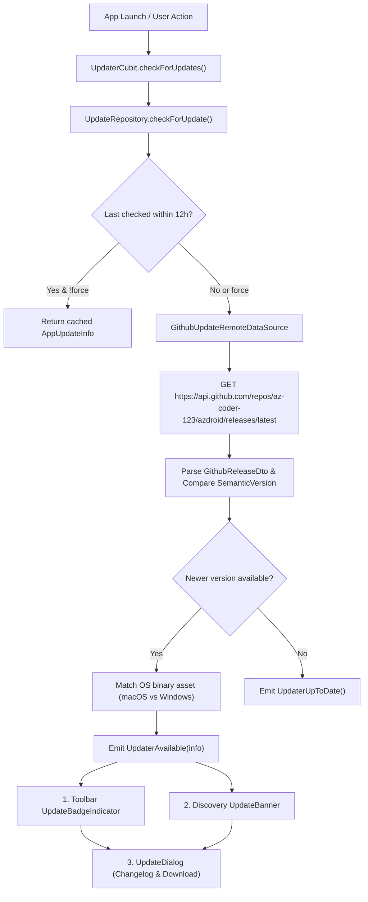

# Feature: In-App Update & Version Discovery System

> **Subsystem:** `lib/features/updater/`  
> **Key Interfaces:** `UpdateRepository`, `UpdateRemoteDataSource`, `SemanticVersion`, `AppUpdateInfo`  
> **Presentation:** `UpdaterCubit`, `UpdateBadgeIndicator`, `UpdateBanner`, `UpdateDialog`  
> **Platforms:** macOS & Windows (Desktop)

---

## 📌 Overview

The **In-App Update System** automatically checks GitHub Releases for newer builds of Azdroid without interrupting the user's workflow. It offers an ambient, 3-tier notification experience complying with Apple Human Interface Guidelines and cross-platform desktop standards.

---

## ⚡️ Key Capabilities

### 1. Robust Semantic Version Parsing (`SemanticVersion`)
- Numerical segment comparison (`MAJOR.MINOR.PATCH+BUILD`) guaranteeing `1.10.0` > `1.4.0`.
- Tolerant against leading `v`, build numbers, and pre-release identifiers.

### 2. Multi-Tier Ambient Notifications (Apple HIG Ergonomics)
- **Ambient Indicator (`UpdateBadgeIndicator`):** A discreet toolbar icon in the AppBar displaying a status badge dot when an update is available. Clicking opens the detailed modal dialog.
- **Contextual Banner (`UpdateBanner`):** A non-blocking, dismissible banner above the discovery device list notifying the user of new features.
- **Detailed Modal Dialog (`UpdateDialog`):** macOS-native dialog presenting formatted release notes, published date, matched ZIP archive name and size, direct download trigger, and GitHub release page link.

### 3. Cross-Platform Host Isolation
- Fully conforms to `docs/platform-abstraction.md`.
- Inspects `HostOs` (injected via `platform_di.dart`) to pair the user's OS with the corresponding binary ZIP (`*macOS*.zip` vs `*Windows*.zip`).
- Delegates browser launching to `HostFileLauncher`.

### 4. Rate-Limit & Network Resilience
- Throttles background checks to at most once every 12 hours (`autoCheckThrottle`) to avoid GitHub unauthenticated API rate limits (60 req/hour).
- Fails silently on network dropouts or HTTP 403 errors without blocking app launch or raising unexpected dialogs.
