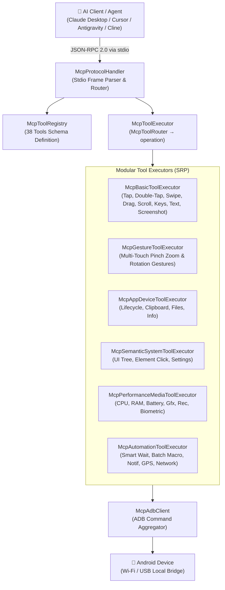

# Feature: Model Context Protocol (MCP) AI Agent Server

> **Subsystem:** `lib/features/mcp/` & `bin/azdroid_mcp.dart`  
> **Key Interfaces:** `McpProtocolHandler`, `McpToolExecutor`, `McpAdbClient`, `McpToolRegistry`  
> **Protocol:** JSON-RPC 2.0 over Standard I/O (`stdio`)  
> **Trigger / Launcher:** `./scripts/start_mcp_server.sh` or `dart run bin/azdroid_mcp.dart`  
> **Platforms:** macOS ✅ · Windows ✅ via `dart run` (no launcher script yet) ([status](../platform-support.md))

---

## 📌 Overview

The **Azdroid Model Context Protocol (MCP) Server** turns Azdroid into an autonomous AI agent powerhouse. It exposes **38 tools** enabling frontier AI models (Claude 3.5 Sonnet, Claude 3.7 Sonnet, GPT-4o) and agentic IDEs (**Claude Desktop**, **Cursor**, **Antigravity**, **Windsurf**, **Cline**) to directly observe, inspect, test, profile, and control physical or virtual Android devices over Wi-Fi and USB with zero UI overhead.

> [!TIP]
> **Headless Execution (No GUI App Required):** The MCP server runs independently as a lightweight Dart CLI process via `stdio`. You **do not need to open `Azdroid.app`** for the AI to work. However, you can optionally run `Azdroid.app` concurrently to visually observe the agent interacting with your device in real time. Each server process records which tools it runs on which device (never the arguments) in an activity file that the app shows ([mcp-activity-log.md](mcp-activity-log.md)).



---

## ⚡️ Key Capabilities Across 6 Clusters

| Cluster | Count | Tools |
| :--- | :-: | :--- |
| **1. Touch, Keys & Text** | 6 | `android_tap` (taps, holdMs), `android_swipe` (style, direction), `android_multitouch_gesture`, `android_input_text`, `android_press_key` (also panels and hardware buttons), `android_batch_actions` |
| **2. Screen & UI** | 7 | `android_take_screenshot`, `android_get_ui_tree`, `android_find_element`, `android_click_element`, `android_wait_for_condition`, `android_record_screen`, `android_set_orientation` |
| **3. Apps & Processes** | 10 | `android_list_devices`, `android_get_current_app`, `android_list_apps`, `android_launch_app`, `android_stop_app`, `android_clear_app_data`, `android_install_apk`, `android_set_permission`, `android_dispatch_intent`, `android_read_shared_prefs` |
| **4. Diagnostics** | 3 | `android_get_logcat` (package, sinceSeconds, crashesOnly), `android_get_device_stats` (kind, incl. fps and thermal), `android_shell_command` |
| **5. App & Game Development** | 3 | `android_find_image`, `android_run_instrumentation`, `android_set_display_config` ([guide](../mcp-app-game-development.md)) |
| **6. System, Network & Files** | 9 | `android_set_network`, `android_set_volume`, `android_open_settings`, `android_clipboard`, `android_transfer_file`, `android_get_notifications`, `android_dismiss_notification`, `android_set_location`, `android_simulate_biometric` |

Related operations share one tool, chosen by a parameter, so the catalog stays under the ~40-tool limit some clients apply (Cursor). `McpToolRouter` maps each call to the executor operation; the 62 names published before 2026-10-22 (for example `android_double_tap`, `android_toggle_wifi`) still work when called. Parameters: [mcp-setup-guide.md](../mcp-setup-guide.md#️-published-mcp-tools-38-tools).

---

## 📋 Prerequisites & System Requirements

Before configuring and executing MCP tools with an AI assistant, verify the following:

1. **Android Physical Device or Emulator:**
   - **Developer Options & USB Debugging:** Enabled on target device (`Settings` > `Developer options` > `USB debugging`).
   - **Host Authorization:** Accept the *"Always allow from this computer"* dialog when connecting via USB.
   - **Connection Verification:** Ensure device is online via macOS Terminal:
     ```bash
     adb devices
     # Expected output: <device_serial> device
     ```
2. **macOS Host Machine:**
   - **Android Platform Tools (ADB):** Installed and accessible in `$PATH` (`brew install android-platform-tools`).
   - **Dart SDK:** Installed (bundled with Flutter SDK or standalone via `brew install dart`).
   - **Execution Permissions:** Ensure launcher script is executable:
     ```bash
     chmod +x scripts/start_mcp_server.sh
     ```

---

## 🚀 Quick Client Integration

### 1. Claude Desktop
Add to `~/Library/Application Support/Claude/claude_desktop_config.json`:
```json
{
  "mcpServers": {
    "azdroid": {
      "command": "/absolute/path/to/azdroid/scripts/start_mcp_server.sh"
    }
  }
}
```

### 2. Cursor IDE & Windsurf
Add to `.cursor/mcp.json` or project settings:
```json
{
  "mcpServers": {
    "azdroid": {
      "command": "dart",
      "args": ["run", "/absolute/path/to/azdroid/bin/azdroid_mcp.dart"]
    }
  }
}
```

### 3. Cline / Roo Code (VS Code Extension)
Add to `cline_mcp_settings.json`:
```json
{
  "mcpServers": {
    "azdroid": {
      "command": "/absolute/path/to/azdroid/scripts/start_mcp_server.sh"
    }
  }
}
```

### 4. Verification & Health Check

- **Terminal Smoke Test:**
  ```bash
  echo '{"jsonrpc":"2.0","id":1,"method":"tools/list","params":{}}' | ./scripts/start_mcp_server.sh
  ```
  *(Note: Running `./start_mcp_server.sh` directly without piped input waits for stdin. This is normal MCP behavior. Press `Ctrl+C` to exit.)*
- **Visual Status:** In Claude Desktop, click the 🔨 tool icon (shows `azdroid` with 38 tools enabled). In Cursor, verify green dot under *Settings > Features > MCP Servers*.

---

## 💡 Practical AI Agent Automation Scenarios

### 🎯 Scenario 1: Launch App & Tap by Text (No Coordinate Guessing)

> **User Prompt:** *"Check if any device is connected, launch YouTube, and tap the Search button."*
> 
> **AI Autonomous Execution:**
> 1. Invokes `android_list_devices()` ➔ Identifies online device serial.
> 2. Invokes `android_launch_app(package="com.google.android.youtube")` ➔ Brings app to foreground.
> 3. Invokes `android_click_element(text="Search", contentDesc="Search")` ➔ Inspects the accessibility tree and taps the center of the matching element.

### 📸 Scenario 2: Automated Visual Inspection & Layout QA

> **User Prompt:** *"Capture the current device display and evaluate whether the user profile header renders properly."*
> 
> **AI Autonomous Execution:**
> 1. Invokes `android_take_screenshot()` ➔ Captures display and returns base64 image artifact into AI context.
> 2. AI Multimodal Vision ➔ Inspects layout alignment, typography, and visual assets to report UI discrepancies.

### 📊 Scenario 3: Performance & Memory Leak Profiling

> **User Prompt:** *"Profile CPU utilization, memory allocations, and battery status for `com.example.app` during a 30-second run."*
> 
> **AI Autonomous Execution:**
> 1. Invokes `android_get_device_stats(kind="cpu", package="com.example.app")` ➔ Measures user and kernel thread CPU load.
> 2. Invokes `android_get_device_stats(kind="memory", package="com.example.app")` ➔ Extracts PSS, Native Heap, and Dalvik Heap sizes.
> 3. Invokes `android_get_device_stats(kind="battery")` ➔ Reads battery temperature (°C) and voltage to detect overheating.

### 🎬 Scenario 4: Bug Reproduction & MP4 Video Capture

> **User Prompt:** *"Rotate display to Landscape, record a 10-second video of the animation bug into `/tmp/bug.mp4`, and check recent error logs."*
> 
> **AI Autonomous Execution:**
> 1. Invokes `android_set_orientation(orientation=1)` ➔ Rotates display to landscape orientation.
> 2. Invokes `android_record_screen(durationSec=10, localDestination="/tmp/bug.mp4")` ➔ Hardware encodes MP4 on device GPU and pulls to Mac.
> 3. Invokes `android_get_logcat(limit=50)` ➔ Filters crash stack traces and exception logs.

### 🔐 Scenario 5: Biometric Authentication Simulation

> **User Prompt (emulator):** *"When on the bank login screen, simulate a successful biometric fingerprint verification."*
> 
> **AI Autonomous Execution:**
> 1. Invokes `android_simulate_biometric(success=true)` ➔ Touches the emulator's fingerprint sensor with an enrolled finger (physical devices return an error).
> 2. Invokes `android_get_current_app()` ➔ Confirms successful transition from lock screen to account dashboard.

---

## 🔒 Security & Privacy

- **100% Local & Offline Capable:** Communications run strictly over local POSIX pipes (`stdio`) and local loopback ADB ports.
- **Zero Cloud Intermediaries:** No screen frames, credentials, or keystrokes ever leave your Mac.
