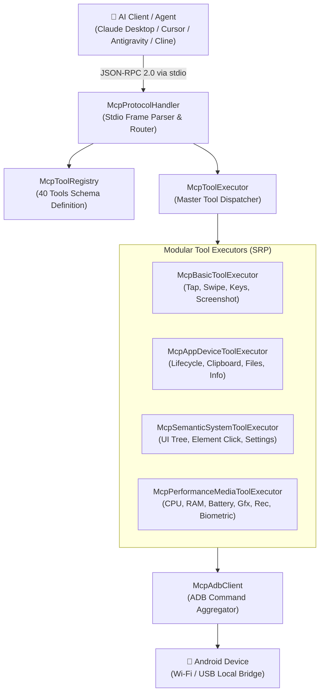

# Feature: Model Context Protocol (MCP) AI Agent Server

> **Subsystem:** `lib/features/mcp/` & `bin/deskdroid_mcp.dart`  
> **Key Interfaces:** `McpProtocolHandler`, `McpToolExecutor`, `McpAdbClient`, `McpToolRegistry`  
> **Protocol:** JSON-RPC 2.0 over Standard I/O (`stdio`)  
> **Trigger / Launcher:** `./scripts/start_mcp_server.sh` or `dart run bin/deskdroid_mcp.dart`

---

## 📌 Overview

The **DeskDroid Model Context Protocol (MCP) Server** turns DeskDroid into an autonomous AI agent powerhouse. It exposes **40 comprehensive tools** enabling frontier AI models (Claude 3.5 Sonnet, Claude 3.7 Sonnet, GPT-4o) and agentic IDEs (**Claude Desktop**, **Cursor**, **Antigravity**, **Windsurf**, **Cline**) to directly observe, inspect, test, profile, and control physical or virtual Android devices over Wi-Fi and USB with zero UI overhead.



---

## ⚡️ Key Capabilities Across 6 Clusters

| Cluster | Count | Key Tools & Scope |
| :--- | :-: | :--- |
| **1. Touch & Input Control** | 6 | `android_tap`, `android_swipe`, `android_type_text`, `android_press_key`, `android_take_screenshot`, `android_list_devices` |
| **2. App Lifecycle & Packages** | 5 | `android_get_current_app`, `android_launch_app`, `android_stop_app`, `android_clear_app_data`, `android_list_packages` |
| **3. Clipboard & File System** | 4 | `android_get_clipboard`, `android_set_clipboard`, `android_push_file`, `android_pull_file` |
| **4. Semantic UI Grounding** | 3 | `android_dump_hierarchy`, `android_find_element`, `android_click_element` |
| **5. System & OS Governance** | 12 | `android_dispatch_intent`, `android_get_logcat`, `android_install_apk`, `android_shell_command`, `android_toggle_wifi`, `android_toggle_airplane_mode`, `android_grant_permission`, `android_revoke_permission`, `android_set_volume`, `android_wake_screen`, `android_open_settings` |
| **6. Performance, Media & QA** | 10 | `android_get_cpu_usage`, `android_get_memory_info`, `android_get_battery_stats`, `android_get_gfx_info`, `android_get_network_info`, `android_record_screen`, `android_list_processes`, `android_kill_process`, `android_set_orientation`, `android_simulate_biometric` |

---

## 🚀 Quick Client Integration

### 1. Claude Desktop
Add to `~/Library/Application Support/Claude/claude_desktop_config.json`:
```json
{
  "mcpServers": {
    "deskdroid": {
      "command": "/absolute/path/to/desk-droid/scripts/start_mcp_server.sh"
    }
  }
}
```

### 2. Cursor IDE & Windsurf
Add to `.cursor/mcp.json` or project settings:
```json
{
  "mcpServers": {
    "deskdroid": {
      "command": "dart",
      "args": ["run", "/absolute/path/to/desk-droid/bin/deskdroid_mcp.dart"]
    }
  }
}
```

### 3. Cline / Roo Code (VS Code Extension)
Add to `cline_mcp_settings.json`:
```json
{
  "mcpServers": {
    "deskdroid": {
      "command": "/absolute/path/to/desk-droid/scripts/start_mcp_server.sh"
    }
  }
}
```

---

## 💡 Practical AI Agent Automation Scenarios

### Scenario 1: Semantic Element Navigation (Zero Coordinate Hallucinations)
- **Prompt:** *"Open YouTube, search for Flutter tutorials, and tap the first result."*
- **Action Sequence:**
  1. `android_launch_app("com.google.android.youtube")`
  2. `android_click_element(text="Search")`
  3. `android_type_text("Flutter tutorials")`
  4. `android_press_key("ENTER")`

### Scenario 2: Visual Regression Testing
- **Prompt:** *"Take a screenshot of the login page and verify if the primary action button aligns with branding guidelines."*
- **Action Sequence:**
  1. `android_take_screenshot()` ➔ Returns high-res base64 image artifact directly to the AI's vision engine.

### Scenario 3: Performance & Memory Leak Profiling
- **Prompt:** *"Stress test the app for 30s, then dump CPU utilization, Dalvik heap, and Choreographer frame drops."*
- **Action Sequence:**
  1. `android_get_cpu_usage(package="com.example.app")`
  2. `android_get_memory_info(package="com.example.app")`
  3. `android_get_gfx_info(package="com.example.app")`

### Scenario 4: Bug Reproduction & MP4 Video Capture
- **Prompt:** *"Rotate device to landscape, record a 10s video of the glitch, and inspect recent logcat exceptions."*
- **Action Sequence:**
  1. `android_set_orientation(orientation=1)`
  2. `android_record_screen(durationSec=10, localDestination="/tmp/glitch.mp4")`
  3. `android_get_logcat(limit=50)`

### Scenario 5: Biometric Authentication Simulation
- **Prompt:** *"Reach the checkout payment confirmation screen and simulate a successful fingerprint match."*
- **Action Sequence:**
  1. `android_simulate_biometric(success=true)`
  2. `android_get_current_app()` to verify navigation to confirmation screen.

---

## 🔒 Security & Privacy

- **100% Local & Offline Capable:** Communications run strictly over local POSIX pipes (`stdio`) and local loopback ADB ports.
- **Zero Cloud Intermediaries:** No screen frames, credentials, or keystrokes ever leave your Mac.
