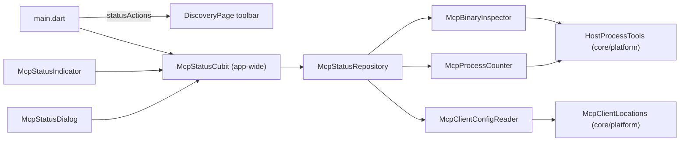

# Feature: MCP Server Status Panel

> **Subsystem:** `lib/features/mcp_status/`
> **Key Interfaces:** `McpStatusCubit`, `McpStatusRepository`, `McpBinaryInspector`, `McpClientConfigReader`, `McpProcessCounter`
> **OS data:** `HostProcessTools`, `McpClientLocations` (`lib/core/platform/`)
> **Trigger:** hub icon in the device list toolbar
> **Platforms:** macOS ✅ · Windows 🧪 (implemented, not run) ([status](../platform-support.md))

---

## 1. What It Shows

AI clients start the MCP server themselves over stdio ([mcp-ai-agent-server.md](mcp-ai-agent-server.md)). DeskDroid does not run or control it, so the panel reports only what the app can check:

| Check | How | Shown as |
|:---|:---|:---|
| Server executable | `deskdroid-mcp` next to the app executable exists; `lipo -archs` (macOS); a `tools/list` handshake | Runs and answers · Runs (through Rosetta 2) · Needs Rosetta 2 · Does not answer · Not in this build |
| AI client setup | Reads Claude Desktop, Cursor, and Antigravity configuration files (read-only) and looks for an entry that runs DeskDroid's server | Set up · Uses another copy · Not set up · Not installed · Config is not valid JSON |
| Sessions | Counts running server processes: `pgrep -f` (macOS), `tasklist` (Windows) | N AI sessions connected |

The panel also shows the JSON to paste into a client's configuration, with a copy button. It never edits client files.

There is no "start" or "stop" button: the app does not own the server process.

## 2. Toolbar Indicator

| Dot or badge | Meaning |
|:---|:---|
| Green number | That many AI sessions are connected now |
| Blue dot | Ready; at least one client is set up; no session yet |
| Orange dot | Ready but no client is set up, or Rosetta 2 is missing |
| Red dot | The server does not answer, or the check failed |
| Gray dot | Not included in this build (debug builds) |

The tooltip repeats the summary. The full check runs at startup and each time the panel opens (or **Refresh** is pressed); the session count refreshes every 10 seconds (`McpStatusConstants.sessionPollInterval`).

## 3. Configuration Files

| Client | macOS | Windows |
|:---|:---|:---|
| Claude Desktop | `~/Library/Application Support/Claude/claude_desktop_config.json` | `%APPDATA%\Claude\claude_desktop_config.json` |
| Cursor | `~/.cursor/mcp.json` | `%USERPROFILE%\.cursor\mcp.json` |
| Antigravity | `~/.gemini/antigravity/mcp_config.json` | `%USERPROFILE%\.gemini\antigravity\mcp_config.json` |

An entry counts as DeskDroid when its command is `deskdroid-mcp` (any folder, any case), `start_mcp_server.sh`, or `dart` with `deskdroid_mcp.dart` in its arguments. It is **Set up** only when the command is this app's own executable; otherwise **Uses another copy** (for example an old download or a source checkout). Cursor's per-project `.cursor/mcp.json` is not checked.

## 4. Architecture

- Discovery does not import this feature: `main.dart` passes `McpStatusIndicator` through `DiscoveryPage.statusActions`.
- `load()` counts sessions **before** the handshake, which starts a server process of its own.
- States: `McpStatusInitial`, `McpStatusLoading`, `McpStatusLoaded` (with `isRefreshing`), `McpStatusFailure`.
- The dialog pins its header and footer and scrolls its body; the footer buttons wrap on narrow windows.

## 5. Limits

- On Windows, only the precompiled `deskdroid-mcp.exe` is counted as a session; `dart run` sessions are not (`tasklist` shows `dart.exe`).
- A session is a running process, not proof that the AI is using a device right now.
- Live tool activity ("the AI is tapping this device") would need a channel between the server and the app; not implemented.

## 6. Tests

`test/unit/mcp_status/` (platform commands, config parsing, executable checks, process counting, repository order), `test/bloc/mcp_status_cubit_test.dart`, `test/widget/mcp_status_widgets_test.dart` (indicator states, panel content, 360 × 420 window without overflow).
