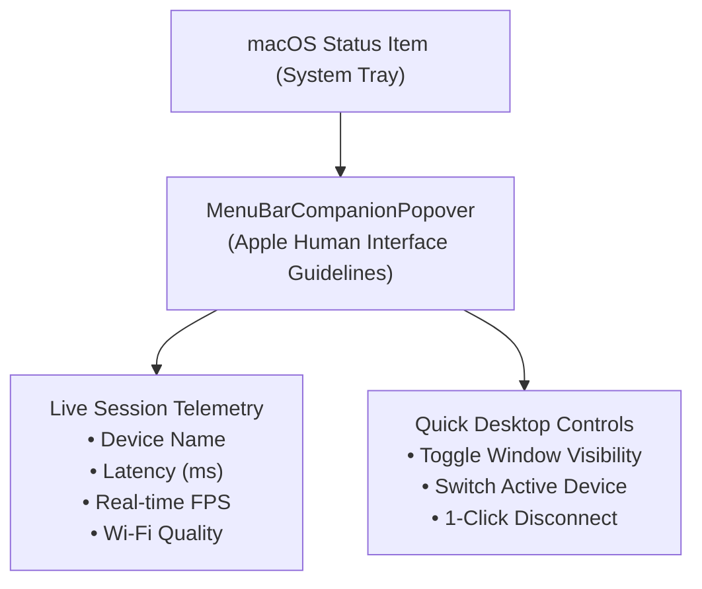

# Feature: Native macOS Menu Bar Companion

> **Subsystem:** `lib/features/menubar/`  
> **Key Interfaces:** `MenuBarStatusEntity`  
> **Presentation:** `MenuBarCubit`, `MenuBarCompanionPopover`  
> **Platforms:** ❌ Not available yet: the popover is not wired into the app on macOS; a Windows system tray is planned ([status](../platform-support.md))

---

## 📌 Overview

The **macOS Menu Bar Companion** anchors DeskDroid directly into the macOS system status bar. It provides instantaneous visibility into active device sessions, connection telemetry, and quick window toggle actions without interrupting your desktop workflow.

---

## ⚡️ Key Capabilities

### 1. Persistent System Status Bar Item
- **Discrete macOS Integration:** Sits unobtrusively in the macOS menu bar alongside Wi-Fi and Battery indicators.
- **Dynamic Status Glyph:** Reflects active connection states (idle, discovering, streaming, or disconnected).

### 2. Live Session Telemetry Popover
Clicking the menu bar icon reveals an Apple-styled frosted glass popover displaying:
- **Active Device Model:** Displays device marketing name (e.g. `Google Pixel 8 Pro`) and connection type (5 GHz Wi-Fi or USB).
- **Processing Latency:** Average host time per frame, from packet received to frame displayed (e.g. `12ms`). It excludes device encoding and network time, so it is not glass-to-glass latency. Shows `— ms` until the first measurement.
- **Stream Frame Rate:** Measured decoded frames per second (e.g. `60 FPS`). scrcpy only sends frames when the screen changes, so a still screen shows a low value.
- **Connection Health:** Color-coded status badge signaling optimal, degraded, or congested wireless links.

### 3. Rapid Window & Session Governance
- **Show / Hide Window:** Quickly hide or bring the DeskDroid mirroring window to the foreground with a single click.
- **Session Controls:** Pause stream, disconnect current device, or switch between discovered phones without opening the main application window.
- **Resource Efficiency:** Telemetry polling drops to zero when mirroring is idle, consuming negligible CPU cycles.
