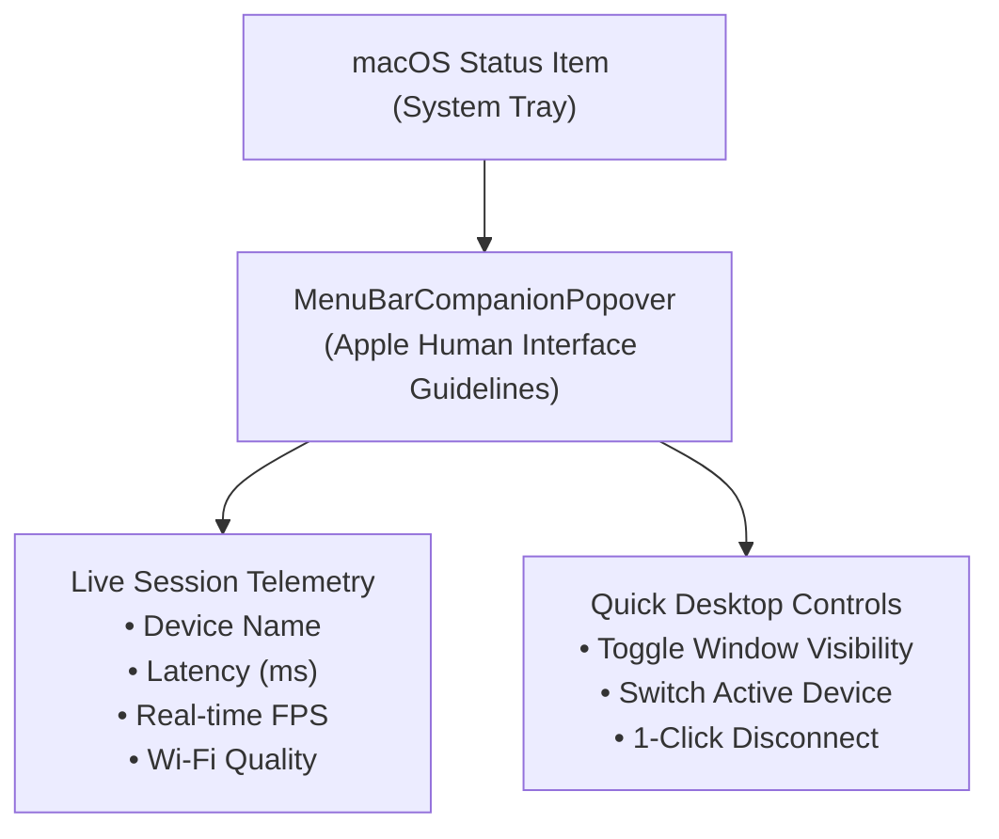

# Feature: Native macOS Menu Bar Companion

> **Subsystem:** `lib/features/menubar/`  
> **Key Interfaces:** `MenuBarStatusEntity`  
> **Presentation:** `MenuBarCubit`, `MenuBarCompanionPopover`

---

## 📌 Overview

The **macOS Menu Bar Companion** anchors WifiDesk directly into the macOS system status bar. It provides instantaneous visibility into active device sessions, connection telemetry, and quick window toggle actions without interrupting your desktop workflow.

---

## ⚡️ Key Capabilities

### 1. Persistent System Status Bar Item
- **Discrete macOS Integration:** Sits unobtrusively in the macOS menu bar alongside Wi-Fi and Battery indicators.
- **Dynamic Status Glyph:** Reflects active connection states (idle, discovering, streaming, or disconnected).

### 2. Live Session Telemetry Popover
Clicking the menu bar icon reveals an Apple-styled frosted glass popover displaying:
- **Active Device Model:** Displays device marketing name (e.g. `Google Pixel 8 Pro`) and connection type (5 GHz Wi-Fi or USB).
- **Glass-to-Glass Latency:** Real-time round-trip latency metric (e.g. `24 ms`).
- **Stream Frame Rate:** Real-time rendered frames per second (e.g. `60 FPS`).
- **Connection Health:** Color-coded status badge signaling optimal, degraded, or congested wireless links.

### 3. Rapid Window & Session Governance
- **Show / Hide Window:** Quickly hide or bring the WifiDesk mirroring window to the foreground with a single click.
- **Session Controls:** Pause stream, disconnect current device, or switch between discovered phones without opening the main application window.
- **Resource Efficiency:** Telemetry polling drops to zero when mirroring is idle, consuming negligible CPU cycles.
