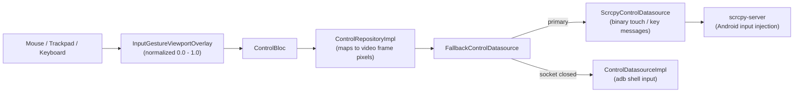

# Feature: Remote Input & Gesture Control

> **Subsystem:** `lib/features/control/`  
> **Key Interfaces:** `ControlRepository`, `ControlDatasource`  
> **Presentation:** `ControlBloc`, `InputGestureViewportOverlay`, `QuickTextInputDialog`, `TouchIndicatorOverlay`  
> **Platforms:** macOS ✅ · Windows 🧪 not yet verified ([status](../platform-support.md))

---

## 📌 Overview

Azdroid turns your computer's trackpad, mouse, and keyboard into Android input. Pointer positions are normalized to the video frame and sent to the phone through the scrcpy **control socket**, with `adb shell input` as the fallback.

### Input Paths

| Input | Path | Notes |
|:---|:---|:---|
| Tap, mouse drag, mouse wheel | Control socket | Touch DOWN, interpolated MOVE every 16 ms, UP (a mouse drag is replayed when the button is released). |
| Trackpad two-finger pan | Control socket | One **live** finger: DOWN, MOVE as the fingers move, UP, so lists scroll and fling as on the phone. |
| Trackpad pinch / rotate, Alt + drag | Control socket | Two **live** fingers (pointer ids -2 and -3); the server turns the second into POINTER_DOWN/UP. Not possible over adb. |
| Key events (BACK, HOME, App Switch: toolbar buttons, shortcuts, mouse buttons) | Control socket | DOWN then UP. All of them go through `ControlBloc` (`ControlNavigationActionDispatched`). |
| Quick Text (<kbd>Cmd</kbd> + <kbd>K</kbd>), ASCII only | `adb shell input text` | Leaves the phone's clipboard alone. |
| Quick Text with accents, CJK, or emoji | Control socket: `SET_CLIPBOARD` with paste | The server sets the phone's clipboard and presses PASTE (Android 7+). Key-map typing cannot produce these characters. |
| Anything while the socket is down | `adb shell input` | Automatic fallback, per event. |

**Frame size.** The server ignores a touch whose screen size differs from the current video size. The repository therefore maps positions with the size reported by the native player (`getDimensions`, through `VideoFrameSizeSource`), not with the device display size. For example, a 1080×2340 display may stream at 1080×2336. When the size is unknown, input uses the adb path.

**Session.** The streaming repository opens the control socket during stream start (see [native-video-contract.md](../native-video-contract.md#2-wire-format-scrcpy-server-video-socket)) and closes it before the stream stops. If it cannot open, the start fails with a clear message instead of a mirror that ignores input.

---

## ⚡️ Key Capabilities

### 1. Pointer & Multi-Touch Emulation
- **Coordinate Normalization:** Normalizes cursor coordinates ($0.0 \to 1.0$) relative to the active video viewport, ensuring precision across arbitrary window sizes and device display resolutions.
- **Two-Finger Gestures:**
  - **Trackpad pinch:** Two fingers centered on the pointer, apart by 30 % of the viewport's shorter side × the pinch scale, turned by the trackpad rotation: zoom maps and photos, rotate maps.
  - **Alt (Option) + left drag:** For a mouse. The second finger mirrors the pointer through the screen center (like scrcpy's Ctrl-drag): drag away from the center to zoom in, around it to rotate.
  - `TouchGestureTracker` decides per gesture: a scale or rotation change starts a pinch, a pan starts a one-finger drag, and the finger count stays fixed until the gesture ends. A hand resting on the trackpad sends nothing.
- **Mouse Button Mapping:**
  - **Left Click & Drag:** A click is a tap; a drag is sent as a swipe when the button is released.
  - **Right Click:** Triggers Android system **BACK** navigation (`KEYCODE_BACK`).
  - **Middle Click (Wheel Click):** Triggers Android system **HOME** (`KEYCODE_HOME`).
- **Visual Feedback:** `TouchIndicatorOverlay` renders an Apple-styled animated ripple at the pointer contact point.

### 2. Trackpad & Wheel Scrolling
- **Trackpad:** A two-finger pan is a live one-finger drag on the phone, following the fingers; lifting them flings the list with Android's own inertia. (Before, trackpad scrolling did nothing: Flutter delivers trackpad gestures as `PointerPanZoom` events, which the overlay did not handle.)
- **Mouse Wheel:** Each wheel step becomes a short touch swipe (`ControlConstants.scrollFactor`).
- **Directional Fidelity:** Supports horizontal and vertical scrolling.

### 3. Hardware Keyboard Forwarding & Android Shortcuts
- **Direct Keystroke Translation:** Maps macOS physical keys directly to Linux and Android standard keycodes via `AndroidKeyCodes`.
- **System Navigation Shortcuts:**
  - <kbd>Cmd</kbd> + <kbd>H</kbd>: Return to Home Screen.
  - <kbd>Cmd</kbd> + <kbd>Backspace</kbd>: Back button.
  - <kbd>Ctrl</kbd> + <kbd>Tab</kbd> (Windows) or the toolbar button: App Switcher / Recent Apps (`KEYCODE_APP_SWITCH`). On macOS, <kbd>Cmd</kbd> + <kbd>Tab</kbd> is the system app switcher and never reaches Azdroid.
  - <kbd>Cmd</kbd> + <kbd>R</kbd>: Rotate the mirror view on the computer by 90 degrees (the phone does not rotate).
  - <kbd>Cmd</kbd> + <kbd>O</kbd>: Turn the phone screen off/on while mirroring continues ([Screen Off](screen-off-streaming.md)).

### 4. Quick Text Injection (<kbd>Cmd</kbd> + <kbd>K</kbd>)
- **ASCII Text:** Typed with `adb shell input text` into the focused Android text field.
- **Accented, CJK, and Emoji Text:** Vietnamese, Japanese, Chinese, Korean, and emoji are sent over the control socket as scrcpy's `SET_CLIPBOARD` with paste: the server puts the text on the phone's clipboard and presses PASTE, so the phone's keyboard (for example Telex) cannot rewrite it. Verified on a Redmi 9: `Tiếng Việt 你好 👋` arrived exactly.
- **Good to Know:** Pasting needs Android 7 or newer. The pasted text stays on the phone's clipboard; with clipboard sync on, it also reaches the computer's clipboard within about 2 seconds. Without the control socket, such text falls back to `input text`, which cannot type it.

---

## 🔒 OEM Security Notice
- **Xiaomi (MIUI / HyperOS):** Requires **"USB debugging (Security settings)"** to be enabled in Developer Options to allow mouse click and keystroke injection.
- **Oppo / Realme / OnePlus:** If input is blocked, toggle ON **"Disable permission monitoring"** in Developer Options.
