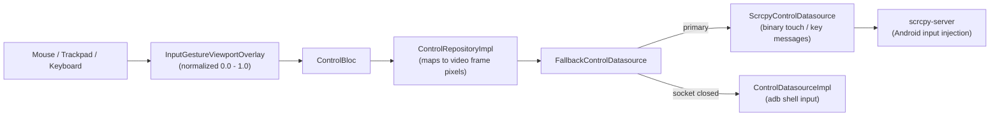

# Feature: Remote Input & Gesture Control

> **Subsystem:** `lib/features/control/`  
> **Key Interfaces:** `ControlRepository`, `ControlDatasource`  
> **Presentation:** `ControlBloc`, `InputGestureViewportOverlay`, `QuickTextInputDialog`, `TouchIndicatorOverlay`  
> **Platforms:** macOS ✅ · Windows 🧪 not yet verified ([status](../platform-support.md))

---

## 📌 Overview

DeskDroid turns your computer's trackpad, mouse, and keyboard into Android input. Pointer positions are normalized to the video frame and sent to the phone through the scrcpy **control socket**, with `adb shell input` as the fallback.

### Input Paths

| Input | Path | Notes |
|:---|:---|:---|
| Tap, drag, swipe, scroll | Control socket | Touch DOWN, interpolated MOVE every 16 ms, UP. |
| Key events (BACK, HOME, shortcuts) | Control socket | DOWN then UP. |
| Quick Text (<kbd>Cmd</kbd> + <kbd>K</kbd>) | `adb` | The scrcpy key map cannot type non-ASCII text such as Vietnamese. |
| Anything while the socket is down | `adb shell input` | Automatic fallback, per event. |

**Frame size.** The server ignores a touch whose screen size differs from the current video size. The repository therefore maps positions with the size reported by the native player (`getDimensions`, through `VideoFrameSizeSource`), not with the device display size. For example, a 1080×2340 display may stream at 1080×2336. When the size is unknown, input uses the adb path.

**Session.** The streaming repository opens the control socket during stream start (see [native-video-contract.md](../native-video-contract.md#2-wire-format-scrcpy-server-video-socket)) and closes it before the stream stops. If it cannot open, the start fails with a clear message instead of a mirror that ignores input.

---

## ⚡️ Key Capabilities

### 1. Advanced Pointer & Multi-Touch Emulation
- **Coordinate Normalization:** Normalizes cursor coordinates ($0.0 \to 1.0$) relative to the active video viewport, ensuring precision across arbitrary window sizes and device display resolutions.
- **Mouse Button Mapping:**
  - **Left Click & Drag:** Natural touch down, drag/swipe, and touch up.
  - **Right Click:** Triggers Android system **BACK** navigation (`KEYCODE_BACK`).
  - **Middle Click (Wheel Click):** Triggers Android system **HOME** (`KEYCODE_HOME`).
- **Visual Feedback:** `TouchIndicatorOverlay` renders an Apple-styled animated ripple at the pointer contact point.

### 2. Smooth Inertial Trackpad & Wheel Scrolling
- **Gesture Conversion:** Converts two-finger trackpad flicks and mouse wheel rotations into short touch swipes (`ControlConstants.scrollFactor`), so lists scroll with native inertia.
- **Directional Fidelity:** Supports horizontal and vertical scrolling.

### 3. Hardware Keyboard Forwarding & Android Shortcuts
- **Direct Keystroke Translation:** Maps macOS physical keys directly to Linux and Android standard keycodes via `AndroidKeyCodes`.
- **System Navigation Shortcuts:**
  - <kbd>Cmd</kbd> + <kbd>H</kbd>: Return to Home Screen.
  - <kbd>Cmd</kbd> + <kbd>Backspace</kbd>: Back button.
  - <kbd>Cmd</kbd> + <kbd>Tab</kbd>: App Switcher / Recent Apps (`KEYCODE_APP_SWITCH`).
  - <kbd>Cmd</kbd> + <kbd>R</kbd>: Rotate display orientation 90 degrees.
  - <kbd>Cmd</kbd> + <kbd>O</kbd>: Turn the phone screen off/on while mirroring continues ([Screen Off](screen-off-streaming.md)).

### 4. International Unicode & IME Text Injection (<kbd>Cmd</kbd> + <kbd>K</kbd>)
- **Direct Character Stream:** While standard hardware keyboard forwarding can encounter difficulties with complex multi-byte input, the **Quick Text Injector** modal (<kbd>Cmd</kbd> + <kbd>K</kbd>) directly injects UTF-8 text strings into the focused Android text field.
- **Accented & Asian Language Support:** Flawlessly supports Vietnamese (Telex, VNI), Japanese, Chinese, Korean, and emoji glyphs without dropping characters.

---

## 🔒 OEM Security Notice
- **Xiaomi (MIUI / HyperOS):** Requires **"USB debugging (Security settings)"** to be enabled in Developer Options to allow mouse click and keystroke injection.
- **Oppo / Realme / OnePlus:** If input is blocked, toggle ON **"Disable permission monitoring"** in Developer Options.
