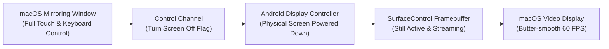

# Feature: Screen-Off Streaming & Power Preservation

> **Subsystem:** `lib/features/streaming/`  
> **Key Interfaces:** `StreamingRepository`, `ScrcpyServerManager`  
> **Presentation:** `StreamingCubit`, `FloatingControlsToolbar`  
> **Shortcut:** <kbd>Cmd</kbd> + <kbd>O</kbd>  
> **Platforms:** macOS ✅ · Windows 🧪 not yet verified ([status](../platform-support.md))

---

## 📌 Overview

**Screen-Off Streaming** allows you to interact with and mirror your Android device while keeping the physical phone screen completely turned off. This feature significantly reduces device battery consumption, prevents heat buildup, and safeguards user privacy in public workspaces.

---

## ⚡️ Key Capabilities

### 1. Zero-Power Physical Display
- **Hardware Blanking:** Powers down the physical OLED / LCD backlight panel on the phone using Android's internal display power mode controls (`--turn-screen-off`).
- **Framebuffer Preservation:** The Android window manager continues rendering frames into `SurfaceControl`, allowing video capture and remote touch input to function normally without interruption.

### 2. Thermal & Battery Preservation
- **Heat Dissipation Reduction:** Display backlights account for up to 60–70% of phone power consumption. Turning off the display keeps device temperatures cool and eliminates battery drain during extended work sessions.
- **OLED Burn-In Protection:** Prevents static UI elements (such as status bars and navigation docks) from causing irreversible burn-in on OLED and AMOLED panels during long debugging sessions.

### 3. Workplace & Public Privacy
- **Covert Operation:** When working in cafes, offices, or shared spaces, your phone lying on the desk remains completely black. Nobody nearby can see notifications, incoming messages, or authentication prompts appearing on the screen.

### 4. Effortless Wakeup & Safety
- **1-Click Toggle:** Press <kbd>Cmd</kbd> + <kbd>O</kbd> or click the screen toggle icon on the vertical action dock to instantly power the phone screen on or off.
- **Physical Button Wakeup:** Pressing the phone's physical power button immediately wakes the physical display.
- **Auto-Restore on Disconnect:** When the streaming session ends, the phone display automatically turns back on.
