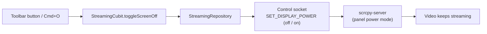

# Feature: Screen-Off Streaming

> **Subsystem:** `lib/features/streaming/`  
> **Key Interfaces:** `StreamingRepository.toggleScreenOff`, `ScrcpyControlConnector.setDisplayPower`  
> **Presentation:** `StreamingCubit`, `LeftControlsToolbar`, `MirroringActiveView` (shortcut)  
> **Shortcut:** <kbd>Cmd</kbd> + <kbd>O</kbd> (<kbd>Ctrl</kbd> + <kbd>O</kbd> on Windows)  
> **Platforms:** macOS ✅ · Windows 🧪 not yet verified ([status](../platform-support.md))

---

## 📌 Overview

**Screen Off** turns off the phone's display panel while you keep mirroring and controlling it. The phone stays awake: apps keep running, the video keeps streaming, and your clicks and keys still work. Only the physical screen goes dark, which saves battery and keeps the screen private on your desk.

---

## ⚡️ How It Works

| Step | What happens |
|:---|:---|
| Turn off | Azdroid sends scrcpy's `SET_DISPLAY_POWER` (off) message over the control socket. The server sets the panel's power mode to off. The device does **not** go to sleep. |
| Turn on | The same message with "on". |
| Bitrate or keep-awake change | The pipeline restarts; the old server's restore process turns the panel on, so Azdroid waits for it to finish, then sends "off" again to the new server. |
| Stop mirroring | Azdroid sends "on". If Azdroid quits or the connection drops instead, the server's restore process (`cleanup=true`) turns the panel on when the server exits. |

The header shows a **Screen Off** badge while it is active. If the control socket is not connected, nothing changes and the app log notes it.

---

## ⚠️ Good to Know

- **Combine with Keep Phone Awake** (the sun icon, on by default). With the panel off the phone is still "awake" and its own screen timeout keeps running. Without Keep Phone Awake, the phone goes to sleep after that timeout and the mirror stops updating.
- **Physical power button:** The phone thinks its screen is on, so pressing the power button puts it to sleep. Press it again to wake the phone; the panel then comes back on (checked on the Android 16 emulator: `Awake` → `Dozing` → `Awake` with the panel on). Press <kbd>Cmd</kbd> + <kbd>O</kbd> to turn it off again.
- **Lock screen:** A phone with a secure lock screen may still lock after its lock timeout. Turn the screen on (<kbd>Cmd</kbd> + <kbd>O</kbd>) and unlock it from the mirror or on the phone.
- Before this feature used the control socket, Screen Off pressed the POWER key, which put the phone to sleep and stopped the mirror. See [lessons-learned/screen-off-power-key-slept-device.md](../lessons-learned/screen-off-power-key-slept-device.md).

---

## ✅ Verification

`dart run tool/verify_scrcpy_server.dart --serial=<serial>` checks that the panel turns off while the device stays awake, that video keeps flowing, and that the panel is on again after the server exits. Verified on an Android 16 emulator (`powerMode=Off` while `mWakefulness=Awake`, video bytes still arriving, `powerMode=On` after exit) and on a Redmi 9 with Android 10 (`powerMode=0` while `Awake`, 4.7 MB of video while off, panel on after exit). On the Redmi, the panel is the second display SurfaceFlinger lists, so the check reads every entry.
