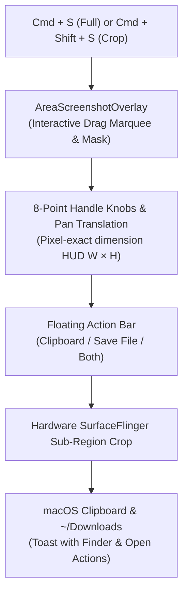

# Feature: Lossless Screenshots & Interactive Area Crop

> **Subsystem:** `lib/features/streaming/`  
> **Key Interfaces:** `ScreenshotRepository`, `ScreenshotDatasource`  
> **Presentation:** `ScreenshotCubit`, `AreaScreenshotOverlay`, `AreaCropActionBar`, `ScreenshotToastHud`  
> **Shortcuts:** <kbd>Cmd</kbd> + <kbd>S</kbd> (Full) / <kbd>Cmd</kbd> + <kbd>Shift</kbd> + <kbd>S</kbd> (Area Crop)

---

## 📌 Overview

WifiDesk includes a lossless image capture system engineered with macOS desktop ergonomics. Developers and designers can capture pixel-perfect full-screen screenshots or draw an interactive 8-point regional crop box with live dimension overlays.

---

## ⚡️ Key Capabilities

### 1. Full Lossless Screenshot (<kbd>Cmd</kbd> + <kbd>S</kbd>)
- **Direct Framebuffer Capture:** Captures the current Android frame via ADB SurfaceFlinger screencap in lossless PNG format.
- **Dual Destination:** Automatically saves the image to `~/Downloads/WifiDesk_Screenshot_*.png` and simultaneously copies it to the macOS clipboard (`⌘V`).

### 2. Interactive Area Crop Marquee (<kbd>Cmd</kbd> + <kbd>Shift</kbd> + <kbd>S</kbd>)
- **Interactive Drag Marquee:** Click and drag anywhere on the phone display to frame the region of interest.
- **Live Dimension HUD:** Displays current width and height in device pixels (e.g. `480 × 320 px`), with a darkened backdrop cutout mask and macOS-style reticles.
- **Quick Abort:** Press <kbd>Esc</kbd> or right-click at any point to cancel without saving.

### 3. Professional 8-Point Resize & Translation Knobs
- **8 Circular Handle Knobs:** Positioned at all 4 corners and 4 edge midpoints with responsive directional cursors (`resizeUpDown`, `resizeLeftRight`, `resizeUpLeftDownRight`, `resizeUpRightDownLeft`).
- **Whole-Box Pan/Move:** Dragging inside the selection body translates the entire frame smoothly with a `move` cursor.
- **Outside Re-Selection:** Dragging outside the active marquee immediately clears the selection and starts drawing a fresh box.

### 4. Floating Glassmorphism Action Bar & Shortcuts
Upon releasing the marquee, an action capsule appears anchored to the selection box offering instant choices:
- **Clipboard (<kbd>C</kbd>):** Copies cropped PNG directly to macOS pasteboard without disk clutter.
- **Save File (<kbd>S</kbd>):** Saves lossless PNG to `~/Downloads/` with Finder reveal.
- **Both (<kbd>Enter</kbd>):** Highlighted primary button that executes both actions simultaneously.

### 5. Floating Toast HUD
- **Instant Preview:** Displays a mini preview thumbnail with exact file size.
- **One-Click Actions:** Click **Finder** to reveal the file (`open -R`) or **Open** to inspect it in macOS Preview.
