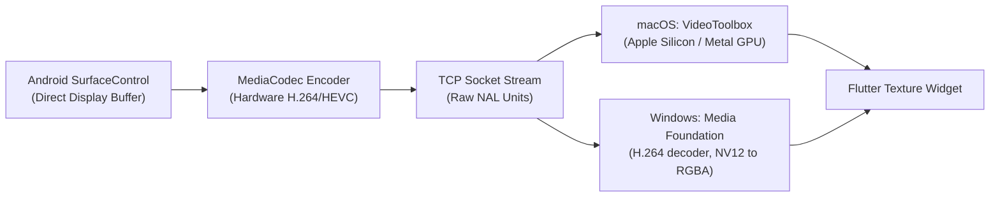

# Feature: Wireless Display & Low-Latency Streaming

> **Subsystem:** `lib/features/streaming/`  
> **Key Interfaces:** `StreamingRepository`, `VideoStreamNativeService`, `ScrcpyServerManager`  
> **Presentation:** `StreamingCubit`, `MirroringPage`, `VideoDisplayViewport`, `StreamTelemetryHeader`  
> **Platforms:** macOS ✅ (VideoToolbox) · Windows ✅ (Media Foundation) ([status](../platform-support.md))

---

## 📌 Overview

The display engine delivers low-latency, hardware-accelerated video mirroring over local Wi-Fi or USB links. It achieves sub-30ms glass-to-glass latency by combining on-device Android hardware capture with native decoding on the desktop: Apple VideoToolbox on macOS, Media Foundation on Windows. Both plugins follow the shared [native video contract](../native-video-contract.md).

---

## ⚡️ Key Capabilities

### 1. Direct SurfaceControl Capture & MediaCodec Hardware Pipeline
- **Kernel-Level Capture:** Bypasses Android UI toolkit compositing overhead by capturing display buffers directly from `SurfaceControl`.
- **Hardware-Accelerated Encoding:** Uses the device GPU/VPU hardware encoder (`MediaCodec`) to generate high-efficiency H.264 NAL units with minimal CPU impact and thermal footprint.
- **Embedded Daemon (`scrcpy-server.jar`):** Automatically pushes and boots the high-performance daemon onto the Android device via ADB; no third-party APK installation is required on the phone.

### 2. Apple VideoToolbox & Metal Native Decoding
- **Zero-Copy Native Texture:** Streams raw H.264 packets directly to a macOS platform plugin utilizing Apple's **VideoToolbox** framework.
- **Hardware Accelerated:** Decodes frames directly on Apple Silicon / Metal GPUs and renders them via Flutter's hardware `Texture` widget, bypassing Dart memory copying.
- **Sub-30ms Latency:** Achieves ultra-fast 20–35ms glass-to-glass response times over 5 GHz Wi-Fi networks.

### 2b. Windows Media Foundation Decoding (Preview)
- **Native Plugin:** `windows/scrcpy_stream` connects with Winsock, parses frames with the shared `native/scrcpy_core` library, and decodes H.264 with the Media Foundation decoder in low-latency mode.
- **Pixel Path:** Decoded NV12 frames are converted to RGBA on the CPU and handed to a Flutter pixel-buffer texture (triple-buffered). A zero-copy GPU path (D3D11) is planned; see [windows-port-plan.md](../windows-port-plan.md).
- **Measured, Not Estimated:** The header badges show measured FPS, bitrate, and host processing time per frame, which excludes device encoding and network time.

### 3. High Refresh Rate & Dynamic Bitrate Scaling
- **Up to 120 FPS:** Supports high-refresh-rate displays (60 Hz, 90 Hz, 120 Hz) for smooth navigation, gaming, and animation testing.
- **Bitrate Presets:** Pick 4, 8, or 16 Mbps from the side dock. scrcpy fixes the bitrate at launch, so a change restarts the video pipeline (about 1 second, at most 3; shown as *"Applying 16 Mbps…"*); the menu is disabled until it finishes. The header's Mbps badge shows the measured rate, which stays below the preset when the screen is still.
- **Keep Phone Awake:** On by default; toggle it with the sun icon under the bitrate menu (filled = on). While mirroring, the phone does not sleep, on a charger or on battery. DeskDroid starts scrcpy-server with `stay_awake=true` and a 24-hour `screen_off_timeout`, and `cleanup=true` makes a restore process put the phone's own values back when mirroring stops, even if DeskDroid quits or the connection drops. The choice is saved in `mirroring_preferences.json` in the app data folder. Like the bitrate, it applies at launch, so toggling restarts the pipeline (*"Keeping the phone awake…"*).
- **Adaptive Resolution:** Configure resolution targets (720p, 1080p, 2K, or Native) to balance network congestion with visual fidelity.

### 4. Apple Retina & HiDPI Pixel Density Compensation
- **Automatic Density Scaling:** Automatically compensates for Apple Retina display backing scale factors ($2\times / 3\times$), ensuring crisp text and sharp UI rendering without blurriness.
- **Aspect Ratio Fidelity:** Maintains the target device's native portrait or landscape aspect ratio using `BoxFit.contain` inside `VideoDisplayViewport`. The size comes from the decoded video (polled with telemetry once per second), so the viewport switches to landscape when the device rotates. A 1080 × 2400 placeholder is used only until the first sample.

---

## 🏛️ State Management (`StreamingCubit`)

- `StreamingInitial`: Idle state awaiting device connection.
- `StreamingStarting`: Checks that ADB lists the device as authorized, launches the scrcpy server, and opens the video socket.
- `StreamingActive`: Video texture is shown. `telemetry` holds measured FPS, bitrate, and processing latency, refreshed every second by `StreamingTelemetryTracker` (`null` until the first sample, shown as `—`). `pendingChange` names the launch option (bitrate or keep-awake) that a pipeline restart is applying; `StreamingReconfigurator` handles both.
- `StreamingError`: Actionable message for an unauthorized, offline, or missing device, a server that failed to start, or a video stream that failed or ended (native `getStats` state). The session is stopped and **Retry Connection** starts a new one.
