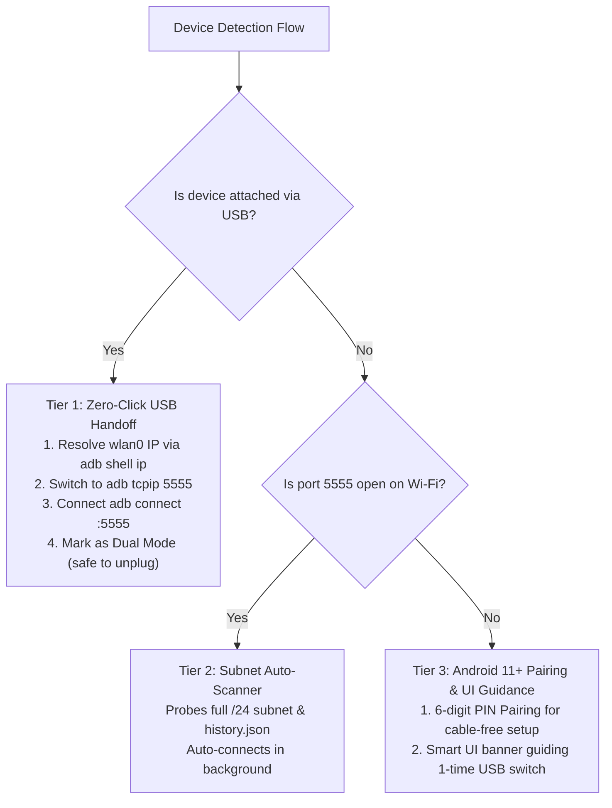

# Lesson Learned: Android adbd TCP/IP Port Lifecycle & Zero-Click USB Handoff

> **Category:** Device Discovery / Android adbd Lifecycle / Security Boundaries  
> **Impact:** Android devices on local Wi-Fi failing to connect over TCP despite responsive ICMP pings and valid ARP entries.

---

## 1. Context & Symptoms

When attempting to connect to an Android device (e.g., Motorola Moto G Play 2023, IP `192.168.1.4`) over Wi-Fi:
1. The host Mac and Android phone shared the same subnet (`192.168.1.0/24`).
2. ICMP ping (`ping -c 1 192.168.1.4`) and ARP cache lookups succeeded with active MAC `fe:4f:21:f9:71:4a`.
3. Attempts to connect via `adb connect 192.168.1.4:5555` failed with `Connection timed out` or `Connection refused`.
4. The device did not appear in the DeskDroid auto-discovered device list until a USB cable was plugged in.

---

## 2. Diagnostic Traces & Evidence

Inspecting the Android device after attaching USB (`ZY22J62QM9`):

1. **Querying adbd TCP/IP Property:**
   ```bash
   adb -s ZY22J62QM9 shell getprop service.adb.tcp.port
   # Returns: (empty / unset)
   ```
2. **Inspecting Active Kernel TCP Sockets (`/proc/net/tcp`):**
   ```bash
   adb -s ZY22J62QM9 shell "cat /proc/net/tcp"
   ```
   No sockets existed with `st = 0A` (TCP_LISTEN). The daemon `adbd` was bound exclusively to the local hardware USB endpoint (`/dev/usb-ffs/adb`).
3. **Triggering TCP/IP Mode:**
   ```bash
   adb -s ZY22J62QM9 tcpip 5555
   # Returns: restarting in TCP mode port: 5555
   adb connect 192.168.1.4:5555
   # Returns: connected to 192.168.1.4:5555
   ```
4. **Verifying Wi-Fi Transport:**
   ```bash
   adb -s 192.168.1.4:5555 shell getprop ro.product.model
   # Returns: moto g play - 2023
   ```
   Once `adbd` was instructed to listen on port 5555, the Wi-Fi connection functioned with low latency and full scrcpy streaming support.

---

## 3. Root Cause Analysis

### A. Android OS Security Sandbox & Ephemeral TCP Lifetimes
Stock Android (Android 5 through 15) strictly disables listening TCP sockets for `adbd` by default. Opening port 5555 indiscriminately across Wi-Fi networks would expose the device's shell and filesystem to any entity on the same local network.

### B. Automatic State Revocation on Network Events
Even when a user or tool previously enabled `adb tcpip 5555`, the Android operating system intentionally revokes and resets the TCP listening port back to `-1` (disabled) whenever:
1. The smartphone restarts or powers off.
2. The Wi-Fi connection drops, reconnects, or switches access points (BSSID/SSID).
3. The device toggles Airplane Mode or enters battery optimization deep sleep.

Consequently, expecting an arbitrary Android phone on Wi-Fi to listen on port 5555 indefinitely without an initialization mechanism is fundamentally impossible under Android's security architecture.

---

## 4. Architectural Solution: 3-Tier Multi-Device Strategy



### Key Architectural Components:
1. **Zero-Click USB-to-Wi-Fi Handoff:**
   Whenever an authorized USB device is detected, DeskDroid can seamlessly query its Wi-Fi IP and issue `enableTcpip()`. The user can unplug the USB cable immediately without manual steps.
2. **Persistent History Auto-Reconnect:**
   Successfully connected Wi-Fi endpoints are saved to `history.json`. On subsequent app launches, DeskDroid prioritizes these endpoints in parallel sweeps.
3. **Android 11+ Wireless Debugging Pairing:**
   For devices without USB cables, DeskDroid provides mDNS service discovery and 6-digit pairing PIN authentication (`_adb-tls-pairing._tcp`).
4. **Smart Diagnostic UI:**
   When the subnet scanner finds active hosts on the LAN with closed port 5555, DeskDroid presents an ergonomic guide card explaining the 1-time USB switch or pairing code options.

---

## 5. Prevention & Reusability Checklist

- [ ] **Do Not Assume Persistent TCP Listeners on Android:** Always design discovery around the reality that `service.adb.tcp.port` resets upon reboot or Wi-Fi reconnect.
- [ ] **Automate the USB-to-Wi-Fi Bridge:** Minimize user friction by automatically executing `adb tcpip 5555` upon detecting an authorized USB device.
- [ ] **Differentiate Host Reachability from Service Availability:** An ICMP ping reply only confirms IP routing; always verify socket availability with explicit TCP handshakes.
- [ ] **Provide Clear UI Fallbacks:** When wireless endpoints are unreachable, guide the user to the fastest resolution path (1-click USB switch or 6-digit PIN).
