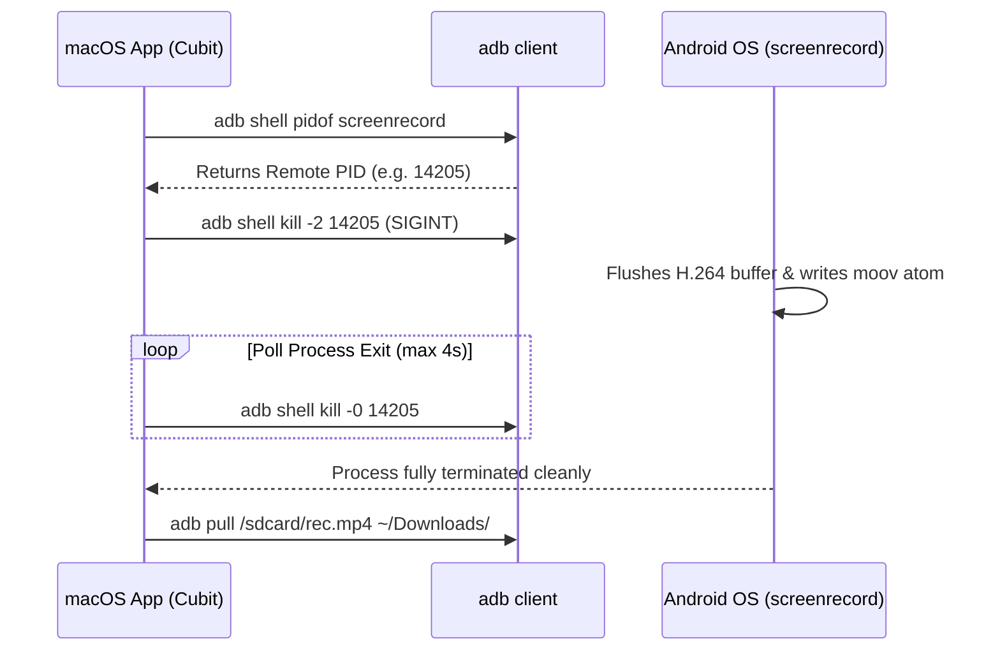

# Lesson Learned: Android screenrecord Daemon Lifecycle & Clean MP4 Finalization

> **Category:** Android OS Media Subsystem / Process Signals / Video Container Encoding  
> **Impact:** Corrupted unplayable MP4 video files and orphaned encoder locks when stopping recordings.

---

## 1. Context & Symptoms

Azdroid provides lossless hardware screen recording by invoking Android's native `screenrecord` binary over ADB:
- When users clicked "Stop Recording", the resulting MP4 pulled from the device was frequently **corrupted or unplayable in macOS QuickTime Player and Finder**:
  ```text
  This file isn’t compatible with QuickTime Player.
  ```
- File size appeared non-zero (e.g., 20 MB), but duration showed 0:00.
- Subsequent attempts to record or start mirroring failed because the hardware video encoder (`OMX.MTK.VIDEO.ENCODER.AVC` or `c2.android.avc.encoder`) remained locked.

---

## 2. Diagnostic Traces & Evidence

1. **Inspecting Corrupted MP4 Structure via `ffprobe`:**
   ```bash
   ffprobe -v error -show_format recording.mp4
   ```
   Output:
   ```text
   [mov,mp4,m4a,3gp,3g2,mj2 @ 0x...] moov atom not found
   recording.mp4: Invalid data found when processing input
   ```
2. **Observing Process Termination Behavior:**
   - Previous stop routine killed the local host process: `process.kill()`.
   - On Android, `adb shell ps -A | grep screenrecord` revealed the remote `screenrecord` process was still alive or was abruptly killed by ADB socket severance without executing its `atexit()` cleanup handler.

---

## 3. Root Cause Analysis

### A. The MP4 `moov` Atom and Index Writing
The MP4/ISO base media file format records video chunks sequentially in the `mdat` (media data) atom. However, the metadata containing frame indexes, timestamps, durations, and chunk offsets is stored in the **`moov` atom**. 

Android's `screenrecord` utility writes the `moov` atom **only upon receiving a graceful termination signal (`SIGINT` / `Ctrl+C`) or when hitting the maximum 180-second duration limit**. If the process is terminated via `SIGKILL` (`kill -9`), or if the socket is severed abruptly, `screenrecord` terminates without writing the `moov` atom, rendering the entire file permanently unreadable.

### B. Hardware MediaCodec Encoder Lockup
`screenrecord` acquires an exclusive session on the hardware `MediaCodec` encoder. If killed uncleanly, the Android `mediaserver` or `media.codec` daemon retains the locked buffer queue until garbage-collected or rebooted, causing subsequent video streaming attempts to fail.

---

## 4. Architectural Solution: Graceful Remote PID Signaling

Implemented a two-phase clean finalization workflow in `ScreenRecordingDatasourceImpl`:



### Key Implementation Principles:
1. **Query Remote PID:** Run `adb shell pidof screenrecord`.
2. **Send `SIGINT` (Signal 2):** Issue `adb shell kill -2 <pid>`. This instructs `screenrecord` to stop capturing, write the `moov` atom to disk, and release the hardware encoder.
3. **Poll for Clean Exit:** Wait until `kill -0 <pid>` returns non-zero (process has exited), allowing up to 3-4 seconds for the disk write to finish.
4. **Pull Finalized Artifact:** Only after clean termination is confirmed does the app pull the MP4 to the macOS host.

---

## 5. Prevention & Reusability Checklist

- [ ] **Never Kill Remote Android Media Daemons Locally:** Killing the local `adb` process does not guarantee graceful signal propagation to remote binaries. Always signal the remote PID directly.
- [ ] **Signal `SIGINT` (2), Never `SIGKILL` (9), for Media Recorders:** MP4 and MKV muxers must write container headers and index tables before exiting.
- [ ] **Poll for Complete Process Termination Before File Retrieval:** Do not initiate file transfer (`adb pull`) immediately after sending a stop signal; verify the writing process has completely exited.
