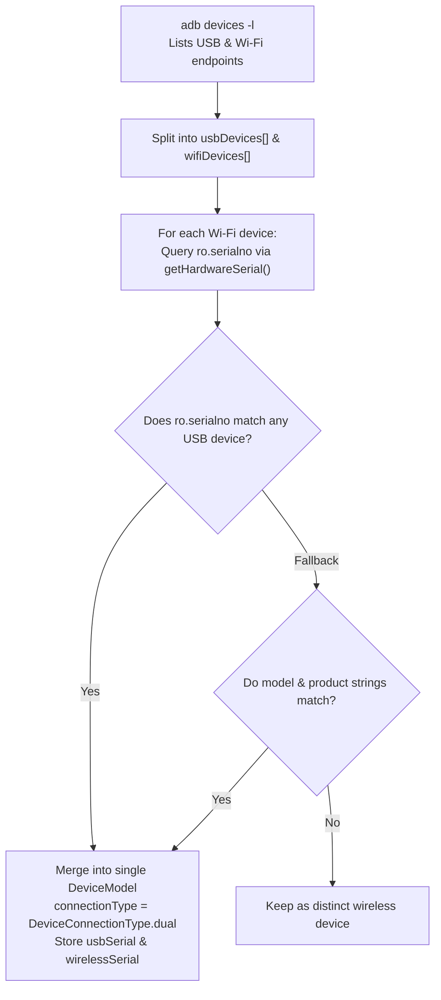

# Lesson Learned: Dual USB/Wi-Fi Device Deduplication & Hardware Identity Resolution

> **Category:** Device Discovery / Transport Multiplexing / State Deduplication  
> **Impact:** Duplicate device cards, port forwarding collisions, and disconnected mirroring sessions.

---

## 1. Context & Symptoms

When an Android phone is connected via USB cable while simultaneously reachable over the local Wi-Fi network:
1. `adb devices -l` outputs two separate records for the exact same physical phone:
   ```text
   9789f2350404         device usb:20-3 product:lancelot_global model:M2004J19C
   192.168.1.3:5555     device product:lancelot_global model:M2004J19C
   ```
2. Without deduplication, the UI presented **two separate cards for the same phone**.
3. If users clicked "Start Mirroring" on both or accidentally switched between them, ADB port collisions (`adb forward tcp:27183 tcp:27183`) and video encoder conflicts caused both sessions to crash.
4. Unplugging the USB cable abruptly severed streaming even though the wireless transport was available.

---

## 2. Diagnostic Traces & Evidence

Querying the device properties across both endpoints:

1. **USB Transport (`-s 9789f2350404`):**
   - Device serial exposed by ADB: `9789f2350404` (USB hardware serial descriptor).
2. **Wi-Fi Transport (`-s 192.168.1.3:5555`):**
   - Device serial exposed by ADB: `192.168.1.3:5555` (Host IP and TCP port).
3. **Querying Hardware Serial Number on Both:**
   ```bash
   adb -s 192.168.1.3:5555 shell getprop ro.serialno
   # Returns: 9789f2350404
   ```
The immutable hardware property `ro.serialno` matches the USB serial descriptor string exactly.

---

## 3. Root Cause Analysis

### A. Transport-Scoped ADB Identifiers
ADB assigns device identifiers based on connection transport:
- Direct USB connections use the USB chip's hardware serial descriptor string.
- Wireless connections use the ephemeral `<ip>:<port>` network socket string.

ADB treats these as two distinct targetable entities with independent state and separate forward socket tables. Because discovery queried `adb devices` and `adb mdns services`, both transports reported their own device instances.

### B. Port Collision Hazards
DeskDroid allocates local loopback ports for video and audio forwarding (e.g., `27183` and `27185`). If two mirroring sessions targeting the same physical device run concurrently over both transports, the scrcpy server binary on Android attempts to bind the same abstract unix socket (`scrcpy`), throwing `java.io.IOException: Address already in use`.

---

## 4. Architectural Solution: Hardware Identity Deduplication

Implemented two-tier deduplication in `DeviceDiscoveryDatasourceImpl.scanDevices()`:



### Key Engineering Enhancements:
1. **Hardware Serial Correlation:** Calls `_tcpipService.getHardwareSerial(wifi.serial)` to resolve `ro.serialno`.
2. **Unified `DeviceModel`:** Sets `DeviceConnectionType.dual`, exposing both `usbSerial` and `wirelessSerial`.
3. **UI Presentation:** Displays a single consolidated device card with a vibrant `Dual Mode (USB + Wi-Fi)` badge.
4. **Seamless Cable Fallback:** Users can transition from high-bandwidth USB setup to wireless freedom with 1 click without losing device pairing context.

---

## 5. Prevention & Reusability Checklist

- [ ] **Do Not Use Network Endpoints as Canonical Identity Keys:** IP addresses and ports change across DHCP leases; always resolve immutable hardware identifiers (`ro.serialno`, MAC address, or UUID).
- [ ] **Deduplicate at the Datasource Layer:** Merge multi-transport representations before feeding domain repositories and presentation Cubits to prevent state thrashing.
- [ ] **Guard Local Forward Ports Against Collisions:** Always verify port availability or allocate dynamic loopback ports before calling `adb forward` on multi-device environments.
