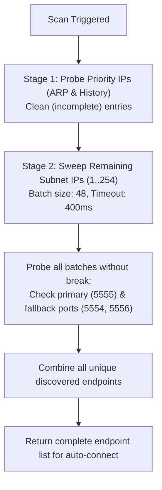

# Lesson Learned: Subnet Auto-Discovery Premature Termination & Wi-Fi Latency Guarding

> **Category:** Device Discovery / Network Socket Probing / Multi-Device Topology  
> **Impact:** Incomplete device discovery on multi-device Wi-Fi networks where only the first device was detected.

---

## 1. Context & Symptoms

When multiple Android devices were active on the same local Wi-Fi subnet (e.g., `192.168.1.0/24`):
1. WifiDesk auto-detected the first Android device (e.g., `192.168.1.3:5555`).
2. Any subsequent Android devices on the same subnet (e.g., at other IP addresses) failed to appear in the discovered device list.
3. Users reported: *"Not all Android devices on this Wi-Fi network are discovered (1 device missing)."*

---

## 2. Diagnostic Traces & Evidence

1. **Subnet Probing Execution Tracing:**
   When examining the batch scanner in `NetworkSubnetScannerImpl._probeIpsInBatches`:
   ```dart
   for (var i = 0; i < ips.length; i += batchSize) {
     final batch = ips.sublist(i, end);
     final active = await _probeIpsInParallel(batch, port);
     results.addAll(active);
     if (results.isNotEmpty) {
       break; // <-- Premature abort on first active device!
     }
   }
   ```
2. **Conditional Stage 2 Bypass:**
   In `findActiveSubnetEndpoints()`:
   ```dart
   if (discoveredIps.isEmpty || fullSubnetSweep) {
     // Only executed when NO devices were found in ARP/History!
   }
   ```
   Because device 1 was resolved via the priority ARP cache, `discoveredIps.isEmpty` evaluated to `false`, completely skipping the subnet sweep for remaining IPs.
3. **Wi-Fi Power-Save Handshake Latency:**
   Connecting to Wi-Fi phones with an aggressive `250ms` socket timeout resulted in intermittent timeouts (`SocketException: Connection timed out`) when phones entered 802.11 power-save or Android Doze mode.

---

## 3. Root Cause Analysis

### A. Premature Termination Antipattern
The scanner was originally designed under the assumption of finding *an* endpoint quickly rather than discovering *all* endpoints on a local subnet. As soon as any batch yielded an active socket, the loop aborted (`break;`), leaving subsequent batches unscanned.

### B. Mutual Exclusivity Between Priority & Subnet Sweep
Stage 1 (Priority ARP/History) and Stage 2 (Deep Subnet Sweep) were treated as fallback alternatives rather than complementary stages. If even a single priority device answered, the entire remaining subnet of 254 IPs was bypassed.

### C. Sub-Threshold Socket Timeout on High-Latency 802.11 Radio Links
Unlike wired Ethernet, mobile phones negotiate power-saving intervals (DTIM) with Wi-Fi access points. Establishing a TCP 3-way handshake to a sleeping phone occasionally takes 250–350ms, causing rigid 250ms timeouts to drop valid endpoints.

---

## 4. Architectural Solution: Non-Aborting Full Subnet Discovery



### Key Enhancements:
1. **Unconditional Subnet Sweep:** Removed early `break;` in `_probeIpsInBatches` and defaulted `fullSubnetSweep = true`.
2. **ARP Entry Sanitization:** Filtered out `(incomplete)` ARP cache lines in `extractArpIps()`.
3. **Resilient Wi-Fi Timeout:** Increased socket probe timeout from `250ms` to `400ms`.
4. **Multi-Port Resolution:** Probes secondary ports (`5554`, `5556`, `5558`) on priority devices and parses `ip:port` strings.

---

## 5. Prevention & Reusability Checklist

- [ ] **Never Use Early `break;` in Discovery Scanners:** Multi-device discovery must sweep the full target domain to guarantee complete topology visibility.
- [ ] **Tune Socket Timeouts for Mobile Radios:** Do not assume sub-100ms LAN latency for battery-powered Wi-Fi targets; use 400–500ms bounds.
- [ ] **Sanitize ARP Tables:** Always check and ignore `(incomplete)` entries when reading platform ARP tables.
- [ ] **Preserve Port Metadata:** Pass `<ip>:<port>` endpoints down the discovery pipeline so non-standard ports can be targeted automatically.
