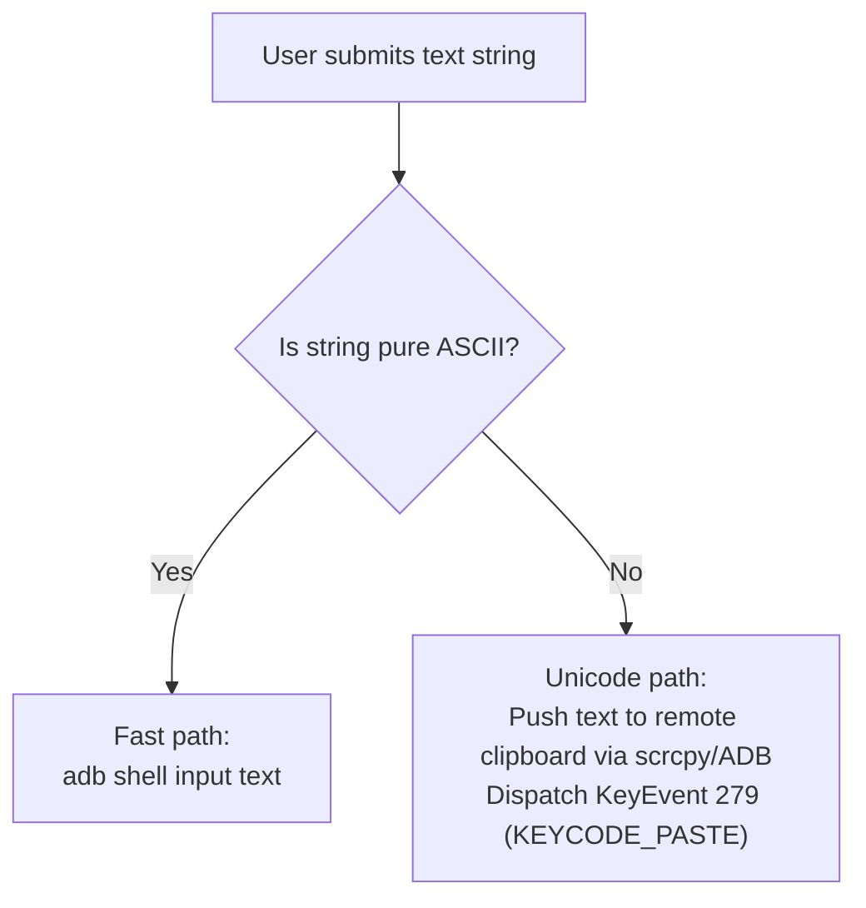

# Lesson Learned: Xiaomi MIUI / HyperOS Input Injection Security & Unicode Text Handling

> **Category:** Vendor-Specific Android Customizations / Input Event Injection / Character Encodings  
> **Impact:** Mouse clicks and keyboard typing silently ignored on Xiaomi/Redmi/POCO devices.

---

## 1. Context & Symptoms

When streaming and controlling Xiaomi, Redmi, or POCO devices running MIUI or HyperOS:
1. Video streaming, screenshot capture, and file transfers work with zero errors.
2. **Mouse clicks, trackpad scrolls, and keyboard inputs are completely ignored by the device**:
   - The phone screen does not react to clicks or navigation buttons (Back, Home, App Switcher).
   - Executing `adb shell input tap 500 500` returns `exitCode = 0` with no error message, yet no touch is registered on the device.
3. Attempting to type non-ASCII or accented text (e.g., Vietnamese characters: `Tiếng Việt`, `Đà Nẵng`) via `adb shell input text` either fails or outputs garbled characters.

---

## 2. Diagnostic Traces & Evidence

1. **Checking Device Properties:**
   ```bash
   adb shell getprop ro.miui.ui.version.name
   # Returns: V12, V13, V14 (or ro.build.version.incremental for HyperOS)
   ```
2. **Checking Remote Input Permissions:**
   ```bash
   adb shell settings get secure adb_enabled
   # Returns: 1 (Standard USB debugging is enabled)
   ```
   However, input injection tests with `scrcpy-server` or `adb shell input` reveal all `MotionEvent` and `KeyEvent` objects dispatched by UID 2000 (`shell`) are dropped by MIUI's custom `InputManagerService`.

---

## 3. Root Cause Analysis

### A. MIUI Custom Security Layer ("Security Settings")
Unlike stock Android (AOSP, Google Pixel, Motorola), Xiaomi enforces an additional proprietary security barrier in MIUI and HyperOS:
- **Standard "USB Debugging":** Allows read-only ADB commands, logcat, video streaming, and APK installs.
- **"USB debugging (Security settings)" (*Gỡ lỗi USB - Cài đặt bảo mật*):** Explicitly grants UID 2000 permission to simulate touch and key events (`android.permission.INJECT_EVENTS`). 

If this second flag is disabled, the Android kernel drops all simulated input events with **zero error return** to prevent unauthorized automated control.

### B. ASCII Limitations of `adb shell input text`
The default Android `input text <string>` command parses keystrokes into software `KeyEvent` scan codes according to the US-English QWERTY keymap. Non-ASCII characters (e.g., Vietnamese diacritics, accented Latin, Cyrillic, emojis) have no direct scancode mapping and are silently dropped or corrupted.

---

## 4. Architectural Solution

### A. Proactive Device Detection & User Onboarding
In `UserGuideDialog` and `DeviceCardView`, WifiDesk detects Xiaomi/Redmi devices by checking `ro.product.manufacturer` or `ro.miui.ui.version.name` and presents a dedicated **Xiaomi Setup Warning Banner**:

1. Open phone **Settings ➔ Additional settings ➔ Developer options**.
2. Enable **USB debugging (Security settings)** / *Gỡ lỗi USB (Cài đặt bảo mật)*.
3. Accept the three consecutive 5-second security warnings. (Requires SIM card inserted or Mi Account session).

### B. Two-Tier Text Injection Architecture
Implemented resilient Unicode text delivery in `ControlBloc` and `ControlDatasource`:



By leveraging the Android system clipboard for non-ASCII characters, full Vietnamese, East Asian, and accented European texts paste seamlessly with zero character loss.

---

## 5. Prevention & Reusability Checklist

- [ ] **Never Assume `exitCode == 0` Implies User-Visible Action:** Vendor-modified Android frameworks (MIUI, ColorOS, EMUI) frequently swallow input permissions silently.
- [ ] **Provide Vendor-Specific Troubleshooting Launchpads:** When targeting Android desktop control, detect vendor OEM fingerprints (`ro.miui`, `ro.build.version.emui`) and guide users directly to their proprietary permission toggles.
- [ ] **Do Not Use `input text` for Multilingual User Input:** Always implement clipboard injection or custom IME input translation for international and Unicode characters.
