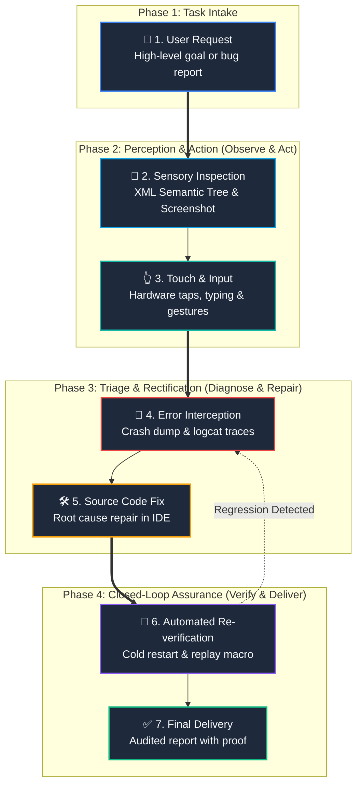
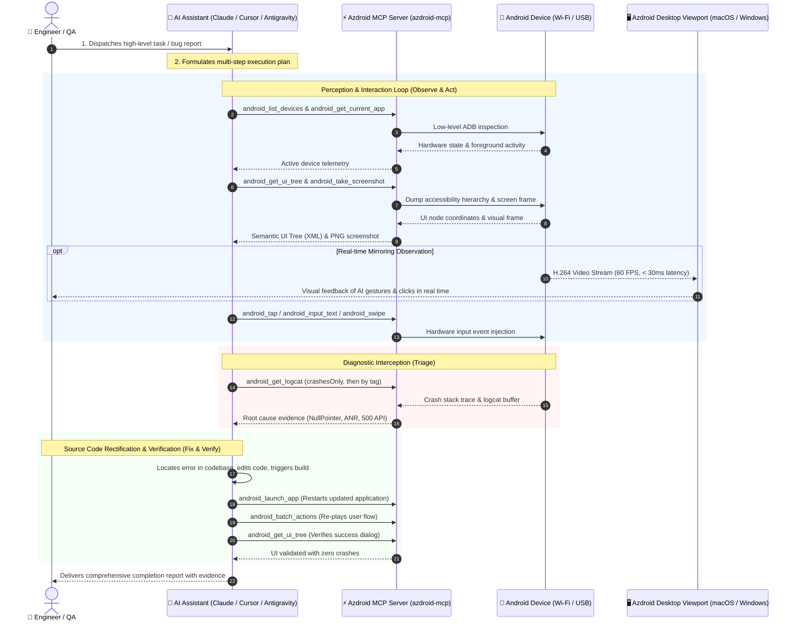

# Autonomous Android Engineering Workflow with Azdroid MCP Server

> A comprehensive architectural and operational walkthrough of closed-loop Android software engineering, automated QA, and bug triage using **Azdroid Model Context Protocol (MCP) Server** with frontier AI agents.

---

## ⚡️ Executive Overview

The **Azdroid MCP Server** (`azdroid-mcp`) transforms your connected Android devices (physical hardware or emulators over Wi-Fi and USB) into an autonomous testing and automation environment for AI assistants (e.g., **Claude Desktop**, **Cursor**, **Antigravity**, **Cline**).

Operating over standard I/O (`stdio`) via JSON-RPC 2.0, the server provides **62 specialized tools**. This empowers AI agents to see, touch, inspect, debug, and verify Android applications in a complete **autonomous closed loop**:



| Phase | Step | Purpose | Primary Azdroid MCP Tools |
| :---: | :--- | :--- | :--- |
| **1** | **🎯 User Request** | Delegating task or bug reproduction prompt | Client Prompt Context |
| **2** | **👀 Sensory Inspection** | Grounding UI structure with millimeter accuracy | `android_get_ui_tree`, `android_take_screenshot` |
| **3** | **👆 Touch & Action** | Injecting multi-touch, typing, and key events | `android_tap`, `android_input_text`, `android_swipe` |
| **4** | **🚨 Error Interception** | Capturing stack traces, ANRs, and log buffers | `android_get_logcat` (`crashesOnly`) |
| **5** | **🛠️ Source Code Fix** | Editing source files and resolving root causes | IDE File Tools / Compiler |
| **6** | **🔁 Re-verification** | Replaying user journey on physical device | `android_launch_app`, `android_batch_actions` |
| **7** | **✅ Final Delivery** | Delivering verified outcome with evidence | Final Audit Report |

---

## 🏛️ High-Level Interaction Architecture



---

## 🎬 End-to-End Real-World Scenario: Autonomous Bug Triage & Fix

### Context
A mobile engineer is working on an authentication screen. Tapping the *"Submit"* button causes an unexpected crash. The engineer delegates the entire investigation to an AI agent.

---

### Step 1: User Request (Prompt)
The user provides a natural language task:
> *"Test the Password Change flow on the connected Android phone. Enter current password `123456`, new password `NewPass@2026`, and tap Submit. If the app crashes or encounters an error, inspect logcat, identify the root cause in the source code, fix it, and verify the resolution on the device."*

---

### Step 2: Agent Planning & Device Discovery
The AI agent formulates an execution plan and queries available hardware:
- **Tool Call:** `android_list_devices`
- **MCP Response:**
  ```json
  [{"serial": "192.168.1.105:5555", "state": "device", "model": "Pixel 7", "product": "panther"}]
  ```
- **Tool Call:** `android_get_current_app` ➔ Identifies foreground activity `com.example.myapp/.ui.auth.ChangePasswordActivity`.

---

### Step 3: Sensory Grounding & Action Execution
The AI inspects the UI hierarchy rather than guessing coordinates:
- **Tool Call:** `android_get_ui_tree`
- **MCP Response:**
  ```json
  {
    "elements": [
      {"id": "edt_old_password", "text": "Current Password", "bounds": [100, 350, 980, 480]},
      {"id": "edt_new_password", "text": "New Password", "bounds": [100, 520, 980, 650]},
      {"id": "btn_submit", "text": "SAVE CHANGES", "bounds": [100, 750, 980, 880]}
    ]
  }
  ```
- **Input Execution:**
  1. `android_tap(x: 540, y: 415)` ➔ Focuses `edt_old_password`.
  2. `android_input_text(text: "123456")` ➔ Types existing password.
  3. `android_tap(x: 540, y: 585)` ➔ Focuses `edt_new_password`.
  4. `android_input_text(text: "NewPass@2026")` ➔ Types new password.
  5. `android_tap(x: 540, y: 815)` ➔ Taps `btn_submit`.

*(If the user has `Azdroid.app` open, they watch the phone display update smoothly at 60 FPS as the agent performs these actions).*

---

### Step 4: Diagnostic Interception & Stack Trace Analysis
Immediately upon tapping Submit, the app exits to the home screen.
- **Tool Call:** `android_get_logcat(crashesOnly: true, package: "com.example.myapp")`
- **MCP Response:**
  ```text
  FATAL EXCEPTION: main
  Process: com.example.myapp, PID: 14205
  java.lang.NullPointerException: Attempt to invoke virtual method 
    'java.lang.String com.example.myapp.model.User.getToken()' on a null object reference
    at com.example.myapp.repository.AuthRepository.changePassword(AuthRepository.kt:42)
  ```
- **Tool Call:** `android_get_logcat(tag: "AuthRepository", lines: 50)` ➔ Traces session lifecycle failure where the in-memory cache was invalidated during background state transitions.

---

### Step 5: Source Code Rectification in IDE
With the stack trace pinned to `AuthRepository.kt:42`, the AI reads the repository file and refactors the token retrieval:
```kotlin
// AuthRepository.kt (Patched)
val token = userSessionManager.getValidToken() 
    ?: throw SessionExpiredException("Authentication token expired. Please re-login.")
```

---

### Step 6: Automated Re-verification Loop
The agent verifies its own fix without requiring human intervention:
1. `android_launch_app(package_name: "com.example.myapp")` ➔ Relaunches app.
2. `android_batch_actions(...)` ➔ Replays login and form filling in a single batch call.
3. `android_get_ui_tree` ➔ Confirms visual presence of `"Password successfully updated!"` dialog.
4. `android_get_logcat(crashesOnly: true)` ➔ Returns `"No recent crashes detected."`.
5. `android_run_instrumentation(package: "com.example.myapp")` ➔ Runs the app's instrumented tests when a test APK is installed.

Games and other screens without a UI tree, launch timing, frame rate, and display settings: [mcp-app-game-development.md](mcp-app-game-development.md).

---

### Step 7: Final Delivery & Evidence Report
The AI provides a concise, structured report to the user:
- **Incident Summary:** Application crashed due to an unguarded `NullPointerException` in `AuthRepository.kt:42`.
- **Root Cause:** Session token was read from a cleared memory cache rather than the secure persistent store.
- **Remediation:** Added defensive session recovery via `userSessionManager.getValidToken()`.
- **Validation:** Executed full regression test on physical Pixel 7 (`192.168.1.105:5555`); flow completed with HTTP 200 and zero crashes.

---

## 🧰 Categorized MCP Tool Matrix

| Functional Cluster | Key Tools | Core Operational Responsibility |
|:---|:---|:---|
| **Perception ("Eyes")** | `android_take_screenshot`<br>`android_get_ui_tree`<br>`android_find_element` | Captures high-res visual frames and parses XML accessibility hierarchies for sub-millimeter coordinate precision. |
| **Manipulation ("Hands")** | `android_tap` (taps, holdMs)<br>`android_swipe` (style, direction)<br>`android_multitouch_gesture`<br>`android_input_text`, `android_press_key` | Dispatches hardware-level touch gestures, multi-touch pinch-zoom, inertial scrolls, text inputs, and hardware keycodes. |
| **Lifecycle & Package** | `android_launch_app`<br>`android_install_apk`<br>`android_clear_app_data`<br>`android_stop_app` | Manages cold starts, package installation, cache clearing, and background suspension. |
| **Diagnostics & Profiling** | `android_get_logcat` (package, sinceSeconds, crashesOnly)<br>`android_get_device_stats` (cpu, memory, fps, thermal)<br>`android_run_instrumentation` | Reads one app's recent logs and crashes, profiles memory, CPU, frame rate, and throttling, and runs the app's tests. |
| **Games & Layouts** | `android_find_image`<br>`android_wait_for_condition` (image_present, screen_changed)<br>`android_set_display_config` | Finds pictures on screens without a UI tree and checks layouts in dark mode, large text, and other screen sizes. |
| **System & Environment** | `android_set_network`<br>`android_set_location`<br>`android_set_permission`<br>`android_simulate_biometric` | Simulates real-world testing environments (network toggling, mock GPS coordinates, biometric pass/fail). |

---

## 🛡️ Key Architectural Guarantees

1. **Closed-Loop Autonomy:** Replaces manual repetitive mobile testing by empowering AI to execute the complete cycle: code ➔ deploy ➔ interact ➔ diagnose ➔ fix ➔ verify.
2. **Headless by Default:** Runs as an ultra-fast, lightweight Dart CLI process via `stdio`. No GUI window is required for CI/CD pipelines or background IDE agents.
3. **Optional 60 FPS Visual Companion:** Developers can concurrently launch `Azdroid.app` to observe agent interactions in real-time with sub-30ms latency.
4. **100% Local P2P Privacy:** All video, touch events, and system logs communicate strictly over local USB or Wi-Fi sockets. Zero data leaves your workstation.
