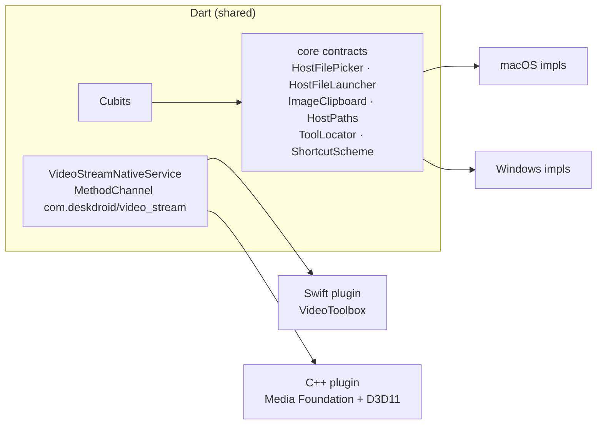

# Windows Port Plan

> Plan for shipping DeskDroid on Windows 10/11 (x64) with feature parity to macOS. Status: **Phase 0 done**, **Phase 1a running on Windows** (visual check pending), **Phase 4 portable ZIP done**. Current feature status: [platform-support.md](platform-support.md).

---

## 1. Goals & Non-Goals

**Goals**
- Same features on Windows: discovery and pairing, low-latency mirroring, input control, clipboard, file transfer, APK installer, logcat, intent dispatcher, screenshots and recording, MCP server.
- One Dart codebase. Platform differences live behind `lib/core` contracts chosen at DI time.
- Keep macOS behavior and tests unchanged.

**Non-goals (first release)**
- Windows on ARM64, Linux, Microsoft Store distribution.
- Audio forwarding (scrcpy currently starts with `audio=false` on macOS too).

---

## 2. Current macOS Coupling (Audit, 2026-10-17)

| Area | macOS implementation | Location |
|:---|:---|:---|
| Video decode and render | Swift plugin, VideoToolbox, `CVPixelBuffer` texture (14 functions, ~560 lines) | `macos/Runner/ScrcpyStreamPlugin.swift` |
| File and folder picker | `osascript` AppleScript dialogs | `core/services/mac_file_picker_service.dart` |
| Open / reveal file | `/usr/bin/open`, `open -R` | `core/services/host_file_launcher.dart`, `device_file_manager_cubit.dart` |
| Image to clipboard | `osascript` with `«class PNGf»` | `screenshot_datasource.dart` |
| Tool lookup | `/usr/bin/which`, Homebrew paths, `~/Library/Android/sdk` | `adb_binary_locator.dart`, `aapt_path_resolver.dart` |
| APK icon extraction | `/usr/bin/unzip` | `apk_metadata_datasource.dart` |
| Subnet discovery | `/usr/sbin/arp -an` output format | `network_subnet_scanner.dart` |
| Home and temp paths | `HOME`, `/tmp/deskdroid_dart.log` (6 call sites) | logger, history, recorder, screenshots |
| Path handling | `split('/')` (4), `'$dir/file'` joins (21) | across data layer |
| Process output parsing | `split('\n')` (13), breaks on `\r\n` | ADB parsers |
| Bundled asset path | `../Frameworks/App.framework/...` | `scrcpy_server_manager.dart` |
| Shortcuts and labels | `isMetaPressed`, `⌘` glyphs (9), `Cmd+` text (23) | key handler, guide, showcase |
| Typography | `.AppleSystemUIFont` | `core/theme/app_typography.dart` |
| Tooling | `build_release.sh`, `start_mcp_server.sh` (bash) | `scripts/` |

The Dart MCP server (`bin/deskdroid_mcp.dart`) is already portable except for ADB lookup, which `AdbBinaryLocator` now owns.

---

## 3. Target Architecture

- `lib/core/platform/host_platform_module.dart` registers either the macOS or the Windows implementations, based on `Platform.isWindows`.
- The video MethodChannel contract does not change: `startStream({host, port}) -> textureId`, `stopStream()`, `getDimensions()`.
- The scrcpy packet framing (12-byte PTS and size header, SPS/PPS config packets) is ported to a small, platform-neutral C++ unit with its own tests.

---

## 4. Phases

### Phase 0 — Platform Abstraction in Dart (≈ 1 week, no Windows machine needed)

1. Use the `path` package for every join, `basename`, and `split`. Remove manual `'/'` handling.
2. Normalize process output with `LineSplitter`, so both `\n` and `\r\n` work. Add parser tests with CRLF fixtures.
3. Add a `HostPaths` contract (home, downloads, temp, log file). macOS reads `HOME`; Windows reads `USERPROFILE` and `getDownloadsDirectory()`.
4. Replace `MacFilePickerService` with `HostFilePicker`, backed by the official `file_selector` package on both platforms. This removes `osascript`.
5. Extend `AdbBinaryLocator` and `AaptPathResolver` with a platform profile: `where` vs `which`, `.exe` suffix, `%LOCALAPPDATA%\Android\Sdk`.
6. Replace `/usr/bin/unzip` with the pure-Dart `archive` package for icon extraction.
7. Add a `ShortcutScheme`: primary modifier is ⌘ on macOS and Ctrl on Windows. Labels come from one formatter and are not hardcoded.
8. Make the `ArpTableParser` platform-aware (`arp -a` prints `192.168.1.5  aa-bb-cc-dd-ee-ff  dynamic` on Windows).

Exit criteria: `flutter analyze` and `flutter test` are green on macOS, and no `dart:io` path literal remains outside `HostPaths`.

**Status (2026-10-17): done.** Implemented as described in [platform-abstraction.md](platform-abstraction.md) and enforced by `test/architecture/platform_isolation_test.dart`. Also delivered early: `HostFileLauncher` and `ImageClipboard` strategies (from Phase 2), and the bundled jar path (`HostPaths.flutterAssetPath`). Remaining copy changes (showcase catalog prose, "macOS" titles in the guide) move to Phase 3.

### Phase 1 — Windows Video Pipeline (≈ 2–3 weeks, highest risk)

| Milestone | Scope | Notes |
|:---|:---|:---|
| 1a | Winsock client + scrcpy framing + Media Foundation H.264 MFT (software) → BGRA → `PixelBufferTexture` | First image on screen. CPU copy, about 1080p at 30–60 FPS. |
| 1b | Hardware decode (DXVA, `MF_SA_D3D11_AWARE`) + D3D11 video processor NV12→BGRA → `FlutterDesktopGpuSurfaceDescriptor` (DXGI shared handle) | Zero-copy, target < 30 ms glass-to-glass latency. |
| 1c | Resolution and rotation changes, decoder reset on new SPS, clean `stopStream` (unregister texture, release COM objects) | Matches the macOS lifecycle and lessons-learned rules. |

Decision: use Media Foundation, not FFmpeg. It ships with Windows, adds no licensing or binary-size cost, and supports hardware decoding. FFmpeg stays a fallback if MF latency misses the target.

**Status (2026-10-18): 1a builds with MSVC and mirrors a real device.**
- `native/scrcpy_core`: platform-neutral parsing, config merging, NV12→RGBA/BGRA, triple frame buffer. 17 tests pass with `-Werror` under ASan/UBSan and TSan.
- `windows/scrcpy_stream`: Winsock client, Media Foundation H.264 MFT (low-latency mode, stream-change handling from 1c), RGBA pixel-buffer texture, DLL plugin registered in `flutter_window.cpp`.
- Contract shared with macOS: [native-video-contract.md](native-video-contract.md).
- First Windows run (Windows 10, Redmi M2004J19C over Wi-Fi): `flutter run -d windows` builds after one fix ([windows-sdk-macro-identifier-clash.md](lessons-learned/windows-sdk-macro-identifier-clash.md)). The plugin reads the header (`h264 1080x2336`), and the MF decoder outputs NV12 with a 1088-pixel coded width; more than 1,100 frames decoded in one session.
- MSVC core tests pass (21 tests, `/W4 /WX`), using the CMake bundled with Visual Studio.
- `getStats` telemetry works end to end: killing the scrcpy server on the phone moves the stream to `ended`, and the app stops the session with an error within one second.
- Still open: visual check of the rendered frame (colors, stride, aspect ratio).

### Phase 2 — Windows Service Implementations (≈ 1 week)

- ~~`HostFileLauncher`~~ and ~~`ImageClipboard`~~: done in Phase 0 (`explorer.exe`, PowerShell `-STA`). Verify both on a real Windows machine; replace the PowerShell clipboard with a native plugin method if start-up latency is noticeable.
- Screen recording: keep remote `adb shell kill -2 <pid>`. Never rely on `Process.kill(ProcessSignal.sigint)`, because Windows ignores the signal and terminates the process, which leaves a corrupt MP4.
- ~~Resolve the scrcpy jar from the Windows bundle~~: done in Phase 0 (`ScrcpyServerJarLocator`).
- Logger: write to `HostPaths.logFile` instead of `/tmp`.

### Phase 3 — UX Adaptation (≈ 1 week)

- Typography: `Segoe UI Variable` on Windows through a platform token in `AppTypography`.
- Window chrome: minimum size and title bar with `window_manager`. Check DPI scaling at 100%, 150%, and 200%.
- Menu bar companion → system tray (`tray_manager`). Optional for the first release.
- Platform-aware copy: guide, showcase, and README show `Ctrl` on Windows. Update `AppConstants.appTagline`, which currently says "for macOS".
- Run all zero-overflow widget tests at 1366×768, the most common small Windows laptop size.

### Phase 4 — Build, CI & Distribution (≈ 1 week)

- GitHub Actions matrix: `macos-latest` and `windows-latest` run `flutter analyze`, `flutter test`, and `flutter build`.
- `scripts/build_release.ps1` produces a signed MSIX (`msix` package) and a portable ZIP.

**Status (2026-10-18): portable ZIP done.** `scripts/build_release.ps1` runs analyze and tests, builds the x64 release, bundles the Visual C++ runtime, and writes the ZIP with SHA-256 checksums (usage: [installation.md](installation.md#5-package-a-release)). The packaged `desk_droid.exe` starts on Windows 10. Still open: code signing, MSIX, CI, and the MCP launcher script (the server already runs with `dart run`).
- `scripts/start_mcp_server.ps1` / `.cmd` launcher with the same PATH discovery as the bash script.
- Bind every local socket to `127.0.0.1`, so Windows Defender Firewall does not prompt.

### Phase 5 — Documentation (alongside each phase)

- ~~`docs/windows-setup.md`~~: covered by [installation.md](installation.md) (ADB install, Google USB driver, OEM drivers) and the Windows section of [troubleshooting.md](troubleshooting.md).
- ~~Platform notes in `docs/troubleshooting.md` and each `docs/features/*.md`~~: done; feature status lives in [platform-support.md](platform-support.md) and each feature doc has a **Platforms** line.
- Lessons-learned entries for Media Foundation, DXGI, and CRLF findings.

---

## 5. Risks & Mitigations

| Risk | Impact | Mitigation |
|:---|:---|:---|
| Media Foundation decoder adds frame buffering | High latency | Set `CODECAPI_AVLowLatencyMode`; FFmpeg fallback spike in 1b. |
| GPU texture sharing differs across drivers | Black or flickering viewport | Keep the 1a pixel-buffer path as a runtime fallback. |
| USB ADB needs OEM drivers on Windows | "No devices found" | Detect `unauthorized` / missing devices (done for mirroring: `StreamDevicePreflight`) and link to [installation.md](installation.md#3-install-adb). |
| CRLF in ADB output | Silent parse failures | Phase 0 `LineSplitter` + CRLF fixtures in every parser test. |
| Paths with spaces or Unicode | Failed push and pull | Always pass arguments as a list. Add tests with `C:\Users\Nguyễn Văn A\`. |
| No Windows hardware for the team | Slow feedback | CI runners for build and tests; one physical test machine for Phase 1. |

---

## 6. Effort Summary

| Phase | Estimate | Blocking for release |
|:---|:---|:---|
| 0 — Dart abstractions | 1 week | Yes |
| 1 — Video pipeline | 2–3 weeks | Yes |
| 2 — Windows services | 1 week | Yes |
| 3 — UX adaptation | 1 week | Partly (tray optional) |
| 4 — CI & packaging | 1 week | Yes |
| 5 — Docs | ongoing | Yes |

**Total: about 6–7 weeks** for one engineer. Phase 0 can start now on macOS and also improves the macOS code.
